<div align="center">
  <picture>
    <source media="(prefers-color-scheme: dark)" srcset="./docs/assets/atc-dark.png">
    
  </picture>

  <p>
    <a href="https://github.com/zgeoff/atc/releases/latest"></a>
    <a href="./LICENSE"></a>
  </p>

  <p>
    <a href="./docs/README.md">Documentation</a> •
    <a href="./docs/guides/using-atc.md">Using atc</a> •
    <a href="./docs/guides/configuration.md">Configuration</a>
  </p>
</div>

**atc** runs your coding agents in a daemon, on as many machines as you like. Watch and steer them
from a TUI, script them from a shell or the client, and let them work together over MCP.

<picture>
  <source media="(prefers-color-scheme: dark)" srcset="./docs/assets/hero-dark.svg">
  
</picture>

## Install

```sh
brew install zgeoff/tap/atc
```

atc needs `claude`, `codex` or `grok` on your PATH, and Codex and Grok need
[atc's hooks](./docs/guides/using-atc.md#grok-and-codex-hooks). The
[install guide](./docs/guides/install.md) covers the other ways to install.

Run `atc` to start the daemon and open the TUI. Press `n` to spawn a session, `Ctrl-Space` for the
list, and `?` for the keys. Quit the TUI and your sessions keep running.

## Usage

Give an agent the whole fleet, or another machine's:

```sh
claude mcp add --scope user atc -- atc mcp
claude mcp add --scope user atc-box -- atc mcp --daemon box
```

Then ask it:

> start a builder on the cloud box for each issue in this milestone, merge each PR once CI is green
> and its review is clean, and tell me only when one needs a decision

Each builder becomes a session in your TUI, so you can jump into any of them.

Message a session from anywhere:

```sh
atc send reviewer "Is the migration safe to run?" --wait
```

Ping your phone when an agent needs you:

```sh
atc events |
  jq --unbuffered -r 'select(.ev == "SessionState" and .session.state == "needs_you") | .session.name' |
  while read -r name; do ntfy publish me "$name is waiting on you"; done
```

Hand a stuck cloud agent to your orchestrator:

```ts
import { connect } from '@atcx/client';

await using local = await connect();
await using cloud = await connect({ ... });

const listed = await local.session.list({});

const orchestrator = listed.sessions.find((session) => session.name === 'orchestrator');

for await (const event of cloud.events()) {
  if (event.ev !== 'SessionState' || event.session.state !== 'needs_you') {
    continue;
  }

  const text = `cloud ${event.session.name} is stuck. Unblock it or tell me.`;

  await local.session.message({ session: orchestrator.id, text });
}
```

## Features

- **Gateway:** [atc-gateway](./docs/guides/gateway.md) federates several daemons behind one OAuth
  MCP endpoint, so a hosted assistant can drive them all. The TUI shows
  [every daemon in your config](./docs/guides/using-atc.md#opening-every-daemon-at-once) in one
  list.
- **Targets:** Run sessions
  [locally, in Docker, on imp microVMs or on Sprites](./docs/guides/configuration/targets.md). Imps
  and sprites sleep when you stop their sessions, and reviving them wakes them where they left off.
- **MCP server:** Agents can spawn, read, message and unstick each other, over
  [stdio](./docs/guides/using-atc.md#agents-that-drive-agents) locally or over
  [HTTP with OAuth](./docs/guides/remote-mcp.md) for a hosted assistant.
- **Events:** Every state change, message and note is [streamed](./docs/guides/events.md) to
  `atc events`, a socket, your hooks or a hosted assistant's webhook, with a history you can resume
  from.
- **Workspaces:** Spawn a session on a [fresh clone](./docs/guides/configuration/workspaces.md) of
  any branch. Forget the session and atc cleans up after itself.
- **Scoped access:** Each client sees only the
  [targets you grant it](./docs/guides/configuration/principals.md), with granular scopes.
- **Brokered credentials:** On imps and sprites,
  [credentials](./docs/guides/configuration/brokered-credentials.md) are added to each request
  outside the VM, so your agent never holds them.

## Documentation

atc creates `~/.config/atc/config.json` on first run, and the
[configuration guide](./docs/guides/configuration.md) covers each key. [docs/](./docs/README.md)
covers how atc works, the guides and the runbooks.
