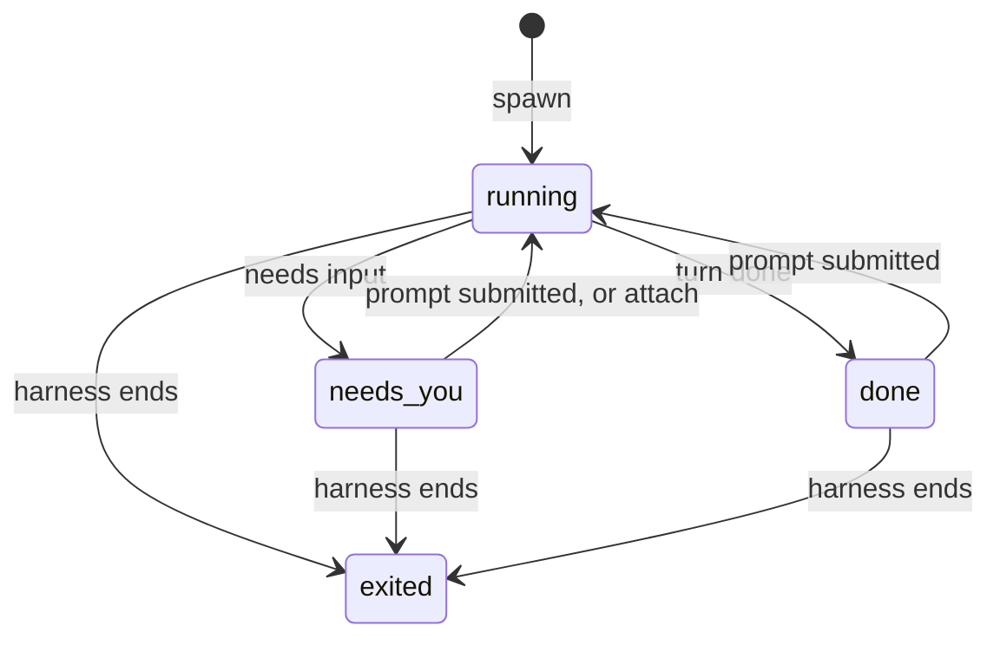

# Sessions

A session is one agent CLI the daemon hosts, under an atc session id that the daemon mints at spawn
and keeps for the session's whole life. The session core holds what every agent shares: the
attention state, the unread flag, the name, the parent link and the lifecycle. Everything that
differs between agents comes from the session's [adapter](../agents/adapters.md). A session's `kind`
is `pty`, a terminal, or `headless`, a structured Agent SDK run with no terminal.

[Fleet and restore](./fleet-and-restore.md) covers how a session survives a daemon restart, and
[terminals](./terminals.md) covers its screen and input.

## Attention

A session's attention comes from its agent's hook reports and from nothing else. The agent's hooks
report each turn's start, end and pending prompt on the reporter socket, the adapter maps each
report to one of a closed set of kinds, and the session core applies it:

A session lists as `exited` whenever its harness is not running, a harness suspended inside a
sleeping host included, and otherwise with the attention its hooks last reported. An end report from
a live terminal never marks the session exited, because resuming inside Claude Code ends one agent
session and starts another in the same process: only the pseudo-terminal closing does. Attaching to
a session that needs the owner moves it back to `running`, since the owner is now looking, and the
agent's next notification flags it again when the prompt still waits.

A needs-input or turn-done report marks the session unread, and attaching, an acknowledgement or a
submitted prompt clears it. The overlay sorts unread sessions that need the owner first, which is
the whole of atc's attention routing.

A needs-input report from Claude Code can say that a permission prompt is open. The session keeps
that mark until a later report shows the prompt closed, and while it holds, the daemon refuses to
type a line into the session, since the carriage return would approve the action
([terminals](./terminals.md#submitting-a-line)).

The daemon drops a hook report whose agent differs from the session's agent. A harness nested inside
a session inherits the session's environment, so without that check a nested agent would report as
the session it runs in.

## Names

The agent is the naming authority. A name the owner sets inside the agent, such as Claude Code's
`/rename`, beats a name typed at spawn, which beats the agent's own summary. The adapter reads the
name from the agent's own files after each report that can change it, so atc never invents a name of
its own.

## Lifecycle layers

Every session descriptor carries four lifecycle layers, each owned by one actor, and the listed
state derives from them and the attention:

| Layer        | Values                                         | Owned by                           |
| ------------ | ---------------------------------------------- | ---------------------------------- |
| `desired`    | `run`, `sleep`, `stop`                         | the owner's last request           |
| `vm`         | `none`, `awake`, `asleep`, `unknown`           | the last host state the daemon saw |
| `harness`    | `running`, `suspended`, `exited`               | the agent process                  |
| `attachment` | `local`, `attached`, `reattaching`, `detached` | the daemon's link to the output    |

A local session has `vm` `none` and `attachment` `local`. A `suspended` harness is a process kept
inside a sleeping host, which a revive brings back as it was. `reattaching` marks a remote harness
whose connection dropped while the daemon reconnects to it
([the imp provider](../execution/imp-provider.md#reconnecting)).

## Sub-sessions

A sub-session is a session spawned with a parent. `atc mcp` started inside a local session reads
that session's id from its environment and passes it as the parent, and a spawn can opt out to make
a top-level session instead. A session inside an imp reaches no daemon socket, so it cannot start
`atc mcp` against the daemon, and its sub-sessions come only from a client that names it as the
parent. The parent link holds a set of sessions together:

- A sub-session lists under its parent and sorts among its siblings alone, so its attention never
  moves the parent's row.
- It pins with its parent, and a kill of the parent ends its live sub-sessions.
- The set stays one level deep: a spawn whose parent is itself a sub-session lands beside it.
- The fleet stores the link by the parent's atc session id, so a restore brings the whole set back.

A sub-session runs on the default target unless its spawn sets one, and never inherits its parent's
target. On an imp target it shares its parent's host only when its target matches the parent's
binding ([the imp provider](../execution/imp-provider.md)).

## Ending a session

Ending a session is always an explicit request, never a side effect of a client disconnecting. What
a kill does depends on what the session's target can do with its host:

- **Kill of a live session.** It ends the harness and the harnesses of its live sub-sessions, and
  the session lists as exited. The daemon writes the fleet before it answers, so the stored fleet
  never lags a kill.
- **Kill of a session that owns a host that can sleep.** It puts the host to sleep instead of ending
  anything, so every harness on it stays suspended inside, and a revive wakes the host and finds the
  harness as it was. A host that another owner keeps awake refuses to sleep, and the daemon never
  forces it, so the kill fails and the session keeps running.
- **Second kill of a dead session.** It forgets the session: the daemon drops it and its dead
  sub-sessions from the list and the fleet.
- **Forget on a target that can destroy its host.** Destroying the host destroys everything on it,
  so a second kill refuses, and a forget takes two calls: the first returns a confirm token that
  belongs to one session, works once and expires quickly, and the second destroys the host with
  every session on it.

A forget can refuse a pinned session or a live one in the same step that forgets it, when the caller
asks, so a pin or a revive that lands first wins. A stop-only kill ends a live session and leaves an
exited one listed, for a caller that must never remove a session by mistake.

## Headless handoff

A Claude session can move between its terminal and a headless Agent SDK run. Ejecting kills the
terminal and keeps the session as a headless run that works unattended. Adopting resumes the same
agent session in a fresh terminal. The handoff works because the Agent SDK and the CLI share one
session store, and it is sequential, so the two never run the same agent session at once. Grok and
Codex have no headless runner, so the daemon refuses an eject of their sessions.

A headless run has no terminal hooks, so the daemon writes its turn events to the trail itself: a
prompt submitted when the run starts, then a turn done or a needs-input when it ends. Hook reports
that arrive for a headless session stay out of the trail, so a gateway agent's own hooks never
duplicate those events.
