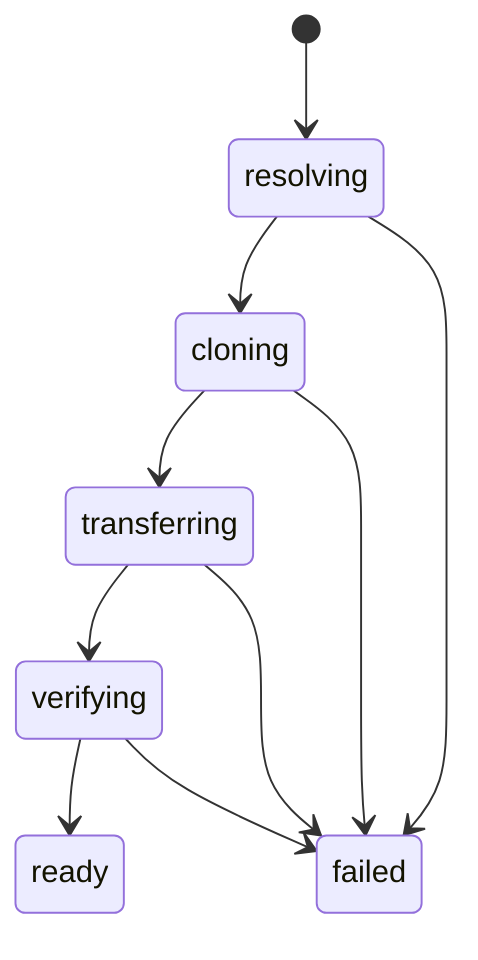

# Workspaces

A workspace is a clean checkout of a pushed commit that the daemon builds in a session's working
directory before the session starts. A spawn without one runs in its directory as it stands. A spawn
with one holds a source, a git checkout on the daemon's host or a repository URL, and the daemon
pins it to a commit, materializes that commit into a new directory on the session's target, verifies
it, and only then starts the session there. No client ever lists a session over a partial checkout,
and the checkout never holds a credential.

[Targets](./targets.md) covers where the workspace lands, and [sources](#sources) covers how the
spawn picker finds what to check out.

## Sources of a workspace

- **A path source** is a git checkout on the daemon's host. It resolves to its origin's URL,
  stripped of any credential, and to HEAD, which origin must already hold, so the session gets a
  commit anyone can fetch. Uncommitted and untracked changes stay behind: the daemon clones HEAD,
  leaves the checkout as it was, and warns with the count of paths it left. A spawn can refuse a
  dirty checkout instead. A dirty checkout whose HEAD origin lacks is refused, so the daemon never
  clones an older commit in its place.
- **A git source** is a repository URL with a branch or tag, a commit, or both. With both, the
  daemon checks out the commit, on the named branch when the upstream has it, and records the ref
  without checking that it still points at the commit. A source can name a daemon environment
  variable that holds a token. git receives the token through a private askpass helper for the ref
  lookup and the clone alone, and atc never writes, logs or stores it.

The daemon fetches only over the transports the config allows, https and ssh by default, and every
git command it runs carries the same list as git's own protocol allow-list, so an `insteadOf`
rewrite, an origin or a submodule cannot reach another transport either. The config refuses `ext::`
and `fd::` outright, since they run commands.

## Materializing

The working directory must be absolute, and must not exist on the target: the daemon creates it, so
it never fills or removes a directory someone else made. It works on the physical path the directory
resolves to, with every symlink resolved, and never removes anything through the path as written.

The daemon records each phase in the store before the phase starts:

1. **Resolving** pins the source to a URL and a commit, readies the host, and creates the directory.
2. **Cloning** makes the clone and sanitizes it before it leaves its host: it strips everything that
   could authenticate as that host or run code for it, such as credential settings, hooks and the
   reflogs that record the clone URL, then checks that the history still reads. A commit with
   submodules or Git LFS paths is refused, because neither comes across clean.
3. **Transferring** unpacks the clone into the directory, for a clone built on the daemon's host.
4. **Verifying** checks on the target that HEAD is the pinned commit and every tracked file matches
   it.
5. **Ready** starts the session in the directory.

An imp clones a git source over its own network, so no repository bytes cross the daemon's link. It
makes a blobless clone of the pinned commit, ignoring the imp's own git config, and impd's broker
adds a GitHub credential to the clone's requests when the session's grants hold one. The daemon
builds the clone on its own host and uploads it instead for a path source, for a target other than
an imp, for a source with a token variable, whose token stays on the daemon's host, and once more
after a clone inside the imp fails. The image holds no git identity, so the daemon writes the daemon
host's git name and email into the checkout.

A git command whose output stays open after git exits, because a helper it started still holds it,
fails its step with `git_output_open` after a bounded wait. Each git command leads its own process
group, so the kill reaches those helpers.

The session's fleet row holds the URL without its credential, the commit and the ref, and the names
of the variables the session withholds: the token variable and the askpass context. The harness
starts without them on every provider, and so does each revive and headless run of the session.

## Claims and rollback

On a shared host, a workspace spawn claims its directory against every session listed there and
every other workspace spawn in flight there, in the same step that checks it, so two concurrent
spawns never both take nested directories. Once the host is ready, the daemon checks the claim again
with each directory as the host resolves it, symlinks included. A directory the daemon picked is
claimed only at that second check, once per attempt, so two concurrent spawns of one repository
never refuse each other a directory that neither holds yet, and one of them takes it. A refused
spawn's `workspace_overlap` holds the session or spawn it overlaps. Plain spawns, those without a
workspace, share directories freely with each other and with listed sessions, but no plain spawn may
start inside a directory that a failed workspace spawn is removing.

A failure takes back what the spawn made. It destroys a host the session owned, and on a host that
stays, the parent's or the daemon's own machine, it removes only the directory its materialization
created. The removal enters the directory, checks where it landed, and removes the contents from
inside, and it runs only while no other session's or claim's directory lies inside. Otherwise the
directory stays, the daemon logs it, and the refusal holds it, so a retry into the same directory
fails as `workspace_exists` rather than writing over it. A failure whose outcome the daemon cannot
confirm keeps its claim until a daemon restart, since its directory may still hold what it left.

On a shared host, the daemon checks each listed session's directory as the host resolves it, and a
directory the host cannot resolve keeps the rollback's directory, since it may lie inside through a
symlink. One exception covers a relative directory that the host can no longer enter, such as one
removed inside the guest. The daemon joins it to the host's home and resolves that path through its
nearest existing directory, and every missing part of it lies beneath that directory, so the entry
keeps the rollback's directory only when the result lies inside. A relative directory stays
unresolved in two cases:

- It has a parent step, which the host follows through symlinks rather than lexically.
- A missing part of it is a symlink, such as one whose target was removed, which could lead
  anywhere.

An absolute directory the host cannot resolve stays unresolved, and so does every relative one when
the host cannot resolve its home.

A daemon that stops partway leaves a row short of ready. The next daemon fails every such row as
`workspace_interrupted` before it serves a request, and the directory stays on the target.

## Cleanup on forget

A forget removes the workspace atc built for the session, and so does a kill of a session that has
already exited, which forgets it. atc removes only the directory that the session's ready
materialization row names on the session's own target, so a session in a directory atc did not build
never loses it. The forget answers with `workspace`: `removed` with the path and what the checks
found, `kept` with the path and one reason per check that failed, or `none`. The daemon logs every
`removed` and `kept`. The same step runs for each sub-session that the forget takes off the list,
and only the daemon log carries those outcomes.

The step runs inside the forget, once the session is off the list, on the session's host through the
provider's `runCommand`, so a sub-session in its parent's imp is checked and removed inside the imp.
It starts only once atc has seen the session's process exit. The killer keeps the handle of each
harness that a kill or forget ends, and the step waits for its exit, then ends it with a forced kill
and waits once more. A harness that still shows no exit, or a headless turn that ran when the forget
began, keeps both folders as unchecked, since the turn's runner reports no exit to wait on.

One script answers seven checks. It refuses the directory when the row's path is now a symlink,
since atc never builds a workspace as one, and enters it through any symlink in a parent:

1. `git status --porcelain --untracked-files=all --ignore-submodules=none` prints nothing. An
   ignored file never counts.
2. `git ls-files -v` marks no path assume-unchanged or skip-worktree, since `git status` skips the
   edits to such a path.
3. `git stash list` prints nothing.
4. Every commit reachable from HEAD or from a local branch is on a remote-tracking ref, so a commit
   made on a detached HEAD counts as unpushed.
5. `git worktree list` names no linked worktree whose folder still exists. A linked worktree keeps
   its git data inside the workspace, and the other checks never look inside it.
6. The index holds no submodule, since the other checks never look inside one either.
7. The host answers. A host that fails the command keeps the directory as unchecked.

The script reads no system or global git config and turns off an fsmonitor that the repository's own
config names, since `git status` would start it. It refuses a directory that is not the top of a git
checkout holding the row's commit, and the forget then keeps it. A directory already gone gives
`none`. One table of fields in `run-workspace-check.ts`, the per-branch and detached-HEAD counts
included, writes every line the script prints and the schema that reads them, so an answer that
lacks a line, adds one, or labels one differently keeps the directory as unchecked.

| Case                                                    | Workspace                        |
| ------------------------------------------------------- | -------------------------------- |
| `workspaces.cleanup.enabled` is `false`                 | `none`, and nothing is removed   |
| The forget destroyed the session's host                 | `none`, and no check runs        |
| No ready materialization row for the session            | `none`                           |
| atc saw no exit of the session's process                | `kept`, and both folders stay    |
| Another listed session's directory lies inside it       | `kept`, `in use by session <id>` |
| A check fails, under `check: "unpushed"`                | `kept`, one reason per check     |
| A check fails, under `check: "none"`                    | `removed`, with `found`          |
| The host does not answer, or the directory is not atc's | `kept`, under either check       |
| Every check passes                                      | `removed`                        |

The removal is the rollback's: it removes the contents from inside the directory while the directory
still resolves to itself, and it refuses while a listed session's or a claim's directory lies
inside, as the host resolves each one. A refused or failed removal keeps the directory with its
reason. Every spawn that builds a workspace claims its directory before the clone creates it: on a
shared host as before, and on the daemon's own machine from its landing. While a removal runs, a
claim on that shared host, or one on the daemon's machine that overlaps the directory, is refused as
`workspace_overlap`, so no spawn builds inside a directory that a removal is emptying. The session's
state folder on the daemon's host goes after the workspace step, whatever that step decided, unless
cleanup is off or atc saw no exit of the session's process.

## Sources

A source is where the spawn picker finds what a session runs in: directories on the daemon's host, a
GitHub account's repositories, or a typed git URL. The daemon lists the sources it can offer in the
config's order and leaves out one its host cannot run, such as GitHub without the `gh` CLI. Every
source request runs on the daemon's host and checks the target the spawn will use, as a spawn does.
The picker needs a source to list anything, so a daemon that offers none gets a refusal in place of
a list.

- **Directories** list the spawn history on the targets the caller may use, then the directories
  under the configured roots, then zoxide's list, and drop any that no longer exist. They complete a
  typed path on the daemon's host and resolve it the same way: `~` reads as the home of the user the
  daemon runs as, and a relative path reads from the directory the TUI runs in when the daemon runs
  on the TUI's machine, else from that home. The TUI reads every path through them, so it reads no
  path on its own host, and it asks for a completion only once typing pauses. An adopt opens only on
  them.
- **GitHub** lists one owner's repositories through `gh`, as the account `gh` is signed in to sees
  them, at the clone URL form `gh` prefers.
- **A git URL** lists nothing and reads what the owner types.

Every source reaches a repository with the daemon host's own git authentication, so every repository
a picker offers is read with the same credentials. Before a spawn, the picker probes a git source:
one ref listing that authenticates as the clone would, resolving the ref the way a spawn does. A
caller that spawns with both the resolved commit and its ref gets the commit it showed, whatever
lands on the branch in between. A refused probe holds the repository's other URL forms that a source
knows, such as the ssh form of an https URL.
