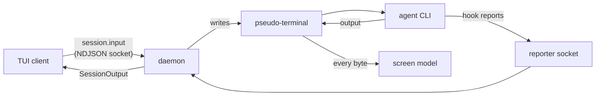
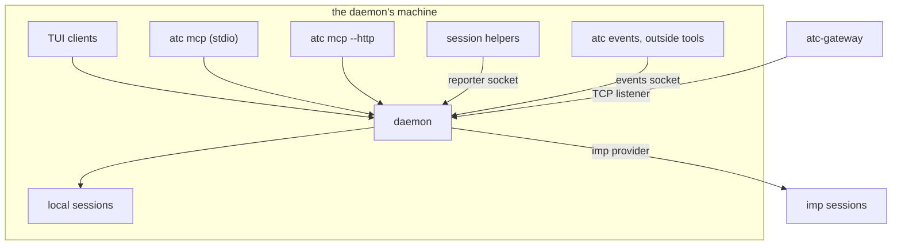

# Architecture overview

atc runs many coding-agent sessions behind one terminal. Each session is a stock agent CLI, such as
Claude Code, Grok Build or Codex CLI, running in a pseudo-terminal that a per-user daemon hosts. A
thin TUI client shows one session at a time on the whole terminal, and a keyboard overlay lists the
rest, sorted by which one needs the owner. The bet is that the hard part of running many agents is
knowing which one is waiting, not arranging windows, so atc has no panes and no layout engine.

The daemon owns everything that must outlive a client: the sessions, their screens, the fleet it
restores after a restart, and every message and event. Clients are disposable. Everything specific
to one agent CLI sits in that agent's adapter, so the daemon's session core works the same for every
agent.

## The path of a keystroke

A key the owner presses travels from the TUI to the session's pseudo-terminal, and the agent's
output travels back the same way.

1. The TUI sends each key event or paste as one request on the
   [client protocol](./protocol/protocol.md), a newline-delimited JSON dialect over a unix socket.
2. The daemon writes the input to the session's pseudo-terminal whole, so input from two clients
   never interleaves inside one payload.
3. The daemon reads every byte the agent prints, attached or not, and feeds it to the session's
   screen model, a headless terminal emulator. It forwards the output only to the clients attached
   to that session ([terminals](./daemon/terminals.md)).
4. The agent's hooks report each turn's start, end and pending prompt on a separate reporter socket.
   The daemon turns those reports into the session's attention state, which every client sees
   ([sessions](./daemon/sessions.md)).

## Topology

One daemon runs per state directory, and a kernel lock enforces it
([the daemon](./daemon/daemon.md)). Every other atc process is a client of that daemon or a helper
that runs inside a session.

- **The daemon** hosts every session. A local session runs as a child process of the daemon. A
  session on an [execution target](./execution/targets.md) such as an imp runs on a remote host that
  the daemon reaches through that target's provider.
- **Clients** speak the client protocol over the daemon's socket: the TUI, the stdio MCP server, the
  HTTP MCP server and `atc tap`. Any of them boots the daemon when none answers, unless a service
  manager owns the daemon.
- **Session helpers** run inside a session on every hook event, statusline render, note and answer.
  They speak a one-line dialect on the reporter socket, so a helper needs no handshake.
- **atc-gateway** is a separate binary that serves the MCP tools for several daemons over HTTP and
  routes each call to one daemon over that daemon's TCP listener
  ([the gateway](./remote/gateway.md)).

"Gateway" names two things in atc. A **gateway agent** is a Claude Code entry pointed at a
Claude-compatible backend, which [adapters](./agents/adapters.md) covers. **atc-gateway** is the
federation binary. The docs always say which one.

## Data

The daemon keeps its state in one SQLite file, `atc.db`, in the state directory, behind one
connection that orders every query ([fleet and restore](./daemon/fleet-and-restore.md)).

- **The fleet** holds one row per session the daemon can restore: its ids, agent, target, directory,
  spawn prompt, model and latest result.
- **The event trail** holds the recent hook events, message status changes and notes, in order, for
  cursor reads ([events](./protocol/events.md)).
- **The inbox** holds each message sent to a session and its status
  ([messages](./protocol/messages.md)).
- **Idempotency keys** hold what each keyed spawn or message did
  ([idempotency](./protocol/idempotency.md)).
- **Workspace rows** and **runtime auth bindings** hold the progress of each
  [workspace](./execution/workspaces.md) and the broker grants of each imp
  ([runtime auth](./execution/runtime-auth.md)).
- **Session records** hold what atc vouches for about each session
  ([session record](./execution/session-record.md)).

The state directory holds these entries beside `atc.db` and its SQLite WAL files:

- `status.json` holds the fleet's counts for the statusline, and stays a plain file because a
  statusline helper reads it without speaking the protocol.
- `mcp-auth.db` holds the OAuth state of `atc mcp --http`, which the daemon never opens
  ([OAuth](./remote/oauth.md)).
- `daemon.lock` is the lock file that admits one daemon per state directory, and `daemon.json` holds
  the running daemon's pid and the socket paths it listens on ([the daemon](./daemon/daemon.md)).
- The `restarts/` folder holds the run logs of `atc daemon restart` and the record of the last
  finished restart. `daemon-restart.lock` admits one restart at a time.
- The `records/` folder holds a read-only copy of each local session's record.
- The `sessions/` folder holds one folder per session, with its scratch folder and, for a Codex
  session, the folder of its message bridge.
- Each `hook-settings-<agent_id>.json` is the generated Claude `--settings` file of one agent entry,
  and the `atc-bridge/` folder holds the copy of the mod that Claude sessions load
  ([agent integration](./agents/agent-integration.md)).
- `listing-cache.json` belongs to the TUI clients, not the daemon: it holds the repository lists the
  spawn picker showed, so the next open shows one at once while the client lists again. A client of
  a remote daemon keeps its lists in `listing-cache-<daemon_name>.json`.
- `fleet.json` exists only in a state directory older than `atc.db`, and the store seeds the fleet
  from it once.
- When `$XDG_RUNTIME_DIR` is unset, the sockets and the daemon's pid file sit here too.

Terminal output is never stored: each screen model lives in memory, and the agent's own transcript
on disk is the durable copy of a session.

## Cross-cutting rules

- **Sessions are data, not processes.** A daemon that stops takes its local sessions with it, and
  the next daemon resumes each one from the agent's transcript under the same atc session id
  ([fleet and restore](./daemon/fleet-and-restore.md)).
- **Additive evolution.** Client and daemon must speak the same protocol version. Within one
  version, the daemon lists the features it serves, so a client that outlives an upgrade asks only
  for what the running daemon honours ([protocol](./protocol/protocol.md#versions-and-features)).
- **Principals.** A request on the owner's unix socket acts as the owner. A request can act as a
  named principal, which narrows it to the targets that principal may use, and every request on the
  TCP listener must ([principals](./protocol/principals.md)).
- **Grant scopes.** Each MCP tool needs one of four grant scopes, and a remote MCP client calls only
  the tools its grant holds ([MCP](./remote/mcp.md)). A grant scope differs from a session record's
  scope, which lists the worktrees and branches a session may touch.
- **Execution checks.** Every request that starts work on a session asks one check whether the
  session's target can run it, so no path falls back to another machine
  ([targets](./execution/targets.md)).
- **Adapters own the agent.** The session core never sees past the adapter interface
  ([adapters](./agents/adapters.md)), and atc never writes into an agent's own config
  ([agent integration](./agents/agent-integration.md)).
