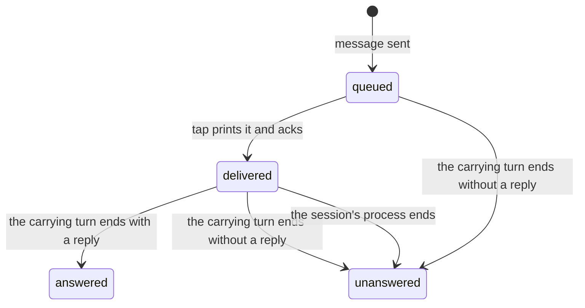

# Messages

A message is text one caller sends a session for its agent to act on, such as one agent handing
another a task. The daemon keeps each message in the session's inbox in `atc.db` until the session
takes it, so a message survives a daemon restart and a fleet restore. The daemon never types a
message into the session's terminal: a process inside the session takes it through a tap, and the
`atc-bridge` mod inside Claude Code hands it to the model. The answer to a message is the final
output of the turn that carried it, which the mod reports when the turn ends. A turn that ends
without a reply leaves the message unanswered.

[Agent integration](../agents/agent-integration.md#the-atc-bridge-mod) covers the mod, and
[events](./events.md) covers the trail that records each status change.

## Sending

A caller sends a message with a sender name and the text. The daemon refuses the message when the
session cannot take one:

- The session's agent has no tap, as Grok and Codex have none: `unsupported`.
- A Claude Code session started some time ago and no tap has attached since, so the mod is missing:
  `unsupported`.
- The session has no live process: `session_dead`.

Otherwise the message queues, while the session restores and while a dropped tap reconnects too. A
busy session is no refusal: the mod adds the message to the running turn. The daemon writes messages
one at a time, in the order they arrive, and checks the sender's reach in the same step that starts
the write, so a session cannot leave a principal's reach between the check and the write.

## The tap

A tap is a connection that asked for one session's inbox. The mod starts `atc tap` for its session,
and the tap prints each message as one JSON line on stdout. When a tap attaches, the daemon sends
every queued message in order, one at a time: it sends the next only after the tap acks the last,
which bounds what waits in the connection's queue. The tap prints a message, then acks it, and the
ack marks it delivered. A second tap for the same session replaces the first, which receives a
closing event and exits, so one session never has two consumers.

Delivered means the tap printed the message to the mod, not that the model saw it. The mod keeps the
messages it holds for the current turn in memory, so a Claude Code process that dies after the ack
makes no report. The daemon settles those messages itself, as
[the end of a process](#the-end-of-a-process) describes.

A message belongs to the session it was sent to, and follows the agent session when the session
resumes or clears it, so a resumed session keeps its queue.

## Answers

The mod wraps each message in an `<atc-message>` envelope that holds the sender and the message id.
When the session is idle, the mod submits the message as a new turn; when a turn is running, it adds
the message to that turn. One turn can therefore carry several messages, and each of them gets the
same answer: the turn's final reply. When the turn ends with a reply, the mod sends one answer that
holds every message the turn carried and the turn's id, and the daemon marks them all answered in
one statement, so a reader that finds one of them answered finds the whole group answered. A turn
that ends without a reply, because a person interrupted it, it failed, or the model refused, gets
one `unanswered` report instead, with the turn's id and a one-word reason: `interrupted`, `error` or
`refusal`. A message the mod submitted as a prompt that no turn ever carried, because a hook dropped
the prompt or a turn ended without a reply before it started one, is reported `unanswered` with the
reason `not_started`. A message the model never saw, one added to a running turn that ended before
its next step, is delivered again instead.

Unanswered is final. A later answer for that message changes nothing, and atc never delivers the
message again, because redelivering after an interrupt would restart work a person stopped, and
redelivering after an error would repeat the failure. A caller that wants the work done sends the
message again. A read of an unanswered message returns `unansweredAt` and `unansweredReason`, and a
read that waits returns as soon as the status becomes answered or unanswered.

A caller reads a message's status, answer and turn by its id, and can hold the read open until the
status moves. Message ids and statuses live in `atc.db`, so a caller whose wait ended, or whose
connection dropped, reads again with the same id.

### The end of a process

When a session's process exits, or a person kills or removes the session, the daemon marks each
message the session holds delivered `unanswered` with the reason `session_ended`. The mod's state
died with the process, so no report about those messages can arrive. The daemon marks them rather
than delivering them again when the session revives, because nothing promises a revive, and the
ended turn may have done part of the work that a second delivery would repeat. A message still
queued stays queued for the session's next process.

Every local process ends with the daemon that started it, so a daemon that starts marks the
delivered messages of every fleet session on its own machine the same way. Three ends mark nothing,
because the process may still run:

- A host that goes to sleep with the process inside, which a wake resumes.
- A connection to a remote host that is lost for good, since a revive can attach to the same
  process.
- The end of a session while another live session resumes the same agent session, since the daemon
  cannot tell which of the two processes holds a message.

## Progress notes

A note is progress a session sends with no message attached, through the mod's `note` tool, labelled
`progress`, `blocked` or `decision`. The daemon records each note in the event trail and broadcasts
it. A note never answers a message, so a model that sends a note mid-turn still answers its messages
with the turn's final reply.

## Remote sessions

A session on an imp has no reporter socket and no client socket, so its tap, notes and answers
travel over its [session bridge](../execution/imp-provider.md#the-session-bridge). There the tap
reconnects after every dropped connection, with no end, since a sleep or a daemon restart drops it.
Each new connection replays the messages not yet acked, and the tap prints each message once and
acks a repeat again. A note or an answer waits in an outbox file beside the bridge socket until the
bridge takes it, and the tap sends the outbox again on every connection, so a note survives a
dropped connection and lands once.

A local session has no outbox. Its notes and answers go to the reporter socket once, and a daemon
that is down at that moment loses them. Its tap exits when the daemon goes away, which ends the
local session too, and the restored session starts a tap of its own.
