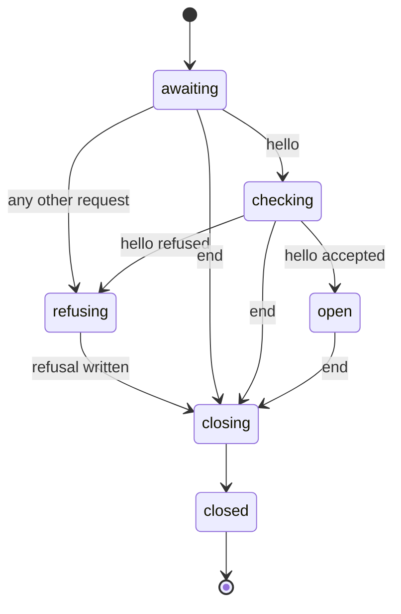

# The client protocol

Every atc client talks to the daemon in one dialect: oRPC peer messages, one JSON message per line,
in UTF-8, over the daemon's unix socket or its TCP listener. A connection opens with a handshake,
then carries requests, one response per request, and the event stream the client subscribes to.
Client and daemon ship from one repo and must speak the same protocol version, and a peer never
breaks on a field it does not know.

[Principals](./principals.md) covers who a request acts as, [idempotency](./idempotency.md) covers
retrying a spawn or a message, [messages](./messages.md) covers the inbox, and [events](./events.md)
covers the event trail and the events socket.

## Why JSON lines

The protocol has no binary frame. The pseudo-terminal library delivers output as decoded strings, so
byte-level transparency is gone before the protocol sees the data, and binary framing would buy size
but no fidelity. One dialect also serves every peer: the session helpers, the MCP tools and the
Agent SDK all speak JSON already.

## Messages

The daemon's procedures and their schemas come from one oRPC contract in the protocol module, and
the client and the daemon both build on it. A procedure is named `noun.verb`, and a request names it
as a path, so `session.spawn` travels as `/session/spawn`:

```jsonc
// request (client to daemon): the client picks a message id
{ "i": "7", "p": { "u": "/session/spawn", "b": { "json": { "cwd": "/x", "name": "auth-bug" } } } }

// response (daemon to client): exactly one per request, under the request's id
{ "i": "7", "p": { "b": { "json": { "session": { "id": "s7-m4x2p" } } } } }
{ "i": "7", "p": { "s": 500, "b": { "json": { "code": "no_such_session", "message": "…" } } } }
```

Events are `PascalCase`, and the MCP tools map procedure and event names onto their own
mechanically. The protocol module's error list defines every code.

The daemon runs each request on its own, so responses can arrive in another order than their
requests, and a client matches each response to its request by message id. A state-changing request
always gets a response, but a client need not wait for one, as the TUI does not for keystrokes: one
socket carries one ordered stream, so input, resize and output stay in order by construction.

## Errors

An error holds a code from a closed list that grows by addition, a human message, and optional
`data` whose fields the code defines. The rules exist so additive evolution never breaks a peer:

- An unknown procedure is an `unknown_method` error, never a disconnect.
- A request whose input fails its procedure's schema is a `bad_args` error with the first issue's
  message.
- An answer that fails its procedure's schema is an `internal` error, so a client never reads an
  answer outside the contract.
- Every field a peer does not know is ignored, in any message.
- A peer decodes an error code it does not know as `internal` and keeps the message.

A line that is no peer message, or one longer than the line cap, means a buggy or hostile peer,
since the transport guarantees byte integrity. The daemon closes the connection without an answer
rather than scan for the next good line, and it enforces the cap before it buffers a line. A client
built for an older daemon writes such a line first, so it meets a closed connection.

## The handshake

The first request on a connection must be `daemon.hello`. The hello carries the client's build, its
protocol version and its credential, which is `none` on the unix socket and a bearer token on the
TCP listener ([principals](./principals.md#the-tcp-listener)). A client started inside a session
also sends that session's id, which the daemon uses to stop a session from widening its own record.
On the unix socket the daemon reads the caller's session from the kernel instead, where the platform
allows it, and refuses a hello whose session differs
([session record](../execution/session-record.md#who-may-change-the-record)).

The answer holds the daemon's build, its line limits, how long it keeps a completed idempotency key,
the last agent the owner spawned, and the daemon id. The daemon mints that id into its store the
first time it opens it, so the id stays the same across restarts, and every session descriptor holds
a locator of the daemon id and the session's target, which tells a client routing across several
daemons where a session lives.

A connection takes one handshake, because a second could change the principal under the connection's
attachments. A second hello gets `unauthorized`, and the connection stays open with the identity the
first one gave.

## Connection lifecycle

A connection moves through six states, and only an open connection runs requests and receives
events:



- **Awaiting the handshake.** A request other than the hello gets `unauthorized` and refuses the
  connection.
- **Checking.** The daemon checks the hello's token on the TCP listener first, then its principal,
  its session and its protocol version. A request that arrives meanwhile waits and runs once the
  hello passes. One exception: on the TCP listener, a line that arrives while the daemon checks the
  token records `unexpected_line` and ends the connection with no answer.
- **Open.** Requests run, and the event subscription delivers.
- **Refusing.** The daemon writes the refusal whole before it ends the socket, so the client reads
  why it was refused. A request queued behind the refused hello gets `unauthorized`.
- **Closing and closed.** The socket ends, and the daemon answers nothing more.

Every change to the fleet is an explicit request: detach, kill, quit. The daemon never infers one
from a connection closing, and a dropped connection means only that the daemon detaches that
connection's attachments and its message tap. A client whose connection drops rejects every request
still waiting for a response, and decides for itself whether to resend it.

## Versions

The protocol version is one integer compared for equality, and the current version is 10. The daemon
records it in `daemon.json` beside its socket paths, and a client sends its own in the hello. A
daemon on another version refuses the handshake with `protocol_mismatch`, so a client and a daemon
on different versions never talk, and the two install together. The error holds both versions and
both builds, so the failure says what to do. Its data holds the daemon's version as
`daemonProtocol`, and that field keeps its shape across versions, because a client on any version
reads it. [The daemon](../daemon/daemon.md#builds-and-protocol-versions) covers how each client
handles it.

Any change to a procedure, an input field, or an answer field raises the version. A client and a
daemon that pass the handshake therefore serve the same procedures and fields, so a client offers
every tool and input without asking the daemon what it serves. A peer ignores a field it does not
know, in a request or in an answer.

Version 10 differs from version 9 in one answer field. An `events.read` event of the
`daemon-restarted` kind holds the restart's whole result record in `result`
([Events](./events.md#the-event-trail)).

## Events

A client receives events through one `events.subscribe` request, which the daemon answers with a
stream that lasts as long as the connection. The daemon collects a connection's events from its
handshake on into a bounded backlog, so a subscription sent right after the hello misses none while
the backlog holds them. A backlog that fills before the subscription comes is dropped, and the
connection then receives only the events after its subscription. A connection takes one subscription
at a time.

The daemon broadcasts lifecycle and state events to every connection: sessions added, removed,
renamed and resized, state changes, attaches and detaches, notes, message status changes, and
permission prompts. Each event that concerns a session carries the full session descriptor, the same
shape a session listing returns, so a client decodes every event through one path. Two kinds of
event go to one connection alone: a session's output goes only to the clients attached to it, and
inbox events go only to the session's message tap ([messages](./messages.md#the-tap)). A connection
that acts as a principal receives only the events of sessions within its reach.

A permission prompt broadcasts with a flag that says whether a client can answer it through the
protocol. Every prompt from a terminal session carries false, because the agent takes its answer as
keys in its terminal. A session that takes a structured answer raises the same event with the flag
set, and the first answer wins: it broadcasts the resolution, so every client dismisses its prompt,
and later answers get `already_answered`.
