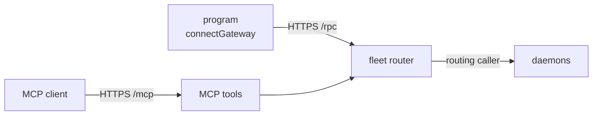

# The typed fleet API

A program that drives a fleet, such as a coding adapter or a dashboard, reaches atc-gateway through
a typed oRPC API at `/rpc`, beside the MCP tools at `/mcp`. Both front doors call one fleet router
in the same process, so an operation has one implementation, one set of scope checks and one set of
tests, whichever door a caller uses. The MCP tools shape the router's answers for a model. A program
gets the answers as typed values, holds an event stream open in place of polling a cursor, and
builds against the contract's types, so a renamed procedure or field fails its type check, and a
gateway on another major version refuses its first call.

Read this before you change the fleet router, a fleet contract, the `/rpc` route or the event
stream. [The gateway](./gateway.md) covers routing and ids, [the MCP servers](./mcp.md) covers the
tools and their scopes, and [the published client](../protocol/client.md) covers the package a
program imports.

## The router and its two contracts

The router runs the rules every front door shares, and reaches daemons only through the caller it is
given. It never opens a daemon connection. The gateway gives it the routing caller and
`FLEET_CONTRACT`, and `atc mcp` gives it its channel to one daemon and `LOCAL_FLEET_CONTRACT`. One
builder in `@atcx/contract` makes both contracts from the same procedures, so the router runs the
same handlers over the gateway and over one daemon, and each caller's answers pass its own output
check.

The fleet procedures keep the daemon's method names, so the gateway's id rules and the compat check
keep working by name. Each input is an allowlist of the fields the MCP tools send, picked from the
daemon procedure's input, so a field that a later daemon adds never reaches a front door, and a
`/rpc` caller can change nothing and reach no session that the same token cannot through `/mcp`.
`FLEET_CONTRACT` adds `daemon` to each procedure that runs on one daemon, and adds `daemons.list`.
`idempotencyKey` is required on `session.spawn` and `session.message`, so a program can always
resend either one; the MCP tools mint a key for a call that holds none. Quit, backup, restore,
prune, attach, raw input and resize are on neither contract.

Before the router calls a daemon, it refuses:

- a caller whose scopes lack the procedure's scope, with `insufficient_scope` and the scope in
  `data.required`;
- a procedure only the daemon's owner may call, for a caller with a principal, with `unauthorized`;
- a spawn whose `atcAccess` grants a scope the caller lacks, with `insufficient_scope` and the
  missing scopes in `data.required`.

The router then sends the params its input schema parsed, with the schema's defaults, plus the
params each procedure always sends: `stopOnly` on a kill, `refusePinned` and `refuseLive` on a
forget, and the terminal size on a spawn and an adopt. It checks each answer against its contract's
output schema, and an answer that fails is `internal`. The check lets through what a daemon on
another minor version can send, an undeclared field, an enum value it does not list, or a missing
optional field, because the gateway serves daemons on several minor versions. The published types
stay exact. An error from the caller keeps its `code`, message and `data`, matched by `code` and
never by class, because the gateway's own errors and the client's errors are not `AtcError`s.

## Scopes

Each procedure takes the scope of the MCP tool that calls it, and a test ties each tool's scope to
the scopes of the procedures it calls. The MCP SDK still checks each tool's scope before the router
does, because only it sends the HTTP 403 challenge that an MCP client needs to ask for the scope.

| Scope     | Procedures                                                                                                                                                                           |
| --------- | ------------------------------------------------------------------------------------------------------------------------------------------------------------------------------------ |
| `read`    | `daemons.list`, `agents.list`, `dirs.list`, `session.list`, `session.get`, `session.read`, `session.screen`, `message.get`, `note.get`, `answer.get`, `events.read`, `events.stream` |
| `message` | `session.message`, `session.update`, `session.ack`                                                                                                                                   |
| `spawn`   | `session.spawn`, `session.submit`, `session.menu`, `session.choose`, `session.adopt`, `session.scope.add`, `session.auth.rebind`                                                     |
| `kill`    | `session.kill`, `session.forget`                                                                                                                                                     |

`session.menu` takes `spawn`, because only the tool that chooses a menu option reads a menu.
`note.get` and `answer.get` take `read`, because each returns the text that an event read inlines
for the same event.

## The /rpc route

Only atc-gateway serves `/rpc`; `atc mcp --http` serves MCP alone. The route applies the Host and
Origin checks of `/mcp` before it reads the bearer, and verifies the bearer from the `Authorization`
header with the verifier `/mcp` uses, so a static service token, a `client_credentials` token and an
OAuth access token all pass and each acts as its client's principal. A service client's scopes come
from the service-token file and its targets from each daemon's `principals` entry
([principals](../protocol/principals.md)); `/rpc` adds to neither. A missing or refused bearer gets
HTTP 401 with the challenge `/mcp` sends, and the same security event.

HTTP has no handshake, so each call carries the major version of the contract its program was built
against in the `x-atc-major` header. The gateway carries the contract version of the atc commit it
was built from, and a call whose header is missing or names another major gets `protocol_mismatch`
with `data.gatewayMajor`, before the router runs. A daemon on an older minor version is the
gateway's concern: a call that needs a feature the daemon lacks fails with `feature_missing`.
`daemons.list` gives the gateway's build and contract version, and each daemon's build and features,
to a program that needs them; the MCP tool for it leaves those fields out.

An error over `/rpc` keeps its `code` and message, and from `data` only `problem`, `effectRef` and
`required`, plus `gatewayMajor` on `protocol_mismatch`. `effectRef` names the effect an
`outcome_unknown` left, which a program checks before it retries under a new key. The route passes
it only when the daemon's own error holds it. When the gateway's key binding restores one from its
cache, it marks the error, and the route drops that ref, because the daemon checked the effect's
reach only when it first answered.

The route never reads a token from a URL or a query string, and a request line or a security event
records `/rpc` and the procedure's path only.

## The event stream

`events.stream` reads the same merged trail as `events.read`, and holds open until the caller ends
it or the gateway ends it for one of the reasons below. It reads the trail alone, and not the
daemon's live `events.subscribe`, because the trail resumes from a cursor after a dropped connection
and the live stream drops its backlog. A program reads current state with `session.list`.

- Each `event` item carries the event's merged cursor as its oRPC event id, and each `daemons` item,
  which lists the daemons that are unavailable, started or truncated, carries its page's cursor. A
  `daemons` item comes only when its lists change.
- On reconnect the stream starts after the client's last event id; with none, after the input
  `cursor`; with neither, after the newest event of each daemon.
- When the trail refuses a cursor, as after a daemon's new incarnation, the stream ends with
  `bad_args`. The program has a gap then: it reads `session.list` and opens a new stream without a
  cursor.
- The stream reads its next page only after the client takes the last one, so it holds at most one
  page. Each read is a new daemon request as the stream's principal, so a session that leaves the
  principal's reach drops out of the next page; an event already in the held page can still reach
  the client.
- The route sends keep-alive comments more often than the HTTP server's idle timeout, so a quiet
  stream stays open.
- The route verifies the stream's bearer again on a fixed interval. The stream ends when the bearer
  no longer verifies with `read`, verifies as another principal, or the check runs past its
  deadline, and it sends nothing between a failed check and its end. A static service token's stream
  therefore ends within one interval and one deadline of a reload that drops the token.
- A gateway process holds at most 8 open streams per principal and refuses the ninth with
  `too_many_streams`. A stream frees its place however it ends, a client's disconnect included. The
  gateway keeps its grants and key bindings in SQLite on one volume, so one process serves it, and
  the limit counts that one process.

## Versions

Each fleet contract follows the daemon contract's rule: every change within a major version is
additive. `bun run check:contract-compat` records `FLEET_CONTRACT` under a `fleet:` prefix and
`LOCAL_FLEET_CONTRACT` under `fleet-local:`, and compares each only with its own earlier release; a
release tag with no fleet contract leaves nothing to compare. A new fleet input field takes a
`FEATURE_INPUT_FIELDS` entry or a harmless-field entry, as a daemon input field does
([the published contract](../protocol/contract.md#versions)).
