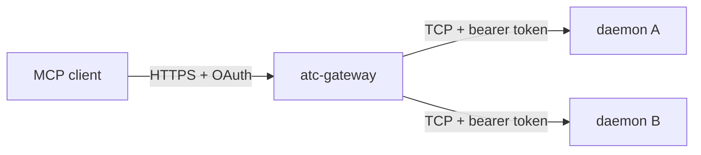

# The gateway

atc-gateway serves the MCP tools and the OAuth server for several daemons at once, so one hosted
assistant can reach fleets on several machines through one connector. It is a hub with spokes: the
gateway holds one connection to each daemon in its registry, over that daemon's TCP listener, and
routes every tool call to exactly one daemon. Daemons never talk to each other. The gateway never
starts a daemon or a session on its own machine, so a call to a daemon that does not answer fails.

[The MCP servers](./mcp.md) covers the tools, [OAuth](./oauth.md) covers the authorization server
the gateway runs, and the [gateway guide](../../guides/gateway.md) covers running it.

## The binary

The gateway ships as its own release binary, compiled from its own entry point. That binary holds no
daemon, pseudo-terminal or agent code, and the import check fails when the entry reaches any, so the
gateway's host needs no agent CLI and can never run a session by accident.

The registry file lists each daemon by name with its TCP address and its daemon id, plus the daemon
a spawn without one goes to. The bearer token for each daemon comes from the gateway's environment,
one variable per daemon name. Each connection pins the daemon's identity: a daemon whose handshake
gives another daemon id is refused before the gateway sends it anything, so a reused address never
routes calls to the wrong fleet. The gateway acts as the OAuth client that made each call, so every
daemon limits that client to the targets its own `principals` key grants
([principals](../protocol/principals.md)).

The gateway writes only in its state directory, which it requires, so one volume holds all its
state: the authorization server's database and a database of idempotency key bindings.

## Ids and routing

The gateway rewrites every session id it returns as `<daemon name>.<incarnation>.<id>`, where the
incarnation comes from the pinned daemon id, and rewrites it back on the way in. An id with an
unknown daemon or an old incarnation reads as an id the gateway never returned, so a session from a
replaced daemon answers as unknown rather than reaching a new daemon under the same name. For each
method, a rule says which fields of the request and the answer hold ids, and the gateway refuses a
method that has no rule, so a new daemon method never passes through with its ids unrewritten.

A call goes to the daemon its ids name, then to the daemon its params name, then to the default
daemon. A call whose ids and params name two different daemons is refused with `bad_args`. A call
never fails over to another daemon. Listings of sessions and agents fan out to every daemon and
report each daemon's state beside the merged answer: up, down, unauthorized, refused, or changed
when its identity no longer matches the registry.

An event read merges every daemon's trail under one gateway cursor that keeps each daemon's place,
so a daemon that did not answer resumes from where it stopped on the next call. Each merged event
holds an `origin`: its daemon's name and incarnation and the daemon's own cursor of the event, which
stays the same when another daemon's place changes the merged cursor. The page lists a daemon that
did not answer under `unavailable`, one the read started at its newest or latest events under
`started`, and one whose older events went unread under `truncated`. A read that waits first reads
every daemon without waiting, and only when none has an event does each wait, returning as soon as
one has.

Every other call passes through the gateway's routing steps in a fixed order. The id rules rewrite
its ids, the daemon pick chooses its daemon, the key binding binds its idempotency key, and the
pass-through sends it to that daemon. Each step wraps the steps after it, so a daemon's answer or
refusal comes back out through the key binding, which records it, and then through the id rules,
which rewrite the daemon's ids before the client sees them.

The gateway carries no terminal stream. It serves a screen read, a transcript read and a submitted
line, and no attach or raw input, because an MCP tool call has nowhere to put a live stream.

## Lost answers

The gateway dials a daemon when a call first needs it, and again after a connection drops, with no
background reconnect. A failure before a request leaves is `daemon_unavailable`. A request whose
answer is lost, because the connection closed or timed out, ends that connection, and only a request
that cannot double its effect is retried once on a fresh one:

- A read-only request is retried.
- A keyed spawn or message is resent as replay-only
  ([idempotency](../protocol/idempotency.md#replay-only-resends)).

Anything else ends as `outcome_unknown`.

The gateway binds each keyed request to its daemon in its own database before it sends it, and marks
the binding sent just before each write. A retry after a gateway restart of a request marked sent
therefore replays on the same daemon instead of running again, while one the gateway never sent goes
out as a first send, and a key whose daemon's identity changed fails with `daemon_unavailable` and
the reason `daemon_changed`, rather than moving to another daemon.
