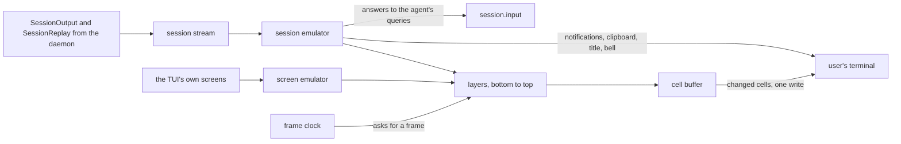

# The compositor

The TUI draws every screen into one grid of cells, the cell buffer, and writes to the user's
terminal only the cells that changed since the last frame. The bottom layer is the session the user
is attached to. The TUI feeds that session's output to a terminal emulator of its own and copies the
emulator's screen into the grid, so the session's bytes never reach the user's terminal directly.
The TUI's own screens, such as home (the screen the TUI shows with no session attached), the session
list, help, the spawn picker and the prompts, draw in layers over the session layer.

One layer at a time has focus, and the keys the user types go to it. The attached session has focus
until the user opens another screen, such as the session list, and gets it back when that screen
closes. A session can stay attached without focus, drawn behind the screen that has it.

[The decision record](../../decisions/0003-the-tui-composites-attached-sessions.md) gives the reason
the TUI composites the attached session. atc never uses a TUI framework: the compositor is written
by hand, and the `hand-rolled-tui` lint rule refuses a framework import.

## The session emulator

The TUI keeps one `@xterm/headless` emulator for the attached session, the same emulator the daemon
keeps for each session. The emulator parses the session's output.

The emulator answers the queries the agent sends to its terminal, such as cursor position and device
attributes, and the TUI sends each answer to the session as input. The user's terminal never sees
the queries. When several clients are attached to one session, each client's emulator answers, so
the agent gets one answer from each client.

Three queries get answers from what the TUI knows about the user's terminal:

- OSC 10 gets the terminal's foreground colour.
- OSC 11 gets the terminal's background colour.
- A kitty keyboard query (`CSI ? u`) gets the session's current kitty flags, as
  [Input modes](#input-modes) describes them, but only when the user's terminal supports the kitty
  keyboard protocol. Otherwise the emulator sends no answer, and an agent that probes for the
  protocol falls back as it does on a terminal without it.

Every emulator, the daemon's included, measures text with xterm's grapheme width provider,
`@xterm/addon-unicode-graphemes`. An emoji, a skin tone or a joined emoji then takes two columns, as
it does in the user's terminal and in the TUI's own text layout. xterm's default Unicode 6 tables
give most emoji one column, which would draw every cell after an emoji one column to the left.

The emulator passes these sequences on to the user's terminal, between frames: OSC 52 (a write to
the clipboard, never a read of it), OSC 0 and 2 (the window title), OSC 9 and 777 (desktop
notifications) and the bell. An OSC 8 hyperlink becomes the link of the cells it covers. The
emulator drops every other sequence it does not draw, among them OSC 7, OSC 133 and the image
protocols.

## The screen emulator

Every screen of the TUI's own except the session list and [home](./home.md), such as help and the
spawn picker, draws with escape sequences. These screens all write through one function into a
second emulator, the screen emulator, which is as large as the user's terminal. One layer, the
screen layer, copies the screen emulator's cells into the cell buffer. When one of these screens
writes a clear-screen sequence, the compositor repaints every cell in the next frame. While a
session has focus, the screen layer copies only the last row of the screen emulator, where the TUI
draws a notice over the session.

The session list and home never draw through the screen emulator. [The panel](./session-list.md) and
[home](./home.md) are layers of their own that write cells into the cell buffer.

## The session stream

The session stream decides which bytes reach the session emulator. It starts a new emulator on each
attach. The emulator takes the TUI's own size at first, then the size in the daemon's answer to
`session.attach`, then the size in each `SessionResized` event.

A daemon lists the features it supports in its hello message. When the list holds `full-replay`, the
daemon sends the session's whole emulator state as `SessionReplay` events, on attach and after each
`SessionDesync`, the event the daemon sends after it drops output that a slow client could not take
([Backpressure](../daemon/terminals.md#backpressure)). Each event holds one chunk of the replay.
Every chunk carries the `seq` of the last output the replay holds, and the last chunk has `done`
set.

1. On the first chunk, the stream resets the emulator. It writes every chunk.
2. After the chunk with `done`, the stream lets the session layer draw again, so no frame shows half
   a replay.
3. It then writes each `SessionOutput` whose `seq` is above the replay's, and drops the others,
   because the replay already holds their bytes. For the same reason it drops output that arrives
   between the attach and the replay, or between a desync and its replay.

[Terminals](../daemon/terminals.md#full-replay) covers the daemon's side of the replay.

When the daemon's list lacks `full-replay`, the daemon sends the visible screen as ordinary output,
and the stream writes every output event. When the agent then leaves the alternate screen, the main
screen shows blank until the agent redraws it.

The session emulator's `write` resolves once xterm has parsed its input. Its `resize` goes through
xterm's same write queue, so a `SessionResized` that arrives behind a replay or behind output
applies after them.

When the frame clock asks for a frame while a write to either emulator is pending, the TUI waits for
the write, so a frame never shows a screen halfway through a chunk. Two cases change the wait:

- A session that writes without a pause always has a write pending. A frame then waits one frame
  interval, at 60 Hz, and draws anyway.
- While a replay arrives or its last chunk parses, the TUI draws no frame at all.

## Layers and frames

Each layer draws into the cell buffer over the layers below it. Each layer also gives the frame
clock the time it next needs a frame, or null when it needs none.

Each cell holds one grapheme, its foreground and background colours, its attributes (bold, dim,
italic, underline in four styles, strikethrough, inverse) and an OSC 8 link. A wide grapheme takes
its cell and leaves the next cell empty.

- xterm 6 reports every link cell as underlined. The session layer therefore reads a link cell's
  underline from the cell's own attribute bits, so the cell keeps the underline the agent set.
- When the window shrinks, the cell buffer shrinks at once, and the session emulator only when the
  daemon's `SessionResized` arrives. Until then the emulator is wider than the frame, and a wide
  grapheme can start in the frame's last column. The session layer draws a blank there, because the
  user's terminal would wrap the grapheme onto the next row.

The compositor composes the layers into a buffer and flushes the buffer to the user's terminal. A
flush is one write, wrapped in synchronized output (`ESC[?2026h` to `ESC[?2026l`). A terminal that
supports the mode shows no half frame, and one that does not still shows a correct frame. The flush
writes only the cells that differ from the last frame. The first frame, and a frame of another size,
clear the terminal first. While the session has focus, the cursor goes where the session emulator's
cursor is, with its shape. While another layer has focus, the cursor is hidden.

The frame clock decides when the compositor draws:

- An event that needs a frame, such as session output, a key or a resize, asks the clock for one,
  and the clock draws it at once.
- After each frame, the clock collects each layer's next-frame time, and schedules a frame at the
  earliest one. A frame the clock schedules this way is a tick. When every layer answers null, the
  clock stops.
- A tick that fires more than one frame interval late is skipped, so a busy event loop never draws a
  backlog of ticks. The clock never queues a second tick behind the first.
- When the clock skips a tick and then finds that no layer asks for a later frame, the clock draws
  one frame at once. Without that frame, a fade that ended during the skipped tick would stay on the
  screen part-way through.
- When an event asks for a frame while a tick is overdue, the tick becomes a requested frame, and it
  draws however late it runs.

The config key `animations` reaches each layer through the clock, and a layer drops its decorative
motion when the key is false. Two layers ask for frames: the [session list](./session-list.md), for
its fades, spinners and row ages, and the [fleet bar](./fleet-bar.md), for its spinner. A spinner
shows that a session is running, and an age shows how long a session has been in its state, so both
change whatever `animations` says.

## Colour

The colour depth comes from `COLORTERM` (`truecolor` or `24bit`), then from `TERM` (`*-256color`),
and is 16 colours otherwise. The flush maps each colour to the nearest one the depth has. It leaves
a palette index inside the depth as the agent sent it.

A layer can dim the layers below it. To dim a cell, the compositor applies `inverse` first, then
blends each colour toward the terminal's background. For the blend, a default foreground resolves to
the terminal's own foreground, and a palette index to the standard xterm palette. The compositor
never blends a default background: the cell keeps it, so a transparent terminal stays transparent.
atc paints no background of its own: home and every empty cell use the terminal's background
(`ESC[49m`), so the user's theme shows through. At 16 colours a blend has no colour to land on, so
the cell keeps its colours and gains SGR dim.

At start, the TUI asks the user's terminal three questions: OSC 10, OSC 11 and `CSI ? u`. It sends a
device attributes request after them, because every terminal answers that one, and its answer means
no other answer is coming.

1. The TUI draws the first frame at once, from the fallbacks: `#0d1117` for the background,
   `#c9d1d9` for the foreground, and no kitty keyboard.
2. As each answer arrives, the TUI redraws.
3. When the device attributes answer arrives, or the TUI's answer timeout ends, the TUI stops
   waiting, and keeps the fallback for each question with no answer.

The TUI's input reader, which reads the bytes the user's terminal sends, takes these answers out of
the input stream whenever they arrive, even after the wait ends, so they never reach the session as
keys.

## Input modes

An agent switches the terminal's input modes, such as mouse reporting, bracketed paste and the
keyboard protocols. While the session has focus, the user's terminal has to be in the same modes.
Otherwise the keys and mouse reports the terminal sends would not match what the agent expects.

While the session has focus, the TUI mirrors the session's modes onto the user's terminal, and sets
a changed mode before the next key reaches the session. While another layer has focus, the terminal
runs with the TUI's own modes: no mouse reporting, no bracketed paste, no focus events, normal
cursor keys, the normal keypad and no kitty flags. The session's modes return when it has focus
again.

The kitty keyboard protocol keeps a stack of flag sets in the terminal: a push adds a set, a pop
removes it, and `CSI = <flags> u` replaces the top set.

- The TUI sets the session's kitty flags on the user's terminal with `CSI = <flags> u`, and never
  pushes, so it leaves no entry of its own on the terminal's stack. It sets the flags to 0 when the
  session loses focus.
- The TUI sends no kitty sequence to a terminal that did not answer the kitty query.

The leader key, set by the config's `leader`, opens the session list. The TUI keeps the leader key
for itself, and every other key reaches the session byte for byte.

- The TUI matches the leader key in its plain, modifyOtherKeys and kitty encodings, under every
  kitty flag, including the forms that add event types and associated text.
- The TUI drops the release of the leader key, so the release never reaches the session or the
  session list.
- A mouse report reaches the session only while the session has focus, only inside the area of its
  PTY, and never in the last row of the terminal.

On exit, on detach and on error, the TUI resets every mirrored mode, then restores the terminal: the
main screen, a visible cursor and default colours.

## The input mode tracker

xterm tracks none of the kitty flags, modifyOtherKeys, mouse encodings, alternate scroll or colour
scheme updates, so atc tracks the input modes itself, in one tracker in the core package. The TUI's
session emulator and the daemon's screen model both use it.

The tracker parses a session's output, including a sequence split across two writes. It holds the
current value of each mode: the mouse reporting level and encoding, alternate scroll, bracketed
paste, focus events, application cursor keys, the application keypad, a kitty keyboard stack for
each screen, modifyOtherKeys and colour scheme updates.

A full replay rebuilds these modes in the client's emulator. For the kitty stacks, the replay holds
one push per stack entry. Those pushes go to the client's emulator, never to the user's terminal.

## The last row

The TUI reports `rows - 1` rows as its size when it attaches and when it resizes. It keeps the last
row of the terminal for notices and for the [fleet bar](./fleet-bar.md). The TUI draws in the
alternate screen, so the user's terminal keeps no scrollback of a session. The daemon sizes the
session to the smallest size that its attached clients report. When the PTY is smaller than the
window, the session sits at the top left, and the cells around it keep the default background.
