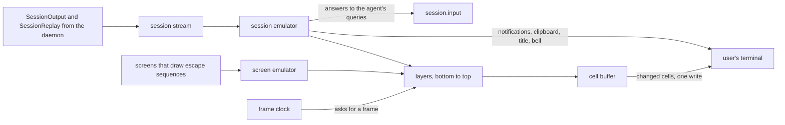

# The compositor

The TUI draws every screen into one grid of cells and writes to the user's terminal only the cells
that changed since the last frame. The session the user is attached to is the bottom layer of the
grid. The TUI feeds the session's output to a terminal emulator of its own and copies that
emulator's screen into the grid, so the session's bytes never reach the user's terminal directly.
Home, the session list, help, the spawn picker and the prompts draw over it as layers of their own.

The design behind this, and what the next changes build on it, is in
[the TUI redesign](../../design/tui-redesign/README.md) and
[the decision record](../../decisions/0003-the-tui-composites-attached-sessions.md).

## The session emulator

The TUI keeps one emulator, `@xterm/headless`, for the attached session, the same emulator the
daemon keeps for each session. The emulator parses the session's output and answers the queries the
agent sends to its terminal, such as cursor position and device attributes. The agent expects those
answers from its terminal, and the user's terminal never sees the queries. The TUI sends each answer
to the session as input. With several clients attached, the agent gets one answer from each.

Every emulator, the daemon's included, measures text with xterm's grapheme width provider,
`@xterm/addon-unicode-graphemes`. An emoji, a skin tone or a joined emoji then takes the two columns
it takes in the user's terminal and in the TUI's own text layout. With xterm's default Unicode 6
tables, most emoji take one column, and every cell after them lands one column early.

The emulator also answers two queries from what the TUI knows about the user's terminal. OSC 10 and
OSC 11 get the foreground and background colours. A kitty keyboard query (`CSI ? u`) gets the
session's current flags, and only when the user's terminal has the protocol. With no answer to give,
the emulator sends nothing, so an agent that probes for the protocol falls back as it does on a
terminal without it.

The emulator passes on to the user's terminal OSC 52 (the clipboard, never a read of it), OSC 0 and
2 (the window title), OSC 9 and 777 (desktop notifications) and the bell. These go to the terminal
between frames. It drops every other sequence it does not draw, among them OSC 7, OSC 133 and image
protocols. An OSC 8 hyperlink becomes the link of the cells it covers.

Other screens still draw with escape sequences. Each of them writes through one function that feeds
a second emulator the size of the terminal, and a layer copies that emulator's cells. A screen that
clears the terminal makes the next frame repaint every cell. When a session has focus, the second
emulator shows only the last row of the terminal, where a notice appears over the session.

## The session stream

The stream decides which bytes reach the emulator. It starts a new emulator on each attach, sized
from the TUI's own size and then from the daemon's answer and each `SessionResized` event.

A daemon that lists the `full-replay` feature sends the session's whole emulator state as
`SessionReplay` events, on attach and after each `SessionDesync`. The stream resets the emulator on
the first chunk of a replay and writes every chunk. It draws the session only after the chunk with
`done`, so a frame never shows half a replay. It then writes each `SessionOutput` whose `seq` is
above the replay's, and drops the rest, because the replay already holds them. Output that arrives
between the attach and the replay, or between a desync and its replay, is dropped for the same
reason. The [terminals doc](../daemon/terminals.md#full-replay) covers the daemon's side.

A daemon without the feature sends the visible screen as ordinary output. The stream then writes
every output event, and when the agent leaves the alternate screen, the main screen shows blank
until the agent redraws it.

The emulator's `write` resolves once its input is parsed, and its `resize` goes through the same
queue, so a `SessionResized` that arrives behind a replay or output applies after them. A frame
waits for pending writes, so it rarely shows a screen halfway through a chunk. A session that writes
without a pause always has a write pending, so a frame waits at most one frame interval and then
draws. A frame never draws while a replay arrives or its last chunk parses.

## Layers and frames

A layer draws into a buffer of cells over the layers below it, and says when it next needs a frame.
A cell holds one grapheme (a wide grapheme leaves the cell after it empty), a foreground and a
background colour, the attributes (bold, dim, italic, underline in four styles, strikethrough,
inverse) and an OSC 8 link. A link cell keeps the underline the agent set, because xterm 6 reports
every link cell as underlined, so the emulator reads the underline from the cell's own attribute
bits. When the emulator is wider than the frame and a wide grapheme starts in the frame's last
column, the session layer draws a blank there, because the terminal would wrap the grapheme onto the
next row.

The compositor composes the layers into a buffer and flushes it. A flush is one write wrapped in
synchronized output (`ESC[?2026h` to `ESC[?2026l`), so a terminal that supports the mode shows no
half frame, and one that does not still shows a correct frame. The flush writes only the cells that
differ from the last frame:

- A short gap of unchanged cells between two changed cells is written over, which costs fewer bytes
  than a cursor move.
- The flush sets an attribute only when the next cell's attributes differ, and it closes a link at
  the end of each run of cells.
- The first frame, and a frame of another size, clear the terminal and draw every cell that is not
  blank.
- The cursor goes where the focused layer's cursor is, with its shape, and is hidden while another
  layer has focus.

A frame clock decides when to draw. An event that needs a frame asks for one, and the clock draws it
at once. After each frame the clock asks every layer when it next needs a frame, and schedules the
earliest answer. When every layer answers null, the clock stops. A tick that fires more than one
frame late is dropped, and the clock never queues a tick. An event that asks for a frame while a
tick is overdue joins that tick, and the frame draws however late it runs. The config key
`animations` reaches the clock, and the [fleet bar](./fleet-bar.md) is the one layer that asks for
frames, for its spinner.

## Colour

The colour depth comes from `COLORTERM` (`truecolor` or `24bit`), then `TERM` (`*-256color`), and is
16 otherwise. The flush maps a colour to the nearest one the depth has, and leaves a palette index
inside the depth as the agent sent it.

To dim a cell, which a layer does to the layers below it, the compositor applies `inverse` first and
then blends each colour toward the terminal's background. A default colour resolves from the
terminal's own foreground and background, and a palette index from the standard xterm palette. A
cell with a default background keeps it, so a transparent terminal stays transparent. At 16 colours
a blend has nothing to land on, so the cell keeps its colours and gains SGR dim.

At start the TUI asks the user's terminal for OSC 10, OSC 11 and `CSI ? u`, followed by a device
attributes request that ends the wait. It draws the first frame at once from the fallbacks
(`#0d1117` for the background, `#c9d1d9` for the foreground, no kitty keyboard) and redraws as
answers arrive. After a short wait it stops waiting and keeps the fallback for each question with no
answer. The input reader takes these answers out of the input stream whenever they arrive, so they
never reach the session as keys.

## Input modes

An agent switches the terminal's input modes, such as mouse reporting, bracketed paste and the
keyboard protocols. The user's terminal has to be in the same modes while the session has focus, or
the keys and mouse reports it sends would not match what the agent expects.

The TUI mirrors the session's modes onto the user's terminal while the session has focus, and sets a
changed mode before the next key reaches the session. While another layer has focus, the terminal
runs with the TUI's own modes: no mouse reporting, no bracketed paste, no focus events, normal
cursor keys, the normal keypad and no kitty flags. The session's modes return when it has focus
again.

- The TUI sets the kitty flags with `CSI = <flags> u`, never with a push, and sets them to 0 when
  the session loses focus, so the user's terminal holds no stack entry of the TUI's. It sends no
  kitty sequence to a terminal that did not answer the query.
- A key that the TUI does not claim reaches the session byte for byte.
- The TUI claims the leader key in its plain, modifyOtherKeys and kitty encodings, under every kitty
  flag, including the forms that add event types and associated text. The release of the leader is
  dropped, so it never reaches the session or the list.
- A mouse report reaches the session only while it has focus, only inside the area of its PTY, and
  never in the last row of the terminal.

On exit, on detach and on error, the TUI resets every mirrored mode and then restores the terminal:
the main screen, a visible cursor and default colours.

## The input mode tracker

xterm tracks none of the kitty flags, modifyOtherKeys, mouse encodings, alternate scroll and colour
scheme updates, so atc tracks the modes itself, in one place. The tracker in the core package parses
a session's output, including a sequence split across two writes, and holds the current value of
each mode: the mouse reporting level and encoding, alternate scroll, bracketed paste, focus events,
application cursor keys, the application keypad, the kitty keyboard stack, modifyOtherKeys and
colour scheme updates. The TUI's emulator and the daemon's screen model both use it. The daemon
replays the modes from it to a client that attaches, with one push for each kitty stack entry.

## The last row

The TUI reports `rows - 1` rows as its size when it attaches and when it resizes, and keeps the last
row of the terminal for the notices and for the [fleet bar](./fleet-bar.md). The daemon sizes the
session to the smallest size its attached clients report. When the PTY is smaller than the window,
the session sits at the top left and the cells around it keep the default background.
