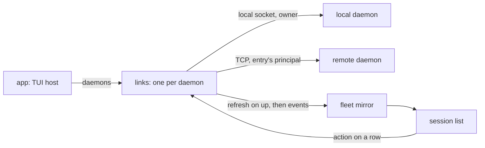

# The TUI and its daemons

Plain `atc` shows the sessions of every daemon the config's `daemons` key lists, beside the sessions
of the local daemon, in one list. The TUI holds one link per daemon, keys each session by the daemon
that holds it and the daemon's own session id, and sends each action through the link of the daemon
that holds the session. The TUI does the merging itself, because the gateway carries no terminal
stream and acts only for OAuth clients, so it cannot act for the owner. The daemons, the gateway and
the wire format are unchanged, and the client speaks one protocol version.

Each edge from a link carries one daemon's traffic. A request for a daemon goes to that daemon's
link and never falls back to another.

## One link per daemon

The app builds a daemon entry for the local daemon and for each entry of the `daemons` map, and
passes them to the TUI in config order. The first is the primary daemon: the local one, or under
`atc --daemon <name>` the one remote daemon, and then no other link opens. A map keeps the order of
its keys because each key starts with a letter, and a JSON object keeps the order of such keys.

The primary link keeps the connection logic of a client with one daemon: its boot, the prompt that
restarts a daemon on another protocol, and the client state machine. The global `waiting` mode, and
the events that move the machine in and out of it, belong to the primary link alone. A failed first
boot of the primary ends the client, because the local daemon starts on demand and a failure means a
broken install the owner should see at once.

Every other link stays out of the state machine. It opens after the primary's first boot, does not
wait on another link, never ends the client, and never offers a restart. It connects as its entry's
principal, so the owner sees on a remote daemon only what that principal's key grants, and the link
carries no owner power across the network. It passes no `viewer`.

A link reports one of five states:

| State          | Meaning                                                      |
| -------------- | ------------------------------------------------------------ |
| `connecting`   | the first handshake has not ended                            |
| `up`           | the handshake passed and the daemon's rows are in the mirror |
| `down`         | the daemon is unreachable, or the connection dropped         |
| `unauthorized` | the token is missing or unreadable, or the daemon refused it |
| `mismatched`   | the daemon speaks another protocol version                   |

The app's remote boot classifies each failure into one of these kinds, so the link sets its state
without reading error text. A `down` link retries on the transport's backoff. An `unauthorized` or
`mismatched` link keeps its state and boots again every 30 seconds, much longer than the backoff,
because a refusal does not heal in seconds. Each boot reads the token again, so a token fix or a
remote upgrade heals the link without a client restart. The state stays at the last refusal until a
retry ends in another outcome.

A remote link is `up` only after its refresh has replaced that daemon's rows in the mirror, so the
list never shows a remote daemon as up with its rows half loaded.

## Session keys

A session id is the id its daemon uses, and the TUI never rewrites it, so an id copied from the TUI
is the id the daemon and its tools use. Two daemons may hold the same id, so every lookup takes a
key of the daemon and the id: the mirror, the time each session finished, focus, attach, and the
confirmations. A map that takes the key encodes it in one place, so no caller builds a string key.

The mirror keeps a daemon's rows while its link is down, with their finished times, and replaces
them wholesale on that daemon's next refresh, which also drops the finished time of each session the
daemon no longer holds. The list hides the rows of a remote daemon that is not `up` and draws one
line with the daemon's name and state in their place, so a daemon never reads as one with no
sessions. The primary's rows stay visible while it waits. Each daemon's rows sort and nest on their
own, the primary's first, because a sub-session nests under a parent on its own daemon even when
another daemon holds a session of the same id.

An event from a link changes only that daemon's rows. The agent labels on a row come from its own
daemon's agent list, which each link reads when it comes `up`.

## Actions and confirmations

An action on a row goes through `clientFor` for the row's daemon, which returns nothing unless the
link is `up`. In that case the TUI sends nothing and shows the daemon's name and state on the status
bar. A refusal from a remote daemon shows on the status bar with the daemon's name and the refusal.
`u` (restart the daemon), `R` (restore the stored fleet) and the stored-fleet count act on the
primary daemon only.

A confirmation holds the key of the session it opened on. Its `y` acts on that key, never on the row
selected now. It cancels when that session leaves the list or its daemon's link leaves `up`, so a
kill opened on a remote row sends nothing after the daemon drops.

When the link of the attached remote session drops, the status bar shows `⟳ waiting for daemon` over
the session. Once the link is `up`, the TUI attaches again if the refreshed list still holds the
session alive, and returns to the list otherwise.

## The spawn picker

The picker opens with a `daemon` step that lists each daemon whose link is `up`, the primary first.
It skips the step only when the primary is the one daemon up, so a client with no remote entry, or
with every remote daemon down, opens at the agent step. A picked remote daemon never shows the
directory you ran `atc` from as a choice, and a typed `~` stands for the home of the user that
daemon runs as. Every later step sends its request through `clientFor` for the picked daemon, reads
and writes that daemon's listing cache, and starts on that daemon's last used agent, so the agents,
targets and directories on screen are the picked daemon's own. Esc on the agent step returns to the
`daemon` step when the picker showed it.

The session spawns on the picked daemon, enters the mirror under that daemon's key, and attaches
through that daemon's link. A picker that is past the `daemon` step ends when the link of its daemon
leaves `up`, and the status bar shows that daemon's name and state. The primary's own loss ends the
picker through the client state machine. The step builds its list when it opens, so a daemon that
leaves `up` while the step is open stays listed, and picking it shows its state as the reason the
agent list failed.

[The client protocol](../protocol/protocol.md) covers the handshake and the events each link
consumes, and [principals](../protocol/principals.md) covers what a remote principal may do.
