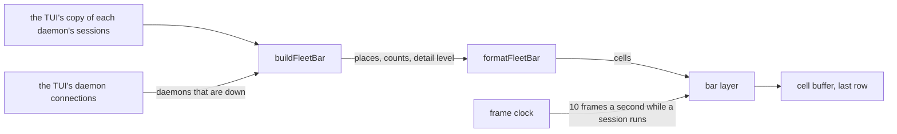

# The fleet bar

While a session has focus, the TUI draws the fleet bar on the last row of the terminal. The bar
groups the TUI's sessions by place, the machine or service a session runs on, which the daemon
reports for each session. For each place, the bar shows the place's label and a state glyph for each
of up to 4 of its sessions. At its right end, it shows how many sessions need the user, then the
leader key, the key that opens the session list. The TUI draws the bar itself, so it looks the same
under Claude Code, Codex and Grok.

```text
laptop ◆⠋✓○ +1    docker ⠴    ink ◆⠸✓✓ +2                     ◆ 2 need you   ^Space
└─ place label, in its colour      └─ ◆ needs you · spinner running · ✓ done · ○ exited
```

[The place a session runs in](../daemon/sessions.md#the-place-a-session-runs-in) defines a place and
how the daemon builds its key. The bar is one layer of the [compositor](./compositor.md), which owns
the frame clock and the cell buffer.

## From sessions to the row



The bar layer builds the bar again on each frame, so the bar keeps no state of its own. A change to
the fleet, such as a session that changes state, asks the frame clock for a frame, as any event
does.

`buildFleetBar` picks what the bar shows, and `formatFleetBar` turns its result into coloured cells
for the last row.

## Places in the TUI

The TUI reads each session's place, a `key` and a `label`, from the session's descriptor in the
daemon's listing. A descriptor with no `place` gets the key `daemon:<daemon name>:<target id>` and
the label `<target id>`, where the target id names the execution target in the daemon's config that
runs the session. The daemon on the TUI's own computer has no name in the config, and the TUI writes
its name as `local`. The fallback key differs from the
[place key](../daemon/sessions.md#the-place-a-session-runs-in) a daemon sends, so a daemon's places
can change colour once it sends `place`.

`pickPlaceLabels` gives one label to each place key:

- When the daemons in one place give it different labels, the TUI uses the label from the daemon on
  its own computer, else the label from the daemon listed first in the config's `daemons`.
- When two places share a label, the TUI adds the name of the daemon whose label it uses, as
  `<label> · <daemon name>`. While two labels still match, it adds the target id next, then the
  place key, one at a time, until they differ. It skips a name that equals the label, and takes the
  next one. When a label with names added matches another place's own label, both add their next
  name.

`pickPlaceColour` picks a place's colour from its key alone, so a place has the same colour on every
daemon that sends its key, and in every run.

## Layout

The attached session's place comes first, then the other places in label order. The bar keeps two
blank columns at its left end and two at its right end, the width of the margin that Claude Code's
own status line keeps on the left. Inside a place, one space separates the label and each glyph, as
in `local ◆ ⠿ ⠿`. Two spaces separate one place from the next, and the bar keeps 3 columns between
the last place and the right end. The bar paints no background.

A session's glyph follows its state: `◆` for `needs_you`, a braille spinner for `running`, `✓` for
`done`, `○` for `exited` and `?` for a state a newer daemon added. Glyphs sort in that order, so a
`◆` goes into the `+<n>` count only when a place has more than 4 sessions in `needs_you`.

The bar uses the most detailed level that fits the width:

| Level    | Each place shows                                                     |
| -------- | -------------------------------------------------------------------- |
| `glyphs` | its label, up to 4 glyphs, and `+<n>` for the rest                   |
| `counts` | its label, its session count, and `◆` when a session in it needs you |
| `short`  | as `counts`, with the label cut to 3 letters                         |

- When `short` leaves no room for every place, the bar drops places from the end of the order, and
  writes `…` after the last place it kept. When no place fits, the bar writes no `…`.
- The bar never writes in its blank end columns. When the right end does not fit between them, the
  bar drops the leader key's label first, then the need-you count.
- The bar measures every width in terminal columns per grapheme, so a wide character such as `界`
  takes two columns.

At the right end, the bar shows `◆ <k> need you` in amber (`#f0b45a`) when `k > 0`, then the leader
key's label in bold blue (`#7aa2f7`). `k` is the number of sessions in `needs_you` across every
place, the dropped places included. Under 90 columns the bar shows `◆ <k>` without the words.

## A daemon that is down

The TUI treats a daemon as down while its connection is lost, while the daemon refuses the TUI's
token, or while the daemon speaks another major protocol version. While a daemon is down, the TUI
keeps that daemon's sessions as they were last listed.

- When a place holds a session from a down daemon, the bar draws every glyph of that place in
  `#3a414b`, the glyphs of its other daemons' sessions included, and puts `?` after its label.
- Those sessions still count toward `k`.

## When the bar shows

The bar shows while a session has focus, and while the session list is open over an attached
session. While the TUI shows a notice, such as a failed call, the advice to update a daemon, or a
lost connection, the notice takes the row, and the bar returns after it. The bar layer draws nothing
while a notice shows, so the notice layer below it shows through. Home, the screen with no session
attached, has no fleet bar.

While a session runs, the spinner turns 10 times a second, whatever the config's `animations` says.
The bar layer asks the frame clock for frames only while the bar shows and a session runs.

## Claude Code's status line

The fleet's state shows in the fleet bar, so Claude Code's own status line shows only the output of
the user's status line command. Claude Code runs the statusline reporter with a JSON report of the
session, such as its model and cost. The reporter sends each report to the daemon, runs the user's
own status line command, and prints only that command's output, or nothing when the user has none.
[Agent integration](../agents/agent-integration.md) owns the reporter and the generated `--settings`
file.
