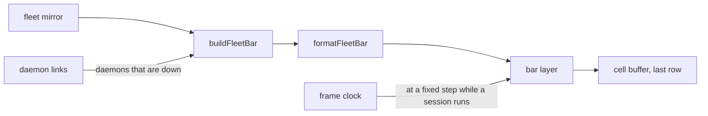

# The fleet bar

While the user is attached to a session, the TUI draws the fleet bar on the last row of the
terminal. For each place, the bar shows a label and a glyph for each of up to 4 of its sessions. At
its right end, it shows how many sessions need the user, and the leader key that opens the session
list. The TUI draws the bar itself, so it looks the same under Claude Code, Codex and Grok.

```text
laptop ◆⠋✓○ +1    docker ⠴    ink ◆⠸✓✓ +2                     ◆ 2 need you   ^Space
└─ place label, in its colour      └─ ◆ needs you · spinner running · ✓ done · ○ exited
```

## Shape



`buildFleetBar` is a pure function of the TUI's sessions, the width and the leader label. The bar
layer calls it on each frame, so the bar needs no state of its own.

## Places in the TUI

A mirror session holds `place`, the descriptor's `place` of `key` and `label`. A descriptor with no
`place`, from a daemon built before the field existed, gets key `daemon:<daemon name>:<target id>`
and label `<target id>`. The daemon on the TUI's own computer has no name in the config, and the TUI
writes it as `local`.

`pickPlaceLabels` gives one label to each place key:

- When the daemons in one place give it different labels, the TUI shows the label from the daemon on
  its own computer, else from the daemon listed first in the config's `daemons`.
- When two places end up with the same label, the TUI writes each as `<label> · <daemon name>`. When
  two places on one daemon still match, it adds the target id, then the place key, and skips a part
  that repeats the label.

`pickPlaceColour` picks a place's colour from its key alone, from a palette of 12 colours, then
moves each channel 20% toward `#6e7681`. A place has the same colour on every daemon that sends its
key, and in every run.

## Layout

- The attached session's place comes first, then the other places in label order.
- A session's glyph follows its state: `◆` for `needs_you`, a braille spinner for `running`, `✓` for
  `done`, `○` for `exited` and `?` for a state a newer daemon added. Glyphs sort in that order, so a
  `◆` goes into `+<n>` only when a place has more than 4 sessions in `needs_you`.
- The bar uses the most detail that fits the width. At `glyphs`, a place shows its label, up to 4
  glyphs and ` +<n>` for the rest. At `counts`, it shows its label, its session count and `◆` when
  any of its sessions needs the user. At `short`, it is `counts` with the label cut to 3 letters.
- When `short` leaves no room for every place, the bar drops places from the end of the order and
  writes `…` after the last place it kept. The right end always shows.
- The bar measures every width in terminal columns per grapheme, so a wide character such as `界`
  takes two.
- Places are 4 columns apart, and the bar keeps 3 columns between the last place and the right end.
- The right end shows `◆ <k> need you` in amber (`#f0b45a`) when `k > 0`, then the leader label in
  bold blue (`#7aa2f7`). Under 90 columns it shows `◆ <k>` without the words. `k` counts every
  place, dropped ones included.
- The bar paints no background.

## A daemon that is down

While a daemon's link is down, refused or mismatched, the mirror keeps that daemon's sessions as
they were last listed. A place with a session from that daemon draws all its glyphs in `#3a414b` and
gets `?` after its label. Those sessions still count toward the right end.

## The row

The bar layer draws after the layer that copies notices from the screen emulator, and only while a
session has focus, or the session list is open over one, and no notice shows. A failed call, the
advice to update a daemon, and a lost connection each take the row while they show, and the bar
returns after. Home has no fleet bar. While the session list is open over a session, the bar keeps
the last row, and the list leaves that row blank.

The spinner turns at a fixed step, 10 times a second, whatever the `animations` setting says. The
layer asks the frame clock for a frame only while the bar shows and a session runs.

## Claude Code's status line

The statusline reporter sends each status line report to the daemon, runs the user's own status line
command, and prints only that command's output. It prints nothing when the user has none, and adds
no atc text. The generated `--settings` file keeps its `statusLine` entry that points Claude Code at
the reporter. See [agent integration](../agents/agent-integration.md).
