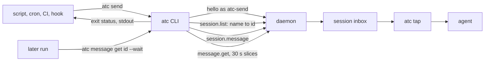

# atc send and atc message get

- **Status:** agreed

A shell script, a cron job, a CI step, a git hook or a systemd unit has no atc command that sends a
session a message: the only senders are an MCP client and a program that speaks the daemon's
protocol itself. This design adds two CLI commands. `atc send` puts a message into a session's inbox
and can wait for the answer, and `atc message get` reads or waits on a message by its id. Both use
the daemon requests that the `atc_message_send` and `atc_message_get` tools already use, so the
daemon and the contract stay as they are.

[Messages](../architecture/protocol/messages.md) covers the inbox, the sender label, answers,
unanswered messages and answer notices.
[Idempotent requests](../architecture/protocol/idempotency.md) covers keys, `outcome_unknown` and
the `effectRef` that names the message a key minted.

## Shape

The CLI opens the daemon socket and sends its handshake, the `hello`, then makes three kinds of
request. Inside the session, `atc tap` reads the session's inbox and hands each message to the
agent.



## Contracts

### The command lines

```sh
atc send <session> [text|-] [--key <key>] [--wait] [--timeout <seconds>]
         [--from <name> | --owner] [--daemon <name>] [--json]

atc message get <message-id> [--wait] [--timeout <seconds>] [--daemon <name>] [--json]
```

```sh
# A cron job: one nudge a day, safe to run twice.
atc send planner "Start the daily triage" --key "triage-$(date +%F)" --from cron
# stdout: msg_7f3c…            exit 0

# A git hook: the text comes from stdin.
git log -1 --format=%B | atc send reviewer - --key "commit-$(git rev-parse HEAD)" --from git-hook

# A CI step: ask, wait, and resume the wait after a timeout.
out=$(atc send release-bot "Is main green to tag?" --key "ci-$RUN_ID" --wait --timeout 600 --json)
case $? in
  0) jq -r .answer <<<"$out" ;;
  8) atc message get "$(jq -r .message <<<"$out")" --wait --timeout 600 ;;
  *) exit 1 ;;
esac
```

| Argument or flag  | Rule                                                                                                                                            |
| ----------------- | ----------------------------------------------------------------------------------------------------------------------------------------------- |
| `<session>`       | A session id, or the exact name of exactly one listed session; see [Addressing](#addressing).                                                   |
| `[text]`          | The message text, at most 256 KiB of UTF-8. When it is absent or `-`, the command reads stdin to its end and drops one trailing `\n` or `\r\n`. |
| `--key <key>`     | The idempotency key, 1 to 200 characters. Without it, the command mints `atc-send-<uuid>` and prints it, so a retry can pass it.                |
| `--wait`          | Wait until the message is answered or unanswered.                                                                                               |
| `--timeout <s>`   | How long `--wait` waits, in whole seconds above 0, counted from the send's answer. The default is 300. It needs `--wait`.                       |
| `--from <name>`   | The sender name of a `local` message, trimmed, 1 to 200 characters. The default is `atc-send`. It conflicts with `--owner`.                     |
| `--owner`         | Send with the sender kind `owner`.                                                                                                              |
| `--daemon <name>` | Send to a remote daemon from the config's `daemons` map, the map the TUI's `--daemon` reads. It conflicts with `--from` and `--owner`.          |
| `--json`          | Print one JSON object on stdout for every outcome except a usage error.                                                                         |

`atc message get` takes the same `--wait`, `--timeout`, `--daemon` and `--json`.

### The sender label

The daemon labels each message with a sender kind and a name, and the receiving agent sees both. A
bare `atc send` must never carry the kind `owner`, because an agent reads `owner` as the owner's own
word.

| Caller                                    | Kind the daemon stores | Name                         |
| ----------------------------------------- | ---------------------- | ---------------------------- |
| `atc send` outside a session              | `local`                | `atc-send`, or the `--from`  |
| `atc send --owner` outside a session      | `owner`                | `owner`                      |
| `atc send` inside a session, local socket | `session`              | the session's name           |
| `atc send --daemon <name>`, anywhere      | `connector`            | the principal the entry uses |

The command sets the kind through the client name in its hello, and the daemon's `findMessageCaller`
reads that name:

- A local send says hello with the client name `atc-send`. The daemon labels a client `local` when
  its name lacks the `atc/` prefix.
- With `--owner`, the command says hello with the atc build string, `atc/<version>`, the name the
  TUI sends. The daemon labels that `owner`.
- The `from` param of `session.message` carries the name of a `local` message. The daemon leaves
  `from` out of the hash it stores with a key, so a retry under another `--from` replays the first
  send.
- A local send passes the session id from `ATC_SESSION_ID` in its hello, as the MCP server does, so
  the daemon labels a send from inside a session `session` wherever it runs. Inside a session, the
  command accepts `--from` and `--owner` and prints one stderr warning that the daemon ignores them.
- A `--daemon` send passes no session in its hello. The remote daemon labels it with the entry's
  principal, the name that daemon knows this client by, and never queues an answer notice for the
  calling session.

### Exit status

`atc send` and `atc message get` share one table.

| Status | Outcome                                                    | The caller then                                                 |
| ------ | ---------------------------------------------------------- | --------------------------------------------------------------- |
| 0      | sent; with `--wait`, answered                              | is done                                                         |
| 1      | refused by the daemon, or the `--daemon` entry is unusable | fixes the cause, then sends under a new key                     |
| 2      | usage error, found before the command connects             | fixes the command line                                          |
| 3      | no session, or several, for the argument                   | passes an id                                                    |
| 4      | the daemon not reached, or no reply from it                | reruns with `--key` set to the same key                         |
| 5      | nothing delivered under the key                            | sends again under a new key                                     |
| 6      | the command cannot tell whether this intent was delivered  | checks by hand, with `atc message get` when it has a message id |
| 7      | the message ended unanswered, which is final               | sends again under a new key, if it wants                        |
| 8      | `--wait` timed out, the message still pending              | runs `atc message get <id> --wait`                              |

`atc message get` exits 0 for a queued, delivered or answered message, 7 for an unanswered one, and
8 when `--wait` times out. Every usage error of these two commands exits 2, a refusal by the shared
command line parser included. Other atc commands keep exit 1 for a usage error.

The command maps each result to a status and an `error.code`:

| Result                                                                                                              | Status                        | `error.code`           |
| ------------------------------------------------------------------------------------------------------------------- | ----------------------------- | ---------------------- |
| No listed session has that id or name                                                                               | 3                             | `no_such_session`      |
| Several listed sessions have that name                                                                              | 3                             | `ambiguous_session`    |
| `session.message` refuses with `no_such_session`                                                                    | 3                             | `no_such_session`      |
| The socket does not open, the hello gets no reply, or the connection closes under a request                         | 4                             | `unreachable`          |
| `outcome_unknown` with an `effectRef`, and `message.get` finds that message                                         | 0, or 7 or 8 after the wait   | none                   |
| `outcome_unknown` on the local socket, with no `effectRef` or a `message.get` that refuses with `bad_args`          | 5                             | `outcome_unknown`      |
| `outcome_unknown` under `--daemon` with no `effectRef`, or any other refusal of that `message.get`, local or remote | 6                             | `outcome_unknown`      |
| `idempotency_conflict`                                                                                              | 6                             | `idempotency_conflict` |
| An `internal` error that carries an `effectRef`                                                                     | as the `outcome_unknown` rows | `outcome_unknown`      |
| `--wait` reaches its timeout                                                                                        | 8                             | `wait_timeout`         |
| An unknown `--daemon` name                                                                                          | 1                             | `no_such_daemon`       |
| An unreadable token for the `--daemon` entry                                                                        | 1                             | `remote_token`         |
| Any other daemon error, such as `session_dead`, `unsupported`, `bad_args` or `unauthorized`                         | 1                             | the daemon's code      |

- The daemon client, `openDaemonClient`, reports a closed connection as `DaemonError` with the code
  `internal`. The command checks whether its connection is closed after an error, and treats an
  `internal` error on a closed connection as no reply.
- Under `--daemon`, `message.get` also refuses with `bad_args` for a message whose session the
  principal cannot see, so that refusal does not show that nothing was delivered.
- An unknown message id in `atc message get` is the daemon's `bad_args`: status 1.

### Output

```ts
// atc send --json: one line on stdout, for every outcome except a usage error
type SendOutput =
  | {
      key: string; // the key used, minted or given
      session: string; // the resolved session id
      message: string; // the message id, for `atc message get`
      status: 'queued' | 'delivered' | 'answered' | 'unanswered'; // 0, 7 and 8 print this shape
      answer?: string; // present once answered
      unansweredReason?: string; // present once unanswered
    }
  | { key?: string; message?: string; error: { code: string; message: string } }; // key and message whenever the command has them
// atc message get --json prints the message view of the contract's MESSAGE_VIEW_SCHEMA, unchanged, for 0, 7 and 8,
// and the error object for every other status.
```

Without `--json`:

- `atc send` prints the message id on stdout. With `--wait`, it prints only the answer text, once
  the message is answered. On a wait timeout it prints the message id, so a script can resume with
  `atc message get`.
- `atc message get` prints the message status, such as `answered`, on the first line, then the
  answer text when there is one.
- Each failure prints `atc send: <code>: <reason>`, or `atc message get: <code>: <reason>`, on
  stderr, with the key and the message id when the command has them. An unanswered message puts its
  reason in that line.
- A minted key goes to stderr as `atc send: key <key>`.
- A usage error prints text on stderr, with `--json` or without it.

### Addressing

- An argument that equals a listed session id is that session.
- Otherwise the argument is a name. It matches by exact, case-sensitive equality among every session
  that `session.list` returns, sub-sessions and exited sessions included.
- One match is that session. Several matches list each candidate's id, name and state on stderr, in
  `session.list` order, with no tie-break.
- The daemon refuses an exited session with `session_dead`, which the command prints with a hint to
  start it with `atc session adopt`.

## Constraints

- The command never starts a daemon. With no daemon on the local socket, it exits 4 within 10
  seconds. Under `--daemon`, it tries the connection once and never waits for the daemon to start.
- `atc send` makes one `session.message` request per run, with the params `session`, `text`,
  `idempotencyKey` and, for a `local` send, `from`. The command never resends on its own: a retry is
  the caller running it again.
- The command never sends `notice` or `replayOnly`. The daemon stores `notice` in a key's hash, so a
  flag that set it would turn a retry with other flags into `idempotency_conflict`.
- `--wait` calls `message.get` with `waitMs` set to the smaller of 30,000 and the time left, until
  the message is answered or unanswered, or the timeout ends.
- A rerun of `atc send` with the same key and text within 24 hours replays the first message and
  resumes the wait. After 24 hours the daemon has dropped the key, so a rerun sends a second
  message, and only `atc message get <id>` reaches the first one.
- On `outcome_unknown` with an `effectRef`, the command reads that message once with `waitMs` 0.
- A `bad_args` from `message.get` during a wait, after `session.message` returned the message,
  exits 1.

## Decisions

- **A bare `atc send` has the sender kind `local`.** Most callers are programs, so `owner` takes the
  explicit `--owner`.
- **The command sets the kind through its hello's client name.** The daemon already labels a client
  `local` when its name lacks the `atc/` prefix, so the command needs no daemon or contract change.
  The `atc/` claim is no credential: any program of the owner's user can act as the owner,
  ([principals](../architecture/protocol/principals.md#who-a-caller-is)).
- **A script picks its next step from the exit status alone.** A program that keys each send maps 0
  to sent, 5 to a new key, and every other status to failed, with no output parsing.
- **Names resolve in the CLI, with no tie-break.** The daemon has no lookup by name, and a
  client-side `session.list` keeps it unchanged. An old session that shares a name with a live one
  makes the name ambiguous, because a tie-break could send to a session the caller did not mean. A
  retry by id is the safe form: a rename between two runs makes a retry by name exit 3, or exit 6
  when the name now points at another session, because the daemon refuses the same key with another
  session as `idempotency_conflict`.
- **`atc message get` is its own command.** A rerun of `atc send` cannot resume after a rename or
  after the key expires, and a caller that holds only a message id needs a read.
- **A send from inside a session always queues an answer notice.** The daemon queues one for every
  sender session that takes messages, and the command never sends `notice`, so the session gets the
  outcome in its conversation, with or without `--wait`.

## Builder decides

- The names of internal functions, files and types, and where the shared exit table and output code
  live in the app package.
- How the local connection opens and sends its hello, within the 10-second limit.
- How the shared command line parser gives these two commands exit 2.
- The wording of each stderr line, keeping the `atc send: <code>:` and `atc message get: <code>:`
  prefixes.
- The test layout, following the `testing` and `project-testing` skills.

## Out of scope

- Moving a program that speaks the daemon's protocol itself, onto `atc send`. That change lives in
  that program's repo.
- Messaging between harnesses through atc-bridge.
- A lookup by name inside the daemon.
- A way to set the sender name over `--daemon`. The remote daemon labels the send with the
  principal.
