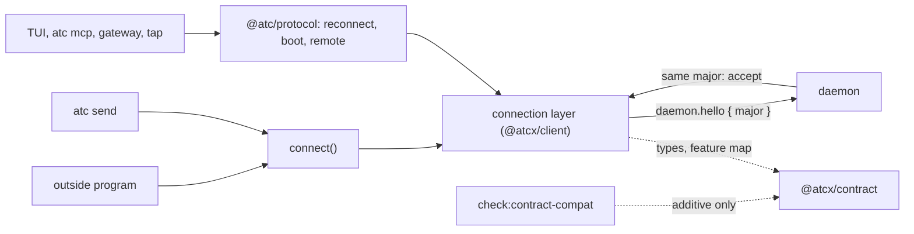

# A published daemon client and minor-version compatibility

- **Status:** draft
- **Decision records:** [0002](../../decisions/0002-clients-and-daemons-talk-across-minor-versions.md)

A program outside atc that calls the daemon writes its own client today. It finds the socket, frames oRPC peer messages over it, sends `daemon.hello` with a protocol number that `@atcx/contract` does not publish, and maps the errors. A local atc and a cloud atc must also run the same build, because every contract change raises that protocol number. Two parts fix both, and ship in this order:

| Doc | What it builds |
| --- | -------------- |
| [Compatibility](./compatibility.md) | a hello that matches by major version, the additive rule inside a major version, and the check that enforces the rule |
| [The client](./client.md) | `@atcx/client`, a second published package that holds the one connection layer, for Node and Bun; atc's own clients build on it |

## Shape

## Decisions

These span both parts. Each part's doc holds its own.

- **A client and a daemon of the same major version talk.** A local client and a cloud daemon no longer need the same build, and `checkDaemon` already holds the rule for features. [0002](../../decisions/0002-clients-and-daemons-talk-across-minor-versions.md)
- **`@atcx/client` holds the one connection layer, and atc's own clients build on it.** atc then runs the wire code that outside programs run, so the two cannot drift. Reconnect, boot and the restart prompt stay private.
- **The client checks features, and the daemon never does.** An older daemon cannot know a field it was built without, so the side that sends the field checks for it. The check lives in the connection layer, so the TUI, `atc mcp`, the gateway and outside programs all run it.
