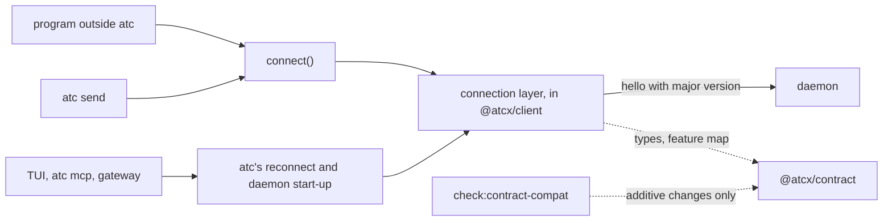

# A published daemon client and minor-version compatibility

- **Status:** draft
- **Decision records:**
  [0002](../../decisions/0002-clients-and-daemons-talk-across-minor-versions.md)

Two pieces of work let a program outside atc call the daemon with one `connect()` call, and let an
atc client talk to a daemon on another minor release of atc. [Terms](#terms) defines the words in
bold.

- [Compatibility](./compatibility.md): the **hello** carries the client's **major version**, and a
  daemon accepts any client of its own major version. Inside one major version every change to the
  **request contract** is additive, and a CI check fails a pull request that breaks that rule.
- [The client](./client.md): `@atcx/client`, a package on npm beside `@atcx/contract`, holds the
  **connection layer** for Node and Bun. atc's own clients build on it, so a program outside atc
  runs the code atc runs.

The compatibility work ships first, and the client builds on it.

## Terms

| Term                     | Meaning                                                                                                                                           | Owning doc                                                                          |
| ------------------------ | ------------------------------------------------------------------------------------------------------------------------------------------------- | ----------------------------------------------------------------------------------- |
| request contract         | the oRPC contract `DAEMON_CONTRACT` in `@atcx/contract`: every daemon procedure with its input and answer schemas                                 | [The published contract](../../architecture/protocol/contract.md)                   |
| hello                    | `daemon.hello`, the first call on every connection; the daemon answers nothing else until it accepts one                                          | [Protocol](../../architecture/protocol/protocol.md#versions)                        |
| protocol number          | `PROTOCOL_V`, an integer each client sends in its hello                                                                                           | [Protocol](../../architecture/protocol/protocol.md#versions)                        |
| major version            | the first number of `CONTRACT_VERSION`, which is atc's version, such as 7 in `7.24.1`                                                             | [The published contract](../../architecture/protocol/contract.md#versions)          |
| feature                  | a name in `DAEMON_FEATURES` for a behaviour that a release adds inside a major version; a daemon lists the features it serves in its hello answer | [The published contract](../../architecture/protocol/contract.md#checking-a-daemon) |
| first compatible release | the atc release that ships [compatibility](./compatibility.md); clients and daemons from that release on follow its rules                         | this design                                                                         |
| connection layer         | the code that opens a daemon socket, frames oRPC peer messages one JSON line each, sends the hello, maps errors and checks features               | [the client](./client.md)                                                           |
| principal                | a named identity that a connection or one call acts as, which limits what it sees and does                                                        | [Principals](../../architecture/protocol/principals.md)                             |

## Shape

The solid arrows are calls at run time. The dashed arrows point at `@atcx/contract`: the connection
layer imports its types and feature map, and the CI check `check:contract-compat` compares its
schemas with the last release. `atc send` is the CLI command that sends one message to a session.

## Decisions

These span both pieces of work. Each piece's doc holds its own.

- **A client and a daemon of the same major version talk, whatever their minor versions.** The TUI
  on one machine can drive a daemon on another over TCP
  ([the TUI and its daemons](../../architecture/tui/daemon-links.md)), and the two installs need not
  run the same build. [0002](../../decisions/0002-clients-and-daemons-talk-across-minor-versions.md)
- **The connection layer lives in `@atcx/client`, and atc's own clients build on it, so the two
  cannot drift.** atc keeps three things in its private packages: reconnecting after a dropped
  socket, starting a daemon when none runs, and the TUI's prompt to restart a daemon of another
  major version.
- **The connection layer checks the daemon's features before it sends a call.** A daemon cannot know
  an input field that a later release added, so the side that sends the field checks for it.
