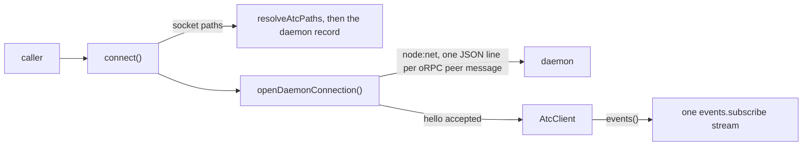

# @atcx/client

- **Status:** draft

`@atcx/client` is a second published package. One call finds the local daemon, opens its socket, sends the hello, and returns every daemon procedure, typed by `@atcx/contract`. The package holds atc's one connection layer: atc's own reconnect, boot and remote code build on it, so outside programs run the same wire code as atc. It builds on [compatibility](./compatibility.md), so it carries no protocol lock of its own.

## Shape



## Contracts

```ts
import { connect, AtcError } from '@atcx/client'

await using atc = await connect({ client: 'stu-watcher' })
// atc.hello → { daemon: 'atc/7.24.1', daemonID: 'd_4k2', features: [...], … }
// atc.check → { verdict: 'match', missing: [], added: [] }

const sessions = await atc.session.list({})
await atc.session.message({ session, text: 'build is green', idempotencyKey: 'build-512' })

for await (const event of atc.events({ signal })) {
  // DaemonEvent, e.g. { ev: 'SessionAdded', session: {...} }
}

// a resume after a dropped connection reads from a saved cursor, and loses nothing the daemon keeps
const page = await atc.events.read({ cursor: saved, waitMs: 30_000 })
// → { events: FleetEvent[], cursor: 'eyJ0IjoxNzM…', more: false }
```

```ts
// @atcx/client
function connect(options?: ConnectOptions): Promise<AtcClient>

interface ConnectOptions {
  client?: string             // the name the daemon logs and shows; default 'atcx-client'
  socketPath?: string         // a unix socket; skips discovery
  address?: { hostname: string; port: number }   // a daemon over TCP; needs token and principal
  token?: string              // the bearer token for address
  principal?: string          // daemon.hello principal; required with address
  viewer?: string             // daemon.hello viewer; needs principal
  session?: SessionID         // daemon.hello session; never read from the environment
  timeoutMs?: number          // connect and hello together; default 8000, atc's own hello deadline
  signal?: AbortSignal        // aborts the connect; after it, an abort closes the client
}

// DaemonProcedures is ContractRouterClient<typeof DAEMON_CONTRACT>. `events` is a function that
// also carries `read`; `events.subscribe` is not on AtcClient, because events() owns the one stream.
type AtcClient = Omit<DaemonProcedures, 'events'> & {
  events: ((options?: { signal?: AbortSignal }) => AsyncIterable<DaemonEvent>) &
    Pick<DaemonProcedures['events'], 'read'>
  readonly hello: HelloResult
  readonly check: DaemonCheck            // verdict 'match', or 'unreadable' for a dev build
  has(feature: DaemonFeature): boolean   // hello.features holds the feature
  readonly closed: Promise<void>         // settles once the socket ends, for any reason; never rejects
  close(): Promise<void>                 // idempotent
  [Symbol.asyncDispose](): Promise<void> // close()
}

class AtcError extends Error {
  readonly code: ErrorCode | ClientErrorCode
  readonly data: Record<string, unknown>
}

// a daemon refusal keeps its own code, such as 'protocol_mismatch' or 'unauthorized'
type ClientErrorCode =
  | 'no_daemon'          // no socket answers; data: { tried: string[] }
  | 'connection_lost'    // the socket ended before the answer; data: { procedure, readOnly, keyed }
  | 'timeout'            // connect and hello passed timeoutMs; data: { timeoutMs }
  | 'feature_missing'    // the daemon lacks a feature the call needs; data: { procedure, field, feature }
  | 'events_overflow'    // one iterator fell 10,000 events behind; data: {}
```

```ts
// @atcx/client/connection. The layer under connect(). @atc/protocol builds its reconnect, boot
// and remote code on it. It is published API, under the same version rules as connect().
function openDaemonConnection(
  target: { path: string } | { hostname: string; port: number },
  hello: {
    client: string
    token?: string
    principal?: string
    viewer?: string
    session?: SessionID
  },
  options?: { timeoutMs?: number; signal?: AbortSignal },
): Promise<DaemonConnection>

interface DaemonConnection {
  readonly hello: HelloResult
  // every procedure; each call takes an optional context that acts as another principal
  readonly procedures: ContractRouterClient<typeof DAEMON_CONTRACT, { as?: string; asName?: string }>
  events(options?: { signal?: AbortSignal }): AsyncIterable<DaemonEvent>
  readonly closed: Promise<void>
  close(): Promise<void>
}

// @atcx/client. Reads the socket paths to try, in order: the one resolveAtcPaths gives, then the
// one the daemon record holds when it differs. @atc/lifecycle's record reader uses the same function.
function readDaemonSocketPaths(env: Record<string, string | undefined>): Promise<string[]>

// @atcx/contract. The one field of the daemon record that a client outside atc reads.
export const DAEMON_RECORD_SOCKET_SCHEMA = z.object({ socketPath: z.string().min(1) })
```

```ts
// @atcx/client/framing. The line framing that the daemon and the client share: the line decoder
// and the outbound queue that today sit in @atc/protocol. The daemon imports them from here.
```

## Constraints

### Connecting

- `connect()` never starts a daemon. With no daemon, it throws `no_daemon`, and `data.tried` lists each path it tried.
- With no `socketPath` and no `address`, `connect()` tries the paths `readDaemonSocketPaths(process.env)` gives. The first path is `daemonSocketPath` from `resolveAtcPaths`. A missing or torn daemon record counts as no record.
- A path where no daemon listens (`ENOENT` or `ECONNREFUSED`) moves on to the next path. Any other connect error throws at once.
- With `address`, `connect()` throws `bad_args` before it connects when `principal` or `token` is missing.
- `connect()` resolves only after the daemon accepts the hello. A refusal throws `AtcError` with the daemon's code and data, and closes the socket.
- After the hello, `connect()` runs `checkDaemon` and stores the result in `atc.check`. The daemon has already matched the major version, so the verdict is `match`, or `unreadable` when the daemon's build string names no version.
- An aborted `signal` on `connect()` rejects with the signal's reason and leaves no open socket.
- `token` never appears in an error message, an error's data, or a log line.

### Calls

- The client never reconnects on its own. When the socket ends, every pending call rejects with `connection_lost`, every `events()` iterator ends, and `closed` settles. The caller calls `connect()` again.
- The client never resends a call, and never makes up an `idempotencyKey`. `connection_lost` carries `readOnly` and `keyed` from the procedure's meta, so the caller knows whether a resend under the same key is safe.
- A call on a closed client rejects with `connection_lost` and sends nothing.
- A call whose field is listed in `FEATURE_INPUT_FIELDS`, present and not `undefined`, and whose feature the daemon lacks, rejects with `feature_missing` and sends nothing ([compatibility](./compatibility.md#constraints)).
- `close()` ends the socket, rejects pending calls with `connection_lost` at once, and ends every iterator. A second `close()` resolves at once.

### Events

- The client opens one `events.subscribe` stream per connection, on the first `events()` call, because the daemon refuses a second subscription on one connection. The stream acts as the hello's principal.
- Each iterator gets the events from the moment it starts. Ending one iterator, by `break` or by its signal, ends no other.
- Each iterator holds up to 10,000 events that its caller has not read. One more ends that iterator with `events_overflow`, and the other iterators carry on.
- The daemon holds the events from the hello until the first subscription, in a backlog of 8 MiB. A backlog that fills before then is dropped without a word to the client. A caller that must not miss an event reads `events.read` with a cursor.
- `events()` skips an event kind that `DAEMON_EVENT_SCHEMA` does not hold, and yields every other event.
- When the stream ends or fails, the client closes the connection, because the daemon ends a subscription only when it drops the connection.

### Package

- The package runs on Node 22 and later, and on Bun 1.3 and later, through `node:net`. It uses no `Bun` global.
- It ships compiled JavaScript and declarations, packed the way `@atcx/contract` is packed, and the same release job publishes both packages.
- Its dependencies are `@atcx/contract` at `^` its own version, `@orpc/client` and `@orpc/standard-server-peer`. It depends on no private workspace package.
- It re-exports the contract types its API names, such as `SessionID`, `DaemonEvent`, `HelloResult` and `DaemonFeature`, so a caller needs no direct import of `@atcx/contract`.
- Its version is atc's version ([versions](../../architecture/protocol/contract.md#versions)).

### Its users in atc

- `@atc/protocol` deletes its own `openDaemonClient`, and builds its reconnect, daemon boot, remote boot and restart prompt on `openDaemonConnection`. The TUI, `atc mcp`, the gateway and the tap reporter keep their behaviour.
- `DaemonError` gives way to `AtcError` across atc. Each internal branch on the old `internal` code for a closed connection moves to `connection_lost`.
- The TUI and the other internal callers start the event stream themselves, through `events()`, where the private client started it after the hello.
- `atc send` calls `connect()`, with the local socket path or with the remote address, token and principal, and keeps its own timeout and exit codes.
- The hook, statusline and note reporters keep their one-line write to `ATC_SOCKET`, and never load the client.

## Decisions

- **`atc.events()` iterates the live `events.subscribe` stream.** Most callers want events as they happen. `events.read` with a cursor serves a caller that must not miss one, and is already a typed call.
- **The client never reconnects or resends.** A call lost with its socket may have run, and only the caller knows whether a resend under its key is safe.
- **`@atcx/client` depends on `@atcx/contract` within its major version.** A caller that also imports the contract gets one copy of it from npm.

## Builder decides

- The internal names, the file layout and the state handling, without `xstate`.
- How `events()` fans one stream out to its iterators.
- How the oRPC link's errors turn into `AtcError`, and the test that searches every error and log line for the token.
- How the publish script and its Node dry run cover two packages.
- The wording of each error message.

## Out of scope

- Reading the config's `daemons` key. A caller passes the address, token and principal itself.
- The gateway. It speaks MCP over HTTP with OAuth, so a gateway client is a different client.
- The raw NDJSON events socket and `atc events`. Both stay as they are.
- Starting a daemon from the client.
