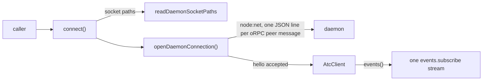

# @atcx/client

- **Status:** agreed

`@atcx/client` is an npm package beside `@atcx/contract`. Its `connect()` finds the local daemon,
opens the daemon socket, sends the hello, and returns every daemon procedure, typed by the request
contract. The package holds the connection layer, and atc's own reconnect and daemon start-up code
build on it. It follows the [compatibility](./compatibility.md) rules, so it connects to any daemon
of its own major version. The [README](./README.md#terms) defines the terms.

## Shape



## Contracts

```ts
import { connect, AtcError } from '@atcx/client';

await using atc = await connect({ client: 'stu-watcher' });
// atc.hello → { daemon: 'atc/7.24.1', daemonID: 'd_4k2', features: [...], … }

const { sessions } = await atc.session.list({});
const session = sessions[0].id;
await atc.session.message({ session, text: 'build is green', idempotencyKey: 'build-512' });

for await (const event of atc.events({ signal })) {
  // DaemonEvent, e.g. { ev: 'SessionAdded', session: {...} }
}

// after a dropped connection, a caller resumes from its saved cursor, and gets every event the
// daemon still keeps after that cursor
const page = await atc.events.read({ cursor: saved, waitMs: 30_000 });
// → { events: FleetEvent[], cursor: 'eyJ0IjoxNzM…', more: false }
// FleetEvent is the stored form the daemon keeps for events.read; DaemonEvent is the live form.
// Both schemas are in @atcx/contract.
```

```ts
// @atcx/client
function connect(options?: ConnectOptions): Promise<AtcClient>;

interface ConnectOptions {
  client?: string; // the name the daemon logs and shows; default 'atcx-client'
  socketPath?: string; // a unix socket; skips the socket search
  address?: { hostname: string; port: number }; // a daemon over TCP; needs token and principal
  token?: string; // the bearer token for address
  principal?: string; // the principal the connection acts as; required with address
  viewer?: string; // a second principal that narrows what the connection sees; needs principal
  session?: SessionID; // the atc session the caller runs in; never read from the environment
  timeoutMs?: number; // connect and hello together; default 8000, atc's own hello deadline
  signal?: AbortSignal; // before connect() resolves, an abort cancels it; afterwards, an abort closes the client
}

// DaemonProcedures is ContractRouterClient<typeof DAEMON_CONTRACT>. `events` is a function that
// also carries `read`. AtcClient leaves out `events.subscribe`, because events() owns the one
// subscription a connection may hold.
type AtcClient = Omit<DaemonProcedures, 'events'> & {
  events: ((options?: { signal?: AbortSignal }) => AsyncIterable<DaemonEvent>) &
    Pick<DaemonProcedures['events'], 'read'>;
  readonly hello: HelloResult;
  has(feature: DaemonFeature): boolean; // hello.features holds the feature
  readonly closed: Promise<void>; // settles once the socket ends, for any reason; never rejects
  close(): Promise<void>; // idempotent
  [Symbol.asyncDispose](): Promise<void>; // close()
};

class AtcError extends Error {
  readonly code: ErrorCode; // from @atcx/contract/light
  readonly data: Record<string, unknown>;
}

// @atcx/contract/light. ERROR_CODES gains these client codes. atc mcp and the gateway pass them on
// as they pass a daemon code.
//   'no_daemon'          no socket answers; data: { tried: string[] }
//   'connection_lost'    the socket ended before the answer; data: { procedure, readOnly, keyed }
//                        readOnly: the procedure is safe to resend; keyed: the procedure takes an
//                        idempotencyKey, so a resend under the same key replays the first answer
//   'timeout'            connect and hello took longer than timeoutMs; data: { timeoutMs }
//   'events_overflow'    one events() iterator fell 10,000 events behind; data: {}
// and 'feature_missing' from compatibility
```

```ts
// @atcx/client/connection. The layer under connect(). atc's reconnect transport, daemon start-up
// and gateway build on it. Published under the same version rules as connect().
function openDaemonConnection(
  target: { path: string } | { hostname: string; port: number },
  hello: {
    client: string;
    token?: string;
    principal?: string;
    viewer?: string;
    session?: SessionID;
  },
  options?: {
    timeoutMs?: number;
    signal?: AbortSignal;
    // sees each answer before its call resolves; atc's test daemon checks answers against the contract here
    onAnswer?: (method: string, answer: Readonly<Record<string, unknown>>) => void;
  },
): Promise<DaemonConnection>;

interface DaemonConnection {
  readonly hello: HelloResult;
  // a call acts as hello.principal unless its context names another principal in `as`
  readonly procedures: ContractRouterClient<typeof DAEMON_CONTRACT, CallContext>;
  // the same call by its method name, such as 'session.list', for callers that route by name
  request(
    method: string,
    params?: Record<string, unknown>,
    context?: CallContext,
  ): Promise<unknown>;
  events(options?: { signal?: AbortSignal }): AsyncIterable<DaemonEvent>;
  readonly closed: Promise<void>;
  close(): Promise<void>;
}

interface CallContext {
  as?: string; // the principal one call acts as
  asName?: string; // the name that labels a message the call sends
}

// @atcx/client. The socket paths to try, in order: paths.daemonSocketPath, then the socketPath
// that the daemon record at paths.daemonRecordFile holds, when it differs. connect() passes
// resolveAtcPaths(process.env); atc's daemon start-up passes its own paths.
function readDaemonSocketPaths(paths: {
  daemonSocketPath: string;
  daemonRecordFile: string;
}): Promise<string[]>;

// @atcx/contract. The one field of the daemon record that a client outside atc reads
export const DAEMON_RECORD_SOCKET_SCHEMA = z.object({ socketPath: z.string().min(1) });
```

## Constraints

### Connecting

- `connect()` never starts a daemon. With no daemon, it throws `no_daemon`, and `data.tried` lists
  each path it tried.
- With no `socketPath` and no `address`, `connect()` tries the paths that `readDaemonSocketPaths`
  gives. A missing or unreadable daemon record counts as no record.
- A path where no daemon listens (`ENOENT` or `ECONNREFUSED`) moves on to the next path. Any other
  connect error throws at once.
- With `address`, `connect()` throws `bad_args` before it connects when `principal` or `token` is
  missing.
- `connect()` resolves only after the daemon accepts the hello. A refusal throws `AtcError` with the
  daemon's code and data, and closes the socket.
- A daemon can answer the hello with a line that is not an oRPC peer message, as the line protocol
  before oRPC does. `connect()` then throws `protocol_mismatch` with no data, which marks the daemon
  as older.
- An aborted `signal` on `connect()` rejects with the signal's reason, and leaves no open socket.
- `token` never appears in an error message, an error's data, or a log line.

### Calls

- The client never reconnects on its own. When the socket ends, every pending call rejects with
  `connection_lost`, every `events()` iterator ends, and `closed` settles. The caller calls
  `connect()` again.
- The client never resends a call, and never makes up an `idempotencyKey`. It reads `readOnly` and
  `keyed` from the procedure's meta in `DAEMON_CONTRACT` at run time.
- A call on a closed client rejects with `connection_lost`, and sends nothing.
- `close()` ends the socket, rejects each pending call with `connection_lost` at once, and ends
  every iterator. A second `close()` resolves at once.
- The outbound queue holds up to 8 MiB. A write that would pass that ends the connection, and each
  pending call rejects with `connection_lost`.

### Events

- The client opens one `events.subscribe` stream per connection, on the first `events()` call,
  because the daemon refuses a second subscription on one connection. The stream acts as
  `hello.principal`.
- Each iterator gets the events from the moment it starts. Ending one iterator, by `break` or by its
  signal, ends no other.
- Each iterator holds up to 10,000 events that its caller has not read. One more ends that iterator
  with `events_overflow`, and the other iterators carry on.
- The daemon keeps up to 8 MiB of events from the hello until the first subscription. When that
  backlog fills, the daemon drops all of it and tells the client nothing. A caller that must not
  miss an event reads `events.read` with a cursor.
- `events()` skips an event whose kind `DAEMON_EVENT_SCHEMA` does not hold, and yields every other
  event.
- When the stream ends or fails, the client closes the connection, because the daemon ends a
  subscription only when it drops the connection.

### Package

- The package runs on Node 22 and later, and on Bun 1.3 and later, through `node:net`. It uses no
  `Bun` global. atc's compiled binary runs the same code, so atc's own clients use `node:net` too.
- It ships compiled JavaScript and declarations, packed and published by the same script and release
  job as `@atcx/contract`. release-please writes atc's version into its `package.json`.
- It depends on `@atcx/contract` at `^` its own version, and on `@orpc/client` and
  `@orpc/standard-server-peer` at the exact versions in atc's catalog, and on nothing else.
- It re-exports the contract types its API names, such as `SessionID`, `DaemonEvent`, `HelloResult`
  and `DaemonFeature`, so a caller needs no direct import of `@atcx/contract`.
- It has its own line decoder. The daemon keeps its own in `@atc/protocol`, and both follow the
  framing in [Protocol](../../architecture/protocol/protocol.md).

### Its users in atc

- `createDaemonTransport`, the reconnect transport in `@atc/protocol` that the TUI, `atc mcp` and
  the gateway use, wraps a `DaemonConnection`. `openDaemonConnection` is the only code in atc that
  opens a daemon connection.
- Each atc caller that sends a request by its method name, the gateway's routing among them, calls
  `DaemonConnection.request`.
- atc code throws and matches `AtcError` for every daemon error. Code that handles a dropped
  connection matches `connection_lost`.
- `atc mcp` returns `connection_lost` for a call whose daemon connection dropped, and `timeout` for
  a hello that ran out of time. Each tool description that names either case follows the
  tool-contract rules. `outcome_unknown` keeps its meaning: a keyed call that the daemon or the
  gateway cannot say ran or not.
- The TUI and the other atc callers start the event stream through `events()`.
- `atc send` calls `connect()`, with the local socket path or with the remote address, token and
  principal, and keeps its own timeout and exit codes.
- The hook, statusline and note reporters write one line to `ATC_SOCKET`, the reporter socket, and
  never load the client.

## Decisions

- **`atc.events()` iterates the live `events.subscribe` stream.** A caller gets each event as it
  happens. A caller that must not miss one reads `events.read` with a cursor, which the request
  contract types.
- **The client never reconnects or resends.** A call lost with its socket may have run, and only the
  caller knows whether a resend under its key is safe.
- **`@atcx/client` depends on `@atcx/contract` within its major version.** A caller that also
  imports the contract gets one copy of it from npm.

## Builder decides

- The internal names, the file layout and the state handling.
- How `events()` fans one stream out to its iterators.
- How the oRPC link's errors turn into `AtcError`, and the test that searches every error and log
  line for the token.
- How the publish script and its Node dry run cover two packages.
- The wording of each error message.

## Out of scope

- Reading the config's `daemons` key. A caller passes the address, token and principal itself.
- A client for the gateway, which speaks MCP over HTTP with OAuth.
- The NDJSON events socket and `atc events`.
- Starting a daemon from the client.
