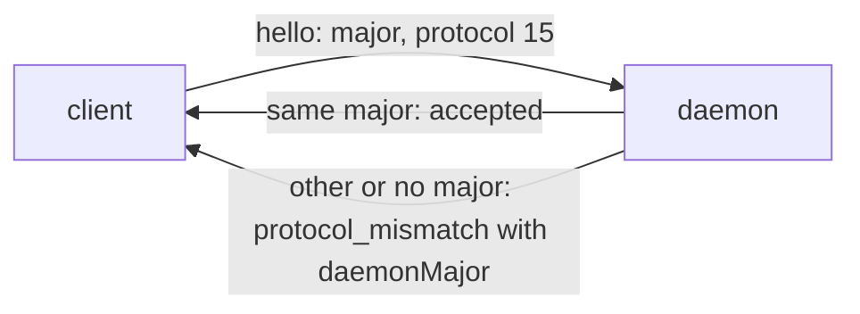

# Compatibility across minor versions

- **Status:** agreed
- **Decision records:**
  [0002](../../decisions/0002-clients-and-daemons-talk-across-minor-versions.md)

A client and a daemon talk when their major versions match. Each client sends its major version in
the hello, and the daemon compares it with its own. Inside one major version every change to the
request contract is additive, and `bun run check:contract-compat` fails a pull request whose change
is not. The [README](./README.md#terms) defines the terms.

The first compatible release sets `PROTOCOL_V` to 15, and no later release changes it. Every daemon
from an earlier release speaks protocol 14 and refuses a hello with any other number. Those older
daemons therefore refuse every client from the first compatible release on, with no change to their
code.

## Shape



## Contracts

```ts
// the hello that every client sends, atc's own and programs outside atc alike
await procedures.daemon.hello({
  client: 'stu-watcher',
  major: 7, // the major version of CONTRACT_VERSION in the client's @atcx/contract
  protocol: 15, // PROTOCOL_V
});
// → HelloResult { daemon: 'atc/7.24.1', features: ['events.read.from-start', …], … }
```

```ts
// @atcx/contract. PARAMS['daemon.hello'] is a strict object: the daemon refuses a hello field it
// does not know with bad_args. A client learns the daemon's features only from the hello answer,
// so it cannot check a hello field first; a daemon that dropped the field in silence would leave
// the client acting on a connection that differs from the one it asked for.
z.strictObject({
  // …existing fields: client, protocol, principal, viewer, session
  // The bearer token that the TCP check reads. Clients send it with no schema entry, so the
  // strict object lists it.
  auth: z
    .union([
      z.object({ scheme: z.literal('none') }),
      z.object({ scheme: z.literal('bearer'), token: z.string() }),
    ])
    .optional(),
  // The daemon accepts the hello when this equals the major version of its own CONTRACT_VERSION.
  major: z.number().int().optional(),
});

// @atcx/contract, moved from @atc/protocol. The data of every protocol_mismatch refusal, on the
// unix socket and over TCP. Both fields are optional: a daemon released before the first compatible
// release sends daemonProtocol alone on the unix socket, and no data over TCP.
export const MISMATCH_REFUSAL_DATA_SCHEMA = z.object({
  daemonProtocol: z.number().int().optional(), // 15
  daemonMajor: z.number().int().optional(),
});

// @atcx/contract. Each input field that changes behaviour, added inside the major version, with
// the feature a daemon must list before a client sends the field. A nested field is a dotted path.
export const FEATURE_INPUT_FIELDS = {
  'events.read': { from: 'events.read.from-start' },
} as const satisfies Record<string, Record<string, DaemonFeature>>;

// @atcx/contract/light. ERROR_CODES gains
//   'feature_missing'   the daemon lacks a feature that a call's input needs
```

```ts
// @atc/lifecycle. The daemon record that `atc daemon` writes beside its sockets
interface DaemonRecord {
  // …existing fields, protocol among them
  major: number | null; // the daemon's major version; null in a record from an older release
}

// @atc/protocol. What a client compares after a refusal
interface ProtocolMismatch {
  // …existing fields: clientProtocol, daemonProtocol
  clientMajor: number;
  daemonMajor: number | null; // null when the refusal carried none
}
```

A hello meets one of four cases:

| Client                            | Daemon                            | What the client sees                                                                            |
| --------------------------------- | --------------------------------- | ----------------------------------------------------------------------------------------------- |
| first compatible release or later | the same major version            | the hello answer                                                                                |
| first compatible release or later | another major version             | `protocol_mismatch` with `daemonMajor`; the client compares the two majors                      |
| first compatible release or later | released before it                | `protocol_mismatch` with `daemonProtocol: 14`, or no data over TCP; the daemon is older         |
| released before it                | first compatible release or later | `protocol_mismatch` with `daemonProtocol: 15`; the client is older and prints how to update atc |

## Constraints

### The daemon

- The daemon takes its own major version from `CONTRACT_VERSION`, never from its build string, so a
  dev build such as `atc/test-build` matches too.
- On the unix socket, the daemon checks `major` first, on the raw params, before it parses them
  against the strict schema. An older client may send a field that the strict schema lacks, and it
  still gets `protocol_mismatch`, never `bad_args`.
- Over TCP, the daemon checks the bearer token first and `major` second, so a peer with no valid
  token learns nothing, the major version included. Both paths run one shared major check, and both
  refusals carry `MISMATCH_REFUSAL_DATA_SCHEMA` data.
- The daemon refuses a hello whose `major` differs from its own, or that has no `major`, with
  `protocol_mismatch`.
- `atc daemon` writes `major` into the daemon record beside `protocol`. The restart plan reads
  `major` where it reads `protocol`.
- Every event keeps `version: PROTOCOL_V`.

### Clients

- Every client sends `major` and `protocol: 15` in its hello.
- Every client decides older or newer from `daemonMajor`. A refusal with no `daemonMajor` comes from
  an older release, so the client treats that daemon as older. `isClientBehind` and the client's
  `formatProtocolMismatch` compare `clientMajor` and `daemonMajor`, and the restart prompt in
  `@atc/lifecycle` decides on their result.
- When the daemon runs another build of the same major version, older or newer, the TUI connects and
  shows `⟳ update ready`. The TUI's prompt to restart the daemon runs only when the major versions
  differ.
- The connection layer checks `FEATURE_INPUT_FIELDS` before it sends a call. When a listed field is
  present and not `undefined`, and the daemon's hello lacks the field's feature, the call fails with
  `feature_missing` and nothing is sent.
- `atc mcp` advertises every tool and input whatever the daemon serves. A call that needs a missing
  feature returns `feature_missing`, with a message that says to restart the daemon on a newer atc.
- Every atc client, the TUI's event parser and the MCP tools among them, skips an event kind it does
  not know, and shows an enum value it does not know as unknown, without an error.
- The gateway admits a daemon of the same major version through `checkDaemon`, and keeps a daemon
  that lacks a feature in service.

### The additive rule

Inside one major version, a change to the request contract or the event schema is one of these:

| Change                                                     | Allowed                                                             | What an older peer does                                                                                              |
| ---------------------------------------------------------- | ------------------------------------------------------------------- | -------------------------------------------------------------------------------------------------------------------- |
| a new procedure                                            | yes, with no feature                                                | an older daemon answers `unknown_method`                                                                             |
| a new optional input field                                 | yes                                                                 | an older daemon drops it from a top-level input object, and refuses it inside a strict nested object with `bad_args` |
| a new input field that changes behaviour                   | yes, with a feature in `DAEMON_FEATURES` and `FEATURE_INPUT_FIELDS` | the client fails the call with `feature_missing`                                                                     |
| a new optional answer field                                | yes                                                                 | an older client ignores it                                                                                           |
| a new enum value, union variant or event kind in an answer | yes                                                                 | an older client skips it or shows it as unknown                                                                      |
| a new field in `daemon.hello`                              | no                                                                  | an older daemon refuses the hello with `bad_args`                                                                    |
| a removed or renamed procedure, field or event kind        | no                                                                  |                                                                                                                      |
| a changed or narrowed type, or a new required field        | no                                                                  |                                                                                                                      |
| a changed meaning of a field                               | no                                                                  |                                                                                                                      |

A change marked "no" goes out in a major release.

### The compatibility check

- `bun run check:contract-compat` compares each procedure's input and answer schemas, and the event
  schema, with the schemas at the latest `@zgeoff/atc@*` release tag.
- The check fails on each change the [additive rule](#the-additive-rule) marks "no".
- The check fails on a new input field that has neither an entry in `FEATURE_INPUT_FIELDS` nor an
  entry, with its reason, in the check's list of harmless fields.
- The check passes a change marked "no" when the pull request's title, or a commit since the release
  tag, marks a breaking change, because release-please then raises the major version.
- CI runs the check on each pull request, beside `check:contract`.

## Decisions

- **The first compatible release is a minor release of atc 7.** Older daemons already refuse it
  through their protocol check, so the rule needs no major release to start.
- **`atc mcp` advertises every input, and fails a call that needs a missing feature.** Its tool list
  then never depends on the daemon it reaches.

## Builder decides

- How the check reads the schemas at the release tag, for example through `git show` and Zod's JSON
  Schema output.
- The shape and place of the list of harmless fields.
- How the stub daemons in the tests send `major`.
- The wording of each refusal message.

## Out of scope

- A restart offer for a daemon that lacks a feature inside the same major version. The
  `feature_missing` message says to restart it.
- Dropping `protocol` from the hello. The first major release after the first compatible release
  does that, and the comment on `PROTOCOL_V` says so.
