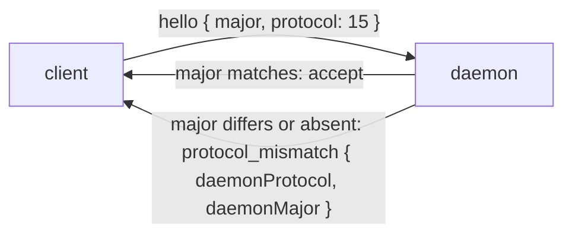

# Compatibility across minor versions

- **Status:** draft
- **Decision records:** [0002](../../decisions/0002-clients-and-daemons-talk-across-minor-versions.md)

A client and a daemon talk when their major versions match. The hello carries the client's major version beside the protocol number, and the daemon compares the major version. Inside one major version every change to the contract is additive, and `bun run check:contract-compat` fails a pull request that breaks that.

The rule starts at the release that holds this part. That release raises `PROTOCOL_V` from 14 to 15 for the last time, so a daemon from before it refuses every newer client, as it refuses any mismatch today.

## Shape



## Contracts

```ts
// the hello every client sends, atc's own and outside programs alike
await procedures.daemon.hello({
  client: 'stu-watcher',
  major: 7,      // the major version of CONTRACT_VERSION in the client's @atcx/contract
  protocol: 15,  // PROTOCOL_V; see the constraints
})
// → HelloResult { daemon: 'atc/7.24.1', features: ['events.read.from-start', …], … }
```

```ts
// @atcx/contract. PARAMS['daemon.hello'] becomes a strict object, so a daemon refuses a hello
// field it does not know with bad_args instead of dropping it.
z.strictObject({
  // …existing fields
  // The bearer token the TCP check reads. Clients send it today without a schema entry, so the
  // strict object must list it.
  auth: z.union([
    z.object({ scheme: z.literal('none') }),
    z.object({ scheme: z.literal('bearer'), token: z.string() }),
  ]).optional(),
  // The daemon accepts the hello when this equals the major version of its own CONTRACT_VERSION.
  // Optional in the schema, so a hello from before this part gets protocol_mismatch, not bad_args.
  major: z.number().int().optional(),
})

// @atcx/contract, moved from @atc/protocol. The data of every protocol_mismatch refusal, on the
// unix socket and over TCP. Both fields are optional, because a daemon from before this part sends
// daemonProtocol alone over the unix socket, and nothing over TCP.
export const MISMATCH_REFUSAL_DATA_SCHEMA = z.object({
  daemonProtocol: z.number().int().optional(),  // 15 from this part on
  daemonMajor: z.number().int().optional(),     // the daemon's major version
})

// @atcx/contract. Each input field that changes behaviour and that a release added inside the
// major version, with the feature name a daemon that serves it lists in its hello.
export const FEATURE_INPUT_FIELDS = {
  'events.read': { from: 'events.read.from-start' },
} as const satisfies Record<string, Record<string, DaemonFeature>>
```

```ts
// @atc/lifecycle. The daemon record
interface DaemonRecord {
  // …existing fields
  major: number | null   // the daemon's major version; null in a record from before this part
}
```

A hello meets one of these cases:

| Client | Daemon | What happens |
| ------ | ------ | ------------ |
| this part or later | this part or later, same major | accepted |
| this part or later | this part or later, other major | `protocol_mismatch` with `daemonMajor`; the client compares majors |
| this part or later | before this part | `protocol_mismatch` with `daemonProtocol: 14`, or no data over TCP; the client treats the daemon as older |
| before this part | this part or later | `protocol_mismatch` with `daemonProtocol: 15`; the client treats itself as older and prints how to update atc |

## Constraints

- The daemon takes its own major version from `CONTRACT_VERSION`, never from its build string, so a dev build such as `atc/test-build` still matches.
- The daemon refuses a hello whose `major` differs from its own, or that has no `major`, with `protocol_mismatch` and `MISMATCH_REFUSAL_DATA_SCHEMA` data. Over TCP the daemon checks the bearer token first, so a peer without a valid token learns nothing, the major version included.
- Every client decides older or newer from `daemonMajor`. A refusal with no `daemonMajor` comes from a daemon before this part, and the client treats that daemon as older. `isClientBehind` and `formatProtocolMismatch` move to these rules.
- Every client sends `protocol: 15` until atc 9.0.0. From 9.0.0 the hello drops `protocol`, and the daemon reads `major` alone. `PROTOCOL_V` never changes again, and its comment says so.
- Every event keeps `version: PROTOCOL_V`, which stays 15.
- Inside one major version a contract change is additive:
  - A new procedure needs no feature name. An older daemon answers it with `unknown_method`.
  - A new input field is optional. An older daemon drops an unknown field from a top-level input object, and refuses one inside a strict nested object, such as a credential reference, with `bad_args`.
  - A new input field that changes behaviour gets a feature name in `DAEMON_FEATURES` and an entry in `FEATURE_INPUT_FIELDS`, because an older daemon drops it without an error.
  - A new answer field is optional in its schema.
  - A new value in an answer's enum, or a new event kind, is additive. Every atc client skips an event kind it does not know, and shows an enum value it does not know as unknown, without an error.
  - Removing or renaming a procedure or a field, making a field required, narrowing an input's type, or changing what a field means raises the major version.
- A new field in `daemon.hello` is a breaking change, because the client cannot read features before the hello. An older daemon refuses it with `bad_args`, as the strict hello says.
- Before the connection layer sends a call, it looks the call's fields up in `FEATURE_INPUT_FIELDS`. When a field is present and not `undefined`, and the daemon's hello lacks its feature, the call fails with `feature_missing` and nothing is sent. The gateway, the TUI, `atc mcp` and outside programs all go through that layer ([the client](./client.md)).
- `atc mcp` advertises every tool and input whatever the daemon serves. A call that needs a missing feature fails with `feature_missing`, and its message says to restart the daemon on a newer atc.
- The TUI shows `⟳ update ready` for a daemon on another build of the same major version, and never blocks on it. Its restart prompt runs only on a major-version mismatch.
- The gateway admits a daemon of the same major version through `checkDaemon`. A daemon that lacks a feature stays in service.
- Of today's four feature names, only `events.read.from-start` names an input field. The other three name answer behaviour, need no entry in `FEATURE_INPUT_FIELDS`, and stay in `DAEMON_FEATURES`.

### The compatibility check

- `bun run check:contract-compat` compares each procedure's input and answer schemas, and the event schema, with the ones the last release published.
- The check fails on any of these:
  - a removed procedure, field or event kind;
  - a changed field type, or a narrowed input type;
  - a new required field, in an input or an answer;
  - a new input field that has neither an entry in `FEATURE_INPUT_FIELDS` nor an entry, with its reason, in the check's list of harmless fields;
  - a new field in `daemon.hello`.
- The check passes a release whose `CONTRACT_VERSION` raises the major version over the last release.
- CI runs the check on each pull request, beside `check:contract`.

## Decisions

- **The rule starts at the release that holds it, inside major version 7.** Raising `PROTOCOL_V` to 15 one last time already makes every older daemon refuse a newer client, so no major release is needed to start the rule.
- **The hello is strict.** A client cannot read features before the hello, so a hello field that an older daemon dropped would go unnoticed. A refusal is the only safe answer.
- **`atc mcp` advertises every input and fails a call that needs a missing feature.** Its tool list then never depends on which daemon it reaches.

## Builder decides

- How the check reads the last release's schemas: a committed snapshot that the release job refreshes, or the release tag.
- The shape and place of the check's list of harmless fields, with a reason per entry.
- How the check compares schemas, for example through Zod's JSON Schema output.
- How the stub daemons in the tests send `major`.
- The wording of each refusal message.

## Out of scope

- A restart offer for a daemon that lacks a feature inside the same major version. The `feature_missing` message says to restart it, and the owner restarts it by hand.
