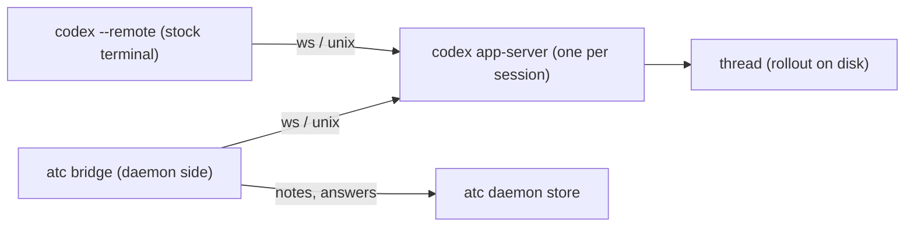

# Codex App Server bridge spike

An external atc bridge can give a stock Codex terminal the core behaviour of the Claude atc-bridge
mod: message delivery while idle and mid-turn, progress notes, automatic final replies, and
message-to-turn tracking. The bridge and the terminal (`codex --remote`) connect as two clients of
one Codex App Server and share one thread. The bridge binds the atc session id to the thread id in
its own state and in the thread's developer instructions, so no part of the design reads identity
from an inherited environment. Every result below comes from Codex CLI 0.162.0 on Linux, with the
App Server's v2 protocol and `experimentalApi`, a scratch `CODEX_HOME`, and 16 short model turns.

The recommendation: build the Codex bridge on App Server, with one App Server per atc session on a
Unix socket, and the bridge inside the daemon.
[The smallest implementation plan](#the-smallest-implementation-plan) lists the steps.



Both clients subscribe to the thread. The App Server sends every thread notification and every
approval request to each subscriber, and the first client to answer a request wins.

## Running the prototype

[`bridge.ts`](./bridge.ts) is the prototype. It starts or resumes one thread, offers the `atc.note`
and `atc.answer` dynamic tools, delivers messages, settles each one from its turn, and keeps its
state in a JSON file so a restart can recover. A small HTTP control port stands in for the daemon's
inbox.

1. Start an App Server with a scratch Codex home, so the run never touches the owner's `~/.codex`:

   ```bash
   CODEX_HOME=<scratch-codex-home> codex app-server --listen ws://127.0.0.1:47172
   ```

2. Start the bridge. It prints the thread id it created:

   ```bash
   bun bridge.ts ws://127.0.0.1:47172 <atc-session-id> <state-dir> "" 47173
   ```

3. Join the stock terminal to the thread:

   ```bash
   CODEX_HOME=<scratch-codex-home> codex resume <thread-id> --remote ws://127.0.0.1:47172
   ```

4. Send a message through the bridge, then read its state:

   ```bash
   curl -s 127.0.0.1:47173/send -d '{"id":"msg-001","from":"spike-sender","text":"Reply with the word PINEAPPLE."}'
   curl -s 127.0.0.1:47173/
   ```

   Expect `"status":"answered"`, `"via":"final-reply"` and `"answer":"PINEAPPLE"` once the turn
   completes. `POST /drop` and `POST /reconnect` test a reconnect, and restarting the process with
   the thread id as the fourth argument tests a bridge crash.

## Findings

### Two clients on one thread

The terminal and the bridge both control and observe the thread. A turn either client starts reaches
the other as `turn/started`, its items and `turn/completed`, and the terminal renders a
bridge-started turn and a steered message live, with the `<atc-message>` envelope visible. Neither
client caused a duplicate turn in any run.

The App Server also sends a client notifications for threads it never subscribed to. When the
terminal submits its first prompt, Codex starts a second, internal thread that names the session,
and its `thread/started` and `thread/status/changed` notifications reach the bridge too. A bridge
therefore filters every notification by thread id, and never reads `thread/status/changed` without
that filter.

### Approvals

An approval request reaches every subscriber, and the first answer settles it for all of them. With
the bridge set to decline approvals, the bridge answered `item/commandExecution/requestApproval` in
the millisecond it arrived, the turn went on with the command refused, and the terminal never showed
the prompt. With the bridge leaving approvals unanswered, the terminal showed the prompt, an
approval typed there settled it, and the bridge received `serverRequest/resolved` for the request.
The bridge therefore never answers an approval or a user-input request, which leaves one owner for
each.

### Message delivery

`turn/start` alone delivers a message race-free. On an idle thread it opens a new turn. On a thread
with an active turn it adds the input to that turn and returns that turn's id, exactly as
`turn/steer` does, with no new `turn/started`. The returned turn id is the turn that carries the
message, so the bridge records it at once.

`turn/steer` takes an `expectedTurnId` and fails with code `-32600` and the message
`no active turn to steer` once that turn has ended. A bridge that steers therefore needs
`turn/start` as its fallback, and `turn/start` with no steer gives the same result in one call.

At the turn-completion boundary, a third client sent `turn/start` the moment the final
`agentMessage` item completed, before `turn/completed`. The App Server added the message to the
ending turn, and the model answered it in a second `final_answer` message in the same turn, 2 s
later. The boundary therefore loses no message, and one turn can end with more than one final
answer.

### Accepted, recorded and consumed

Each delivered message becomes a `userMessage` item whose `clientId` holds the `clientUserMessageId`
the bridge sent, so the bridge matches items to messages without parsing text. The item is recorded
as soon as the App Server accepts the input, even while a command is still running. In one run the
model never saw a steered message, because a client interrupted the turn during its command, and the
message's `userMessage` item had already completed.

The `userMessage` item therefore shows that a message is recorded in the thread's history, not that
the model read it. The first model item in the same turn that starts after it (`reasoning`,
`agentMessage`, or a tool call) shows that the model consumed it, because the model only produces an
item after a request that includes the recorded input.

### Final replies

Each `agentMessage` item carries a `phase`: `commentary` for text such as "I'll run the command",
and `final_answer` for the reply. The bridge takes the text of the last `agentMessage` of a
completed turn as the answer to every message that turn recorded and the `atc.answer` tool did not
answer. A completed turn ends with a model item after its last recorded input, as the boundary run
shows, so the model has consumed every message the turn recorded. A turn that ends `interrupted` or
`failed` leaves its messages unanswered, with the turn status as the reason.

### Progress notes

A dynamic tool works as the progress-note tool. The bridge passes `dynamicTools` (an `atc` namespace
with `note` and `answer` functions) on `thread/start`, the model calls `atc.note`, and the App
Server sends `item/tool/call` with the thread id, turn id and arguments to the bridge. The note
arrived before the final reply in every run. Three limits apply:

- `dynamicTools` exists only on `thread/start`, so the bridge creates the thread and the terminal
  joins it.
- With no bridge connected, a call to `atc.note` waits. The terminal neither answers a dynamic tool
  call nor fails it, so the turn stalls.
- A waiting tool call survives. When the bridge resumed the thread after the call had waited about
  20 s, the App Server sent it the pending `item/tool/call` at once, and the turn completed.

### Reconnect and duplicates

The App Server does not deduplicate a retried message. Two `turn/start` requests with one
`clientUserMessageId` produced two `userMessage` items in one turn. The bridge therefore never
resends a message on its own memory: after a reconnect or a restart, it lists the thread's recent
turns with full items, settles each open message from the turn whose `userMessage` item holds its
id, and requeues only a message no turn holds. Two runs exercised this:

- The bridge was killed after it steered a message and before the turn ended. On restart, it found
  the message in the completed turn and recorded the final reply as its answer, with no resend.
- A message was queued in the bridge's state but never sent. On restart, no turn held it, so the
  bridge sent it, and it was answered once.

`thread/resume` on a loaded thread adds the connection as a subscriber and returns the thread's
status. Events from the disconnected period are not replayed, which the turn listing covers.

### Resume, compaction and restart

The bindings, the tools and the instructions survive each case tested:

- Compaction: after `thread/compact/start`, the model called `atc.note` with the atc session id it
  read from the developer instructions.
- App Server restart: the terminal showed `Reconnecting to server…` and rejoined by itself once a
  server listened on the same address. The bridge resumed the thread from disk with no tools in the
  request, and the model again called `atc.note` with the session id, so the tools and instructions
  came back from the rollout.

### Joining a new thread

The terminal cannot resume a thread before the thread's rollout exists. A thread from `thread/start`
gets its rollout file at its first turn, so `codex resume <thread-id> --remote` on a fresh thread
fails with `no rollout found for thread id <thread-id>`. One `thread/inject_items` request with a
developer message writes the rollout with no model turn, and the terminal then joins the thread.

## Comparison with the Claude bridge

| Behaviour             | Claude atc-bridge mod                                                                  | App Server bridge                                                                |
| --------------------- | -------------------------------------------------------------------------------------- | -------------------------------------------------------------------------------- |
| Delivery while idle   | submits the envelope as a new prompt                                                   | `turn/start` opens a turn                                                        |
| Delivery mid-turn     | appends the envelope to the running turn                                               | `turn/start` adds the input to the active turn                                   |
| Seen by the model     | the next turn step clears the unseen set                                               | the first model item after the `userMessage` item                                |
| Message-to-turn match | parses envelope ids from the turn's prompt                                             | the `clientId` of the `userMessage` item, and the turn id `turn/start` returns   |
| Progress notes        | the `note` mod tool runs `atc note`                                                    | the `atc.note` dynamic tool reaches the bridge as `item/tool/call`               |
| Final reply           | the turn-complete hook reports the turn's answer                                       | the last `agentMessage` of a completed turn                                      |
| Interruption          | carried messages become unanswered                                                     | the same, from the turn status                                                   |
| Bridge restart        | the mod's tracking lives in its process memory, and the daemon ends delivered messages | the bridge rebuilds tracking from the thread's stored turns                      |
| Identity              | `ATC_SESSION_ID` in the environment of the Claude process atc starts                   | the bridge's own binding of session id to thread id, plus developer instructions |

The App Server bridge recovers more than the Claude mod, because the thread's stored turns hold
every message's id and outcome.

## Answers to the questions

- **Both clients on one thread:** yes. Turns from either client reach both, and no duplicate turn
  appeared. Approvals conflict only when the bridge answers them, so the bridge leaves them to the
  terminal.
- **Consumed against accepted:** the `userMessage` item with the message's `clientId` shows the
  message is recorded. The first model item after it in the same turn shows the model consumed it.
- **Pending messages across interruption, failure and reconnect:** keep each message's state in the
  daemon store, keyed by the atc message id, which the bridge sends as `clientUserMessageId`. After
  any reconnect, settle open messages from the thread's stored turns before sending anything,
  because the App Server does not deduplicate. A message in an interrupted or failed turn becomes
  unanswered, as it does for Claude.
- **One server per session:** yes. A Codex App Server runs hooks, MCP servers and tools in its own
  environment, so a server per session keeps each session's environment its own. A per-session
  server also confines a crash to one session and lets each session take its own `CODEX_HOME`. A
  shared server works for message delivery with explicit thread bindings, but brings back the
  wrong-identity bug for every environment-based integration.
- **Survival across resume and compaction:** the binding lives in the daemon store, outside Codex.
  The dynamic tools persist in the thread's rollout and return on resume, and the developer
  instructions survived compaction and a server restart.

## Observed limits

- `dynamicTools`, `thread/inject_items`, `thread/queue/*` and the App Server itself are
  experimental, and the documentation calls the WebSocket transport unsupported for production. A
  Codex upgrade can change any of them, so the bridge pins its tested Codex version the way the
  Claude mod pins Claude Code.
- A dynamic tool call stalls while no bridge is connected. A bridge in the daemon stays connected
  whenever the daemon runs, and a daemon restart resumes the thread and receives the pending call.
- The App Server does not deduplicate on `clientUserMessageId`, so recovery depends on the bridge
  reading the stored turns first.
- The terminal cannot join a thread with no rollout, so the bridge writes one with
  `thread/inject_items` before it starts the terminal.

The spike did not exercise the experimental `thread/queue/*` methods, a server-side queue of
submissions, because `turn/start` with stored-turn recovery covered every case tested.

## The smallest implementation plan

1. Launch: for an App Server Codex session, the daemon starts
   `codex app-server --listen unix://<session-dir>/codex.sock` with the session's environment, then
   starts the terminal as `codex --remote unix://<session-dir>/codex.sock` in the session's PTY, in
   place of the `--no-daemon` server the adapter starts. Bun's WebSocket client reaches that socket
   as `ws+unix://<path>`, and Codex links the path to a socket under `/tmp/codex-daemon-<uid>/` that
   it removes when the server stops.
2. Thread binding: the daemon's bridge connects, calls `thread/start` with the `atc` dynamic tools
   and the bridge instructions, writes the rollout with one `thread/inject_items` request, and
   stores the session-to-thread binding before the terminal starts with `codex resume <thread-id>`.
   A restored session resumes its stored thread.
3. Delivery and tracking: the bridge drains the session's inbox with `turn/start`, sends the atc
   message id as `clientUserMessageId`, records the returned turn id, marks a message seen at the
   first model item after its `userMessage` item, and settles it at `turn/completed`. These map to
   the existing delivered, answered and unanswered message states.
4. Tools: `atc.note` and `atc.answer` reach the bridge as `item/tool/call`, and the bridge calls the
   daemon's existing note and answer paths in process. The bridge answers no other server request.
5. Recovery: on every connect, the bridge settles open messages from `thread/turns/list` before it
   sends anything.
6. Tests: a stand-in App Server that speaks the recorded JSON-RPC sequences, so the suite never runs
   the real `codex`, plus one manual run against the pinned Codex version before a release.
