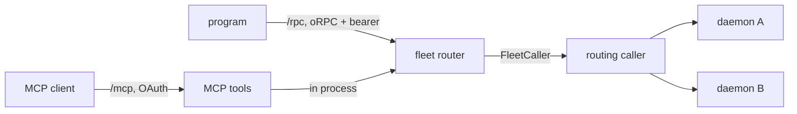

# A typed API for atc-gateway

- **Status:** agreed
- **Decision records:** [0004](../decisions/0004-programs-reach-the-gateway-through-a-typed-api.md)

atc-gateway serves its fleet to programs through a typed oRPC API at `/rpc`, beside the MCP tools at
`/mcp`. Both front doors run one fleet router: the router owns each operation, checks the caller's
scopes, and calls the gateway's existing routing caller. The MCP tools become an adapter that calls
the router in process and shapes each answer for a model.

Programs such as nixie's coding adapter call the gateway as service clients today, through MCP. They
pick `structuredContent` out of each tool result, poll `atc_events_read` with a cursor, and learn of
a version mismatch only at runtime. The second front door costs little, because most of the router
exists already: every MCP tool already turns into one or two untyped
`sendRequest(method, params, principal)` calls, and the gateway already serves the daemon's oRPC
procedures one method at a time.

[The gateway](../architecture/remote/gateway.md) covers the routing caller,
[the MCP servers](../architecture/remote/mcp.md) cover the tools and their scopes,
[service tokens](../architecture/remote/oauth.md#service-tokens) cover non-interactive clients, and
[the event trail](../architecture/protocol/events.md#the-event-trail) covers the cursors a stream
resumes from.

## Shape



## The case

The design rests on three facts from the current code:

- **The tools are close to a router already.** Each tool is one branch that builds params by hand
  and calls `FleetCaller.sendRequest` with a daemon method name. The gateway's routing caller and
  the single-daemon channel caller of `atc mcp` both implement `FleetCaller`. Nothing between the
  tools and the caller is typed.
- **Operation rules live in the MCP layer, where a second front door would skip them.** The MCP SDK
  runs the scope check, per tool. The MCP server checks that a spawn's `atcAccess` grants no scope
  the token lacks. The stop and forget tools set the guards that keep a stop from forgetting and a
  forget from dropping a pinned or live session. The router runs each of these for every front door.
  The MCP SDK keeps its per-tool check as well, to send an MCP client its HTTP 403 challenge.
- **The gateway reshapes the daemon's answers,** so a program typed by `DAEMON_CONTRACT` would read
  wrong types from the gateway.

The gateway changes these answers and inputs:

| Answer or input                | From one daemon            | From the gateway                                           |
| ------------------------------ | -------------------------- | ---------------------------------------------------------- |
| a session id                   | `s7-m4x2p`                 | `build-box.k3f9.s7-m4x2p`                                  |
| a session's `locator`          | `{ daemonID, targetID }`   | `{ daemon, incarnation, targetID }`                        |
| `session.list`                 | `{ sessions }`             | adds `daemons`, each daemon's name and state               |
| `agents.list`                  | one agent list             | one agent list per daemon name, or that daemon's state     |
| an event in `events.read`      | the daemon's event         | adds `origin`, and the `note` or `answer` handle it holds  |
| `events.read`                  | `{ events, cursor, more }` | adds `unavailable`, `started` and `truncated` daemon names |
| `daemon` input, `daemons.list` | absent                     | present                                                    |

Each MCP tool branch holds operation rules, shaping for a model, or both:

| Moves into the router (operation)                                | Stays in the MCP tools (shaping for a model)                          |
| ---------------------------------------------------------------- | --------------------------------------------------------------------- |
| the scope check, per procedure                                   | tool names, descriptions, annotations and JSON Schemas                |
| the `atcAccess` scope check on spawn                             | each result as text plus structured content                           |
| `stopOnly` on every kill                                         | a minted idempotency key when a tool call holds none                  |
| `refusePinned` on every forget, and `refuseLive` unless it stops | the plain-language text of a forget refused as pinned or live         |
| the refusal of an owner-only procedure for a principal           | the menu-token rule of `atc_terminal_choose`                          |
|                                                                  | note and answer text inlined into an event page                       |
|                                                                  | the stdio server's nested spawn and its fallback to a top-level spawn |

Id rewriting, the daemon pick and the key binding stay in the gateway's routing caller, behind
`FleetCaller`, unchanged.

## Contracts

### The program client

```ts
import { connectGateway } from '@atcx/client/gateway';

const atc = connectGateway({ url: 'https://atc.example.com', token: process.env.ATC_TOKEN });

const { session } = await atc.session.spawn({
  daemon: 'build-box', // optional; without it the call goes to the registry's default daemon
  cwd: '/work/kite',
  prompt: 'Fix the flaky upload test',
  idempotencyKey: 'job-4411-spawn',
});
// session.id → 'build-box.k3f9.s7-m4x2p'
// session.locator → { daemon: 'build-box', incarnation: 'k3f9', targetID: 'local' }

await atc.session.submit({ session: session.id, text: 'run the tests again' });
const { text } = await atc.session.screen({ session: session.id });
await atc.session.message({ session: session.id, text: 'status?', idempotencyKey: 'job-4411-m1' });
await atc.session.kill({ session: session.id }); // stops the session and keeps its record

for await (const item of atc.events.stream({ cursor: savedCursor })) {
  // item → { kind: 'event', event: { session: 'build-box.k3f9.s7-m4x2p', kind: 'turn_done', cursor: 'g1.…' } }
  //     or { kind: 'daemons', unavailable: ['laptop'], started: [], truncated: [] }
}
```

```ts
// @atcx/client, new entry `@atcx/client/gateway`. Runs on Node 22+ and Bun 1.3+, like the client's other entries.
function connectGateway(opts: {
  url: string; // the gateway's origin; the client calls `${url}/rpc`
  // a service token, a client_credentials access token, or an OAuth access token; the client
  // calls a function before each call and each stream reconnect, so a short-lived token can renew
  token: string | (() => string | Promise<string>);
  fetch?: typeof fetch;
}): ContractRouterClient<typeof FLEET_CONTRACT>; // every call sends the bearer and `x-atc-major`
```

### The two fleet contracts

`buildFleetContract` makes two contracts from one list of procedures, meta and inputs.
`FLEET_CONTRACT` holds the gateway's answers and inputs from the table in [The case](#the-case): it
adds `daemons.list` and the `daemon` input. `LOCAL_FLEET_CONTRACT` holds one daemon's. Each input
takes only what the MCP tools send today, so a `/rpc` caller can do nothing that the same token
cannot do through `/mcp`.

```ts
// @atcx/contract
export const FLEET_CONTRACT = buildFleetContract(GATEWAY_SHAPES); // the gateway's; /rpc serves it
export const LOCAL_FLEET_CONTRACT = buildFleetContract(DAEMON_SHAPES); // one daemon's, for `atc mcp`

// procedures, by daemon method name:
//   daemons.list (FLEET_CONTRACT only), agents.list, dirs.list,
//   session.{list, get, spawn, update, ack, kill, forget, adopt, submit, screen, menu, choose,
//            read, message, scope.add, auth.rebind},
//   message.get, note.get, answer.get, events.read, events.stream
// each one declares FLEET_ERROR_MAP: the daemon's codes, plus insufficient_scope,
//   daemon_unavailable, daemon_unauthorized and too_many_streams

// each input is the daemon procedure's input, with these changes:
//   - FLEET_CONTRACT adds `daemon?: string` to each procedure that is not a fan-out;
//     the fan-outs are daemons.list, session.list, agents.list, events.read and events.stream
//   - `idempotencyKey` is required on session.spawn and session.message, 1 to 180 characters
//   - session.spawn and session.message drop `replayOnly`, which only the gateway's key binding sets
//   - session.spawn drops `resume`, and FLEET_CONTRACT drops `parent`; the stdio server alone
//     spawns under a parent, through LOCAL_FLEET_CONTRACT
//   - session.kill drops `stopOnly`; the router always sends `stopOnly: true`
//   - session.forget drops `refusePinned` and `refuseLive` and takes `stop?: boolean`; the router
//     sends `refusePinned: true` and `refuseLive: !stop`

// GATEWAY_SHAPES: a session id is a GatewaySessionID, a branded string of its own
type FleetLocator = { daemon: string; incarnation: string; targetID: string };

interface FleetProcedureMeta extends ProcedureMeta {
  // …existing fields, copied from the daemon procedure: access, readOnly, keyed
  scope: GrantScope;
}
```

Each procedure needs the scope of the MCP tool that calls it:

| Scope     | Procedures                                                                                                                                                                           |
| --------- | ------------------------------------------------------------------------------------------------------------------------------------------------------------------------------------ |
| `read`    | `daemons.list`, `agents.list`, `dirs.list`, `session.list`, `session.get`, `session.read`, `session.screen`, `message.get`, `note.get`, `answer.get`, `events.read`, `events.stream` |
| `message` | `session.message`, `session.update`, `session.ack`                                                                                                                                   |
| `spawn`   | `session.spawn`, `session.submit`, `session.menu`, `session.choose`, `session.adopt`, `session.scope.add`, `session.auth.rebind`                                                     |
| `kill`    | `session.kill`, `session.forget`                                                                                                                                                     |

`session.menu` takes `spawn`, because only `atc_terminal_choose` reads a menu. `note.get` and
`answer.get` take `read`: each returns the text that `atc_events_read` inlines for the same event,
and the daemon answers it only for a session within the caller's reach.

### The version check

A program checks one number: the major version of the contract it was built against. The gateway has
its own release track, and it carries the `CONTRACT_VERSION` of the atc commit it was built from, so
the gateway compares a program's major with that. A daemon on an older minor version is the
gateway's concern: a call that needs a feature the daemon lacks fails with `feature_missing`.

```http
POST /rpc/session/spawn HTTP/1.1
Authorization: Bearer atcs_…
x-atc-major: 7
```

```ts
const { build, contract, daemons, defaultDaemon } = await atc.daemons.list({});
// build → 'atc-gateway 1.9.0', contract → '7.26.0', defaultDaemon → 'build-box'
// daemons → [{ name: 'build-box', state: 'up', build: 'atc 7.25.1', daemonID: 'd-…', features: ['session.host'] }]
//   build, contract and features are new optional fields on the existing answer; step 3 fills them
```

### The router

```ts
// @atc/fleet-api, a new workspace package. It depends on @atcx/contract, @atc/protocol, @atc/core
// and @orpc/server. FleetCaller moves here from @atc/mcp.
const router = createFleetRouter({ caller, contract: FLEET_CONTRACT });
// the gateway passes its routing caller and FLEET_CONTRACT;
// `atc mcp` passes its channel caller and LOCAL_FLEET_CONTRACT

interface FleetContext {
  principal: Principal | null; // null acts as the daemon's owner: the stdio server alone passes it
  scopes: readonly GrantScope[]; // the bearer's scopes; the stdio server passes all four
}
```

The two callers of the router, for illustration:

```ts
// /rpc (step 3): oRPC's fetch RPCHandler
handler.handle(request, { prefix: '/rpc', context: { principal, scopes } });

// an MCP tool (step 2): oRPC's in-process router client, one per tool call
const client = createRouterClient(router, { context: { principal, scopes } });
await client.session.spawn(params);
```

## Constraints

### The router

- Each procedure refuses a caller whose scopes lack the procedure's `scope`, with
  `insufficient_scope` and `data.required`, before it calls the daemon.
- A procedure whose `access` is `owner` refuses a caller with a principal, with `unauthorized`,
  before it calls the daemon.
- `session.spawn` refuses an `atcAccess` scope that the caller's scopes lack, with
  `insufficient_scope` and the missing scopes in `data.required`, before it calls the daemon.
- The router sends `FleetCaller` the params its input schema parsed, with the defaults the schema
  fills. The gateway hashes those params for a key, so a key bound before step 2 deploys and resent
  after it can get `idempotency_conflict` once.
- The router checks each answer from `FleetCaller` against its contract's output schema, and an
  answer that fails the check is `internal`. The check lets through what a daemon on another minor
  version can send: an object keeps the keys it does not declare, an enum takes a value it does not
  list, and an answer may leave out an optional field. A field or a value that a newer daemon adds
  still reaches an MCP tool. The published types stay exact.
- The router never opens a daemon connection. It reaches daemons only through its `FleetCaller`.
- The router leaves the feature check to the daemon connections, which fail a call with
  `feature_missing` when the daemon lacks a feature its input needs.
- The MCP adapter mints a UUID key for a spawn or a message that holds none, for both contracts. The
  stdio server's top-level fallback calls `session.spawn` a second time under its derived key, as it
  does today.
- A test checks every MCP tool's scope against the procedures it calls: a token that holds the
  tool's scope passes each procedure check the tool makes.
- The fleet contracts hold no procedure beyond the list above, so quit, backup, restore, prune,
  attach, raw input and resize stay off both front doors.

### The /rpc route

- The gateway serves `/rpc` as `GATEWAY_PATHS.machine.rpc`, so an ingress groups it with the machine
  routes.
- The route applies the Host and Origin checks that `/mcp` applies before it reads the bearer, and a
  request they refuse reaches no procedure.
- The route reads the bearer from the `Authorization` header and verifies it with the verifier
  `/mcp` uses. A static service token, a `client_credentials` token and an OAuth access token all
  pass, and each acts as its client's principal.
- A service client's scopes come from the service-token file, and its targets from each daemon's
  `principals` entry for `service:<name>` ([principals](../architecture/protocol/principals.md)).
  `/rpc` adds to neither.
- A missing or refused bearer gets HTTP 401 with the `WWW-Authenticate` challenge `/mcp` sends, and
  writes the same `bearer` security event.
- A request without `x-atc-major`, or with a major other than the gateway's `CONTRACT_VERSION`
  major, gets `protocol_mismatch` with `data.gatewayMajor`, and the router runs nothing.
- The route passes an error's `code`, and `problem`, `effectRef` and `required` from its `data`, and
  drops every other field of `data`, except `gatewayMajor` on `protocol_mismatch`. `effectRef` is
  the rewritten id of the effect an `outcome_unknown` names, which a program checks before it
  retries under a new key. The route passes `effectRef` only when the daemon's own error holds it,
  and drops one that the gateway's key binding restores from its cache, because the daemon checked
  that effect's reach only when it first answered. The route passes the error's message as `/mcp`
  passes it today.
- The route never reads a token from a URL or a query string. A request line or a security event
  records `/rpc` and the procedure's path, and never the rest of a path or a query string.

### The event stream

- `events.stream` reads the merged event trail that `events.read` returns, and holds open until the
  caller ends it.
- Each `event` item carries the event's merged cursor as its oRPC event id, and each `daemons` item
  carries its page's cursor.
- The stream yields a `daemons` item only when its three lists differ from the last ones it yielded.
- On reconnect, the stream starts after the client's last event id. With no last event id it starts
  after the input `cursor`, and with neither it starts after the newest event of each daemon.
- When the trail refuses a cursor, as after a daemon's new incarnation, the stream ends with
  `bad_args`. The program has a gap then: it reads current state with `session.list` and opens a new
  stream without a cursor.
- The stream sends a keep-alive comment every 15 seconds, inside the HTTP server's 60-second idle
  timeout.
- Every 60 seconds the stream verifies its bearer again. It ends when the bearer no longer verifies
  with `read`, when the bearer verifies as another principal, or when the check takes longer than 10
  seconds, and it sends nothing between a failed check and its end. A static service token's stream
  therefore ends within 70 seconds of a reload that drops the token.
- Each read of the trail is a new daemon request as the stream's principal, so a session that leaves
  the principal's reach drops out of the stream's next page.
- The stream reads its next page only after the client has taken the last one, so it holds at most
  one page. An event from that page can still reach the client after its session leaves reach, and
  no later event of that session can.
- A gateway process holds at most 8 open streams per principal, and refuses the ninth with
  `too_many_streams`. The gateway keeps its grants and key bindings in SQLite on one volume, and
  this design assumes one process serves it.

### Versions and publishing

- Each fleet contract follows the daemon contract's rule: every change within a major version is
  additive. `bun run check:contract-compat` records `FLEET_CONTRACT` under a `fleet:` prefix and
  `LOCAL_FLEET_CONTRACT` under `fleet-local:`, and compares each one only with its own earlier
  release. A tag that has no fleet contract leaves nothing to compare.
- A new fleet input field takes a `FEATURE_INPUT_FIELDS` entry or a harmless-field entry, as a
  daemon input field does.
- `bun run check:contract` keeps a declaration snapshot of the new client entry.
- The new client entry depends on no package that `@atcx/client` does not already depend on.

## Decisions

- **Programs reach atc-gateway through a typed API beside MCP, and the MCP tools call the same
  router.** A program gets typed answers, a stream and a version check at build time, and every
  front door runs the same scope checks.
  [0004](../decisions/0004-programs-reach-the-gateway-through-a-typed-api.md)
- **Only atc-gateway serves `/rpc`.** `atc mcp --http` serves MCP alone until a program needs one
  daemon over HTTP.
- **The fleet contracts keep the daemon's procedure names.** The gateway's id rules and the compat
  check then keep working by method name. The inputs narrow to what the MCP tools send today, and
  `idempotencyKey` is required, so a program can always resend a spawn or a message.
- **One builder makes both fleet contracts.** The router then runs the same handlers over the
  gateway and over one daemon, and each caller's answers pass its own output check.
- **The fleet contracts declare their own error map.** The daemon's map stays as it is, because a
  daemon never sends `insufficient_scope` or a gateway code.
- **The router lives in a new package, `@atc/fleet-api`.** `@atc/mcp` holds the MCP SDK and the
  authorization server, and the gateway package holds no HTTP.
- **The event stream reads the trail alone.** The trail resumes from a cursor after a dropped
  connection, and the live `events.subscribe` stream drops its backlog. A program reads current
  state with `session.list`.
- **The MCP SDK's per-tool scope check stays beside the router's check.** It sends the HTTP 403
  challenge an MCP client needs to ask for the scope, and a test ties each tool's scope to the
  scopes of the procedures it calls.
- **A program sends its major version in a header on each call.** HTTP has no handshake.
  `daemons.list` gives the features of each daemon to a program that needs them.

## Steps

Each step is one PR that leaves the gateway working. The estimates count code and tests.

1. Add both fleet contracts to `@atcx/contract`, with their meta, the scope table, `FLEET_ERROR_MAP`
   and the compat check. Add `@atc/fleet-api` with the router, its scope, `atcAccess` and output
   checks, and a fake `FleetCaller` for its tests, and move `FleetCaller` there. About 1,200 lines.
2. Move the MCP tools onto the router's in-process client. About 300 lines changed. The existing MCP
   tests and the gateway e2e suites keep their assertions on what each tool returns, and they are
   the evidence that no MCP answer changed. A test that checks the params a tool sends now sees the
   minted key and the defaults the input schema fills, and a stub's answer holds every field its
   output schema requires.
3. Serve `/rpc` on the gateway, with the bearer check and the version header, and fill the new
   `daemons.list` fields. Add `events.stream`, and `@atcx/client/gateway` with its publish dry run.
   Add a gateway e2e suite that drives `/rpc` through the client. About 900 lines.

Steps 1 and 2 add no route, and they put every procedure's scope in one table in the contract.

## Builder decides

- Whether the router has one pass-through handler keyed by method name, and whether the fan-out
  branches stay in the routing caller.
- Whether `buildFleetContract` derives its procedures from `DAEMON_CONTRACT` in code or lists them
  by hand.
- How `buildFleetContract` makes each output object keep the keys it does not declare.
- How the router turns an `AtcError` from its caller into an oRPC error.
- The file layout, internal names and zone entry of `@atc/fleet-api`.
- How the gateway counts open streams per principal.
- The test layout, within the testing skills.

## Out of scope

- A live terminal over `/rpc`. The gateway carries no terminal stream.
- Webhook subscriptions for programs. A program holds an `events.stream` open, and MCP Events keeps
  its webhooks.
- A typed API on one daemon over HTTP. A program that talks to one daemon uses `@atcx/client`
  against the daemon's TCP listener.
- More than one gateway process. The 8-stream limit and the key bindings assume one.
- Hiding how far apart two cursors are. A merged cursor holds each daemon's place in its trail, as
  an `atc_events_read` cursor does.
