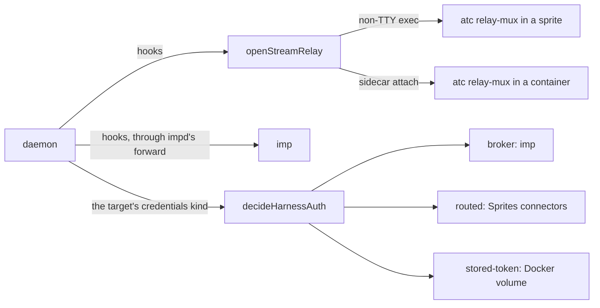

# Remote targets: Sprites and Docker

- **Status:** draft
- **Decision records:** [0001](../../decisions/0001-sprites-credentials-through-connectors.md)

atc gains two execution providers for Claude sessions. [Terms](#terms) defines the words in bold.

- `docker` runs each session on the Docker Engine of the daemon's own Linux machine, with one
  container per **harness**.
- `sprites` runs each session in a sprite, a persistent Linux VM on
  [Fly.io Sprites](https://docs.fly.io/sprites).

Neither kind of **host** has **impd**, so neither can carry a session's hooks back to the daemon or
add credentials to the agent's API requests. [The contract](./contract.md) gives every provider the
**relay** for hooks, and a way to declare how its host supplies credentials. The contract ships
first, the `docker` provider second because it needs no account and runs in CI, and the `sprites`
provider last.

## Terms

| Term               | Meaning                                                                                                                                                                     | Owning doc                                                                              |
| ------------------ | --------------------------------------------------------------------------------------------------------------------------------------------------------------------------- | --------------------------------------------------------------------------------------- |
| session            | one agent conversation that atc runs                                                                                                                                        | [Sessions](../../architecture/daemon/sessions.md)                                       |
| sub-session        | a session that another session starts, on the other session's host                                                                                                          | [Sessions](../../architecture/daemon/sessions.md#sub-sessions)                          |
| top-level session  | a session that no other session started; it gets a host of its own                                                                                                          | [Sessions](../../architecture/daemon/sessions.md#sub-sessions)                          |
| harness            | the agent CLI process of a session, such as `claude`, which the daemon runs in a terminal                                                                                   | [Execution targets](../../architecture/execution/targets.md#starting-a-harness)         |
| hook               | an event that the agent CLI reports, such as a finished turn, through a reporter that atc installs                                                                          | [Agent integration](../../architecture/agents/agent-integration.md)                     |
| execution provider | the plugin that runs harnesses in one kind of place                                                                                                                         | [Execution targets](../../architecture/execution/targets.md#providers-and-capabilities) |
| target             | a config entry that names a provider and its settings                                                                                                                       | [Execution targets](../../architecture/execution/targets.md#binding-to-a-target)        |
| host               | what a top-level session and its sub-sessions share on a target: an imp, a sprite, or a Docker volume that their containers mount                                           | [Sessions](../../architecture/daemon/sessions.md#the-host-a-session-runs-on)            |
| host key           | the name that atc gives a host                                                                                                                                              | [Sessions](../../architecture/daemon/sessions.md#the-host-a-session-runs-on)            |
| imp                | a persistent microVM that atc's imp provider runs sessions in                                                                                                               | [The imp provider](../../architecture/execution/imp-provider.md)                        |
| impd               | the agent inside an imp, which forwards a unix socket to the daemon and holds the broker                                                                                    | [The imp provider](../../architecture/execution/imp-provider.md#the-session-bridge)     |
| broker             | impd's credential store, which replaces a placeholder in each API request with the real credential                                                                          | [Runtime auth](../../architecture/execution/runtime-auth.md)                            |
| session bridge     | the socket in the host that the hook, note and message tap reporters write to; the daemon serves it                                                                         | [The imp provider](../../architecture/execution/imp-provider.md#the-session-bridge)     |
| relay              | the frames that carry the session bridge from the host to the daemon over a provider's byte stream, through `atc relay-mux` in the host and `openStreamRelay` in the daemon | [The contract](./contract.md#the-relay)                                                 |
| connector          | a Sprites service that holds a credential and adds it to each request sent to its gateway URL                                                                               | [0001](../../decisions/0001-sprites-credentials-through-connectors.md)                  |
| kill               | the owner's stop of a session, which puts the harness to sleep: the imp or sprite sleeps, and Docker pauses the containers                                                  | [Sessions](../../architecture/daemon/sessions.md#ending-a-session)                      |
| revive             | the start of a killed session again: atc reattaches to the harness, or starts it with the agent's resume command                                                            | [Sessions](../../architecture/daemon/sessions.md#ending-a-session)                      |
| forget             | the owner's removal of a session and its host                                                                                                                               | [Workspace cleanup](../../architecture/execution/workspace-cleanup.md)                  |
| harness fate       | whether a sleeping host still holds a session's harness                                                                                                                     | [The contract](./contract.md#harness-fates)                                             |

## How the parts connect

| Doc                           | Holds                                                                                                                       |
| ----------------------------- | --------------------------------------------------------------------------------------------------------------------------- |
| [The contract](./contract.md) | the relay and its frames, the credentials kinds, harness fates, and each provider's state folder                            |
| [Docker](./docker.md)         | the `docker` provider: its config, its volumes and containers, the stored token, and what it does in place of each imp duty |
| [Sprites](./sprites.md)       | the `sprites` provider: its config, its sprites and execs, the connectors, and what it does in place of each imp duty       |

## Decisions

- **One relay serves every provider that has a byte stream to its host.** `openStreamRelay` holds
  the framing, the acks and the replay, and a provider supplies only the stream. imp keeps impd's
  forward.
- **A target declares how its host supplies credentials, as one tagged union.** The daemon decides
  each launch's credentials in one pure function, `decideHarnessAuth`, and never branches on the
  provider's kind.
- **A Sprites session takes its credentials from Sprites connectors, so no credential value enters
  the sprite.** [0001](../../decisions/0001-sprites-credentials-through-connectors.md)
- **A Sprites target's sprite name prefix decides which connectors its sessions can use.** Sprites
  lets a sprite use a connector when the sprite's name starts with the connector's prefix, and
  Sprites cannot label a sprite. So a sprite's name is the only thing a connector checks. A second
  set of credentials needs a second target, and the daemon refuses two targets whose prefixes
  overlap.
- **A Docker host is a volume, and each harness is the main process of a container of its own.** An
  Engine can reattach to a container's main process, and never to a `docker exec`. A session without
  sub-sessions is one volume and one harness container, as a session on imp is one imp.
- **A kill puts the harness to sleep on every remote provider.** The imp sleeps, the sprite sleeps
  once atc detaches from it, and the Docker containers pause.
- **A Docker target runs every session under one long-lived Claude token that the user stores in a
  volume.** Any process in any container of the target can read that token. A local session's
  sign-in is open only to the user's own processes. The trade is accepted because the token never
  leaves the user's own machine.
- **Both providers run Claude only.** Codex's ChatGPT sign-in has no Sprites connector, and the
  Docker volume holds a Claude token only.
- **Both providers refuse every spawn when the daemon runs from source.** The relay runs the
  daemon's own compiled binary inside the host.

## Out of scope

- A credential gateway that atc runs on the daemon's machine.
- Sprites checkpoints and egress policy. A sprite runs with the default network policy.
- A Docker Engine on another machine, or one that runs its Linux containers in a VM, such as Docker
  Desktop. The provider mounts files from the daemon's machine and runs the daemon's own Linux
  binary in each container.
- Moving imp onto `openStreamRelay`, which would close the window in which imp loses a hook while
  impd's forward reconnects.
