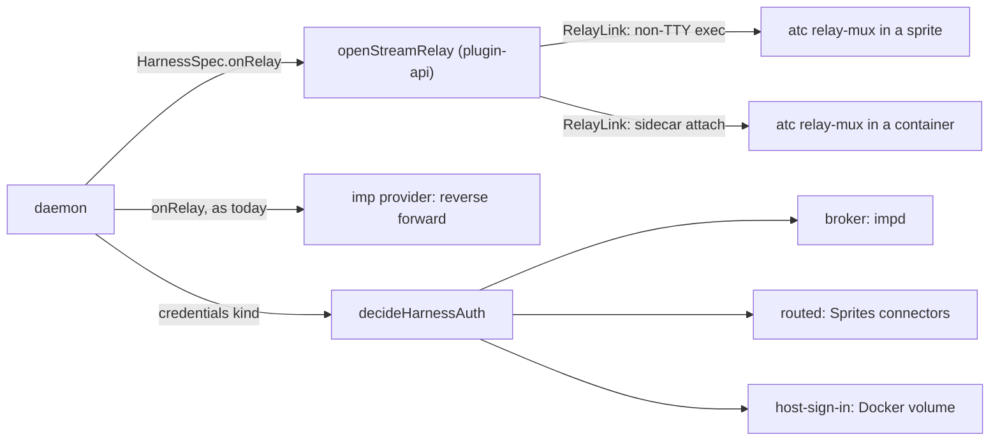

# Remote targets: Sprites and Docker

- **Status:** draft
- **Decision records:** [0001](../../decisions/0001-sprites-credentials-through-connectors.md)

atc gains two execution providers: `sprites`, which runs each session in a Fly.io sprite, and
`docker`, which runs each session in containers on the Docker Engine of the daemon's own machine.
Both build on four changes to the provider contract: a `relay` capability with one shared relay that
carries hooks over any byte stream that can drop and reattach, a tagged union for how a host
supplies credentials, a read of what became of each sleeping harness, and a state folder for each
provider entry. imp, the one remote provider today, keeps its reverse forward and its broker.

## Shape

## The parts

| Doc                           | Owns                                                                                                        |
| ----------------------------- | ----------------------------------------------------------------------------------------------------------- |
| [The contract](./contract.md) | the `relay` capability, `openStreamRelay` and its frames, `HostCredentials`, `readHarnessFates`, `stateDir` |
| [Docker](./docker.md)         | the `docker` provider: its config, the volume and container model, the sign-in volume, its gaps             |
| [Sprites](./sprites.md)       | the `sprites` provider: its config, how each imp duty maps to a sprite, its gaps                            |

The contract ships first. Docker builds on it next, because it needs no account and runs in CI, and
Sprites builds on it last.

## Decisions

- **One relay, shared by every provider that has a byte stream to the host.** Framing, acks and
  de-duplication live once in `openStreamRelay`, and a provider supplies only a `RelayLink`. imp
  keeps its reverse forward, so its behaviour does not change.
- **How a host supplies credentials is one tagged union, `HostCredentials`.** The daemon decides a
  launch's credentials in one pure function, `decideHarnessAuth`, and never branches on the provider
  kind.
- **A Sprites session signs in through a connector, and no credential value enters the sprite.** The
  agent's base URL points at the connector's gateway URL, and its token is a placeholder.
  [0001](../../decisions/0001-sprites-credentials-through-connectors.md)
- **A Sprites target's sprite name prefix is its grant.** A connector's access policy admits sprites
  by name prefix, and Sprites has no API to label a sprite. So one target serves one set of
  connectors, and a second set of credentials needs a second target with its own prefix.
- **A Docker host is a volume, and each harness is the main process of its own container.**
  `docker exec` cannot reattach, and `POST /containers/{id}/attach` can. Without sub-sessions, one
  session is one volume and one container, as one session is one imp.
- **A kill sleeps the harness on every remote provider.** imp sleeps the imp, Sprites detaches every
  exec and lets the sprite sleep, and Docker pauses the session's containers.
- **A Docker target runs Claude under one long-lived token that the user stores once.** Docker has
  no broker. Every process in every container of the target can read that token, which is wider than
  a local session's own sign-in. The target runs only on the user's own machine, under the user's
  own Engine.
- **v1 runs Claude only on both new targets.** Codex's subscription has no connector route, and the
  Docker sign-in volume holds Claude's token only.
- **A daemon run from source refuses every spawn on both new targets.** The relay runs the daemon's
  compiled binary inside the host, and a daemon run from source has none.

## Out of scope

- A credential gateway that atc runs itself on the daemon's machine. Sprites has connectors, and a
  local Docker target holds the user's own token.
- Sprites checkpoints and egress policy. A sprite runs with the default network policy.
- A Docker Engine on another machine, or one that runs Linux containers in a VM, such as Docker
  Desktop. The provider bind-mounts files from the daemon's machine and runs the daemon's own binary
  in each container.
- Moving imp onto `openStreamRelay`, which would close the window in which imp loses a hook while
  its forward reconnects.
