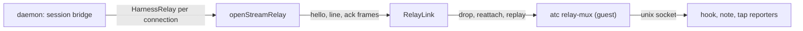

# Remote targets: the contract

- **Status:** draft

The provider contract changes in four places so that a remote host without impd's forward or broker
fits it: a `relay` capability with one shared relay over a byte stream, a tagged union for the
host's credentials, a read of what became of each sleeping harness, and a state folder for each
provider entry. imp and `local-pty` keep their behaviour. [The README](./README.md) holds the
decisions that span the parts.

## Shape



## Contracts

### The relay

A provider whose host offers a byte stream that survives a drop calls `openStreamRelay` in
`spawnHarness`, and passes the daemon's `onRelay` through.

```ts
const relay = openStreamRelay(
  openSpriteRelayLink(api, sprite, { argv: [guest.atc, 'relay-mux', socket] }),
  spec.onRelay,
  { reconnectDelaysMs: [250, 1000, 5000], log },
);

await relay.listening; // the guest listens on `socket`; the harness may start
// → resolves, or rejects when the host lost the mux before it listened
```

```ts
// plugin-api. A provider supplies only the link.
interface RelayLink {
  // starts the guest's `atc relay-mux <socket>`, or attaches the one the host still runs for this link
  open(): Promise<RelayLinkConnection>;
}

interface RelayLinkConnection {
  onData(listener: (data: Uint8Array) => void): void; // may replay stdout from any earlier byte, byte 0 included
  onEnd(listener: (end: 'dropped' | 'lost') => void): void; // lost: the host no longer holds the mux
  write(data: Uint8Array): Promise<void>;
  detach(): void; // lets go and leaves the mux running
}

declare function openStreamRelay(
  link: RelayLink,
  onRelay: (relay: HarnessRelay) => void,
  options: StreamRelayOptions,
): OpenedRelay;

interface OpenedRelay {
  readonly listening: Promise<void>;
  stop(): void; // closes every connection the daemon holds
}

interface StreamRelayOptions {
  readonly reconnectDelaysMs: readonly number[];
  readonly log?: (line: string) => void;
}
```

The frames are one JSON object per line, in a light entry that the guest's `atc relay-mux` loads
without Zod or the protocol contract:

```ts
// protocol, entry `@atc/protocol/relay`
type DaemonFrame =
  | { t: 'hello'; link: string; gen: number; ack: number } // link: new per openStreamRelay call; gen: new per open
  | { t: 'line'; seq: number; conn: number; line: string }
  | { t: 'close'; seq: number; conn: number }
  | { t: 'ack'; ack: number }; // the highest guest seq the daemon applied

type GuestFrame =
  | { t: 'welcome'; link: string; gen: number; ack: number; reset: boolean } // echoes the hello's link and gen
  | { t: 'open'; seq: number; conn: number } // a reporter connected to the socket
  | { t: 'line'; seq: number; conn: number; line: string }
  | { t: 'end'; seq: number; conn: number } // the reporter wrote its last line
  | { t: 'close'; seq: number; conn: number }
  | { t: 'ack'; ack: number };
```

```ts
// plugin-api
interface ExecutionCapabilities {
  // …existing fields
  readonly relay: boolean; // carries HarnessSpec.onRelay; imp true through its forward, local-pty false
}
```

### Credentials

```ts
// daemon, auth. Pure. `overrides` holds the credential and endpoint variables that the agent's
// own config sets, which its adapter finds.
const decision = decideHarnessAuth(selection, provider.credentials ?? { kind: 'none' }, overrides);
// → { kind: 'routed', router }
//   or { kind: 'refused', problem: 'route_required' }
```

```ts
// plugin-api
interface ExecutionProvider {
  // …existing fields, without brokerAuth and rebindChangedAuth
  readonly credentials?: HostCredentials; // absent is { kind: 'none' }
}

type HostCredentials =
  | { kind: 'none' } // the host's own sign-in; an agent whose auth requires the broker is refused
  | { kind: 'broker'; broker: CredentialBroker; rebindChangedAuth: boolean } // imp, today's path moved here
  | { kind: 'routed'; router: CredentialRouter } // Sprites
  | { kind: 'host-sign-in' }; // Docker

interface CredentialRouter {
  readonly hostPrefix: string; // the start of every host name; the router's access policy admits it
  readonly describe: { readonly name: string; readonly upgrade?: string };
  // rejects unless every profile has a route that admits hostPrefix
  verifyRoutes(profiles: readonly AuthProfile[]): Promise<void>;
  // the URL each profile's requests go to, keyed by profile name; the router adds the credential
  readRoutes(profiles: readonly AuthProfile[]): Promise<Readonly<Record<string, string>>>;
}

// daemon, auth
type HarnessAuthDecision =
  | { kind: 'none' }
  | {
      kind: 'refused';
      problem:
        | 'broker_required'
        | 'route_required'
        | 'credential_override'
        | 'auth_on_sign_in_host';
    }
  | { kind: 'broker'; broker: CredentialBroker }
  | { kind: 'routed'; router: CredentialRouter };

declare function decideHarnessAuth(
  selection: AuthSelection | null,
  credentials: HostCredentials,
  overrides: readonly string[],
): HarnessAuthDecision;
```

```ts
// plugin-api, agent-adapter
interface GuestPaths {
  readonly auth?: {
    // …existing fields
    readonly routes?: Readonly<Record<string, string>>; // per profile name; the adapter points its endpoint variable at it
  };
}
```

### What became of a sleeping harness

```ts
const fates = await provider.readHarnessFates?.('k3f9', ['s-1', 's-2']);
// → Map { 's-1' => 'kept', 's-2' => 'lost' }
```

```ts
// plugin-api
interface ExecutionProvider {
  // …existing fields
  // read without waking the host; a session the answer leaves out is 'unknown'
  readonly readHarnessFates?: (
    host: string,
    sessions: readonly string[],
  ) => Promise<ReadonlyMap<string, HarnessFate>>;
}

type HarnessFate = 'kept' | 'lost' | 'unknown'; // lost: the host no longer holds the process, such as after a cold boot

// plugin-api, plugin
interface HostServices {
  // …existing fields
  readonly stateDir: string; // a folder on the daemon's machine that this provider entry alone writes; kept across restarts
}
```

`spawnHarness` keeps its signature. On a remote host it attaches the harness that the host still
runs for `spec.session`, and otherwise starts the spec's argv, which a revive plans as the resume
command. `waitForStart` reports which through `created`.

## Constraints

- A remote spawn on a provider whose `relay` capability is false is refused with
  `unsupported_operation`, problem `no_session_bridge`.
- While the daemon runs and the guest's mux lives, every frame arrives exactly once and in order,
  both ways, across any number of dropped links.
- The daemon discards every byte before the welcome that echoes its own link and gen, so a replay of
  stdout from byte 0 never reaches the bridge twice.
- The daemon writes a newline before each hello, which ends any half line that a cut-off write left
  in the guest's stdin.
- No welcome within 10 seconds counts as a drop.
- A new link, after a daemon restart or a kill and an adopt, resets the guest's numbering. Across
  that reset only:
  - a frame the old link applied but had not acked arrives once more;
  - the unacked tail of a connection whose `open` the old link acked is dropped, and the guest
    closes that connection. Notes come back from the outbox and the tap reconnects; a hook line in
    that tail is lost.
- The mux never closes a connection unread. With 1 MiB of unacked frames held, it stops accepting
  new connections until acks free room.
- Every bridge connection stays open on both sides while a link is down, so the bridge sees only
  lines that arrive late.
- `decideHarnessAuth` refuses:
  - on `none`, an agent whose auth requires the broker, with `broker_required`;
  - on `routed`, an agent with no auth selection, with `route_required`, so no Sprites session signs
    in on the host;
  - on `routed`, an agent whose own config sets a credential or endpoint variable that `overrides`
    lists, with `credential_override`;
  - on `host-sign-in`, every agent with an auth selection, with `auth_on_sign_in_host`.
- A routed launch records no binding, takes no admission, and runs at revision 1. Revoke and rebind
  on a routed host refuse with `unsupported_operation`, problem `routed_auth`.
- `verifyRoutes` runs before anything touches the host, so a refused launch creates no host.
- The target list and the agent list keep `brokerAuth` on the wire, as `credentials` of kind
  `broker` or `routed`, so `@atcx/contract` does not change.
- On restore, and each time the daemon readies a host, the daemon reads the fates of the other
  sleeping sessions on that host. A `lost` session lists as exited with the message of
  `HARNESS_EXIT_TRANSITIONS.ended`, and the fleet row is not rewritten, because the owner never
  asked for the loss.
- A fate read that fails changes nothing: the sessions stay asleep, and the next revive finds out.
- imp declares `relay: true`, `credentials: { kind: 'broker', … }`, and no `readHarnessFates`, and
  otherwise behaves as today.

## Builder decides

- The names and files of internal helpers, the mux's spool layout, and how acks batch.
- The exact reconnect delays, within the 10-second welcome limit.
- The wording of each refusal.
- Whether `openStreamRelay` lives in `@atc/plugin-api` or a package of its own that plugin-api
  re-exports, within the zones in `.oxlintrc.zones.json`.
