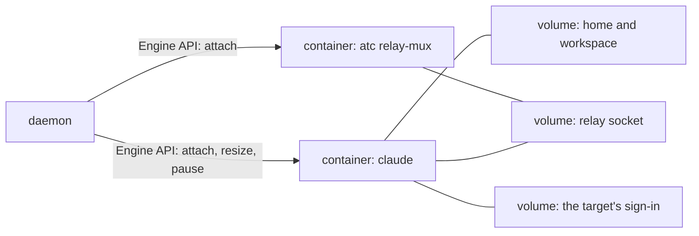

# Remote targets: Docker

- **Status:** draft

The `docker` provider runs sessions in containers on the Docker Engine of the daemon's own machine.
A session's host is a named volume that holds its home folder and workspace, and each harness is the
main process of a container of its own on that volume, because only a container's main process can
be reattached. It builds on [the contract](./contract.md): the relay runs through a sidecar
container's attach, and credentials are the `host-sign-in` kind. A kill pauses the session's
containers.

## Shape



## Contracts

### The target config

```json
{
  "targets": {
    "box": { "provider": "docker", "image": "ghcr.io/example/agents:1.4.0" }
  }
}
```

| Key            | Default                | What it does                                               |
| -------------- | ---------------------- | ---------------------------------------------------------- |
| `image`        | required               | the image every container runs; it must hold the agent CLI |
| `socket`       | `/var/run/docker.sock` | the Engine's unix socket on the daemon's machine           |
| `namePrefix`   | `atc-`                 | the start of every container and volume name               |
| `signInVolume` | `<namePrefix>sign-in`  | the volume that holds the target's one Claude sign-in      |
| `guestDir`     | `/atc`                 | the folder inside each container that atc's files go under |

The target's identity covers `socket`, `namePrefix`, `signInVolume` and `guestDir`. A change to
`image` reaches only new containers.

### The provider's declaration

```ts
// docker provider
return {
  kind: 'docker',
  remote: true,
  capabilities: {
    spawn: true,
    attach: true,
    input: true,
    resize: true,
    kill: true,
    transfer: true,
    run: true,
    headless: false,
    suspend: true,
    destroy: true,
    relay: true,
  },
  credentials: { kind: 'host-sign-in' },
  hostGitIdentity: true,
  readGuest,
  prepareHost,
  checkExistingHost,
  findHostFact,
  spawnHarness,
  transferArchive,
  runCommand,
  writeReadOnlyFile,
  suspendHost,
  destroyHost,
  readHarnessFates,
  dispose,
} satisfies ExecutionProvider;
```

```ts
// docker provider. Adapters: the Engine API over the unix socket, and an in-memory fake for tests.
interface EnginePort {
  readVolume(name: string): Promise<VolumeView | null>;
  createVolume(name: string, labels: Readonly<Record<string, string>>): Promise<VolumeView>;
  removeVolume(name: string): Promise<void>; // a volume already gone counts as removed
  listContainers(labels: Readonly<Record<string, string>>): Promise<readonly ContainerView[]>;
  createContainer(spec: ContainerSpec): Promise<ContainerView>;
  attachContainer(id: string, options: { logs: boolean }): ContainerStream; // stdin, stdout, resize
  pauseContainer(id: string): Promise<void>;
  unpauseContainer(id: string): Promise<void>;
  removeContainer(id: string): Promise<void>; // forced; a container already gone counts as removed
  readImage(ref: string): Promise<{ readonly id: string } | null>;
}

interface ContainerView {
  readonly id: string;
  readonly name: string;
  readonly state: 'created' | 'running' | 'paused' | 'exited' | 'dead';
  readonly labels: Readonly<Record<string, string>>; // holds the session id, the host key and the daemon machine's boot_id at start
}
```

Each harness's container mounts, from the host key's volume, the agent's home at the image user's
home; the relay volume at `<guestDir>/relay`; the daemon's compiled binary read-only at
`<guestDir>/bin/atc`; and the session's record folder from `HostServices.stateDir` read-only at
`<guestDir>/records`.

## How each imp duty maps

| imp does                                     | Docker does                                                                                    | Gap, and what atc does                                                                |
| -------------------------------------------- | ---------------------------------------------------------------------------------------------- | ------------------------------------------------------------------------------------- |
| creates and wakes the host                   | `prepareHost` creates the volume if missing and unpauses the host key's containers             | none                                                                                  |
| sleeps the host on a kill                    | `suspendHost` pauses every container of the host key, sidecars included                        | a reboot of the machine loses the paused processes; `readHarnessFates` reports `lost` |
| reattaches a harness by its impd session     | `attachContainer` on the session's container, with `logs` for the screen                       | none                                                                                  |
| starts a revive in the same VM               | removes the session's exited container and creates one with the resume argv on the same volume | none: the transcript is on the volume                                                 |
| puts a sub-session in its parent's imp       | a sibling container on the parent's volume                                                     | the two processes share the volume and run in separate process namespaces             |
| carries hooks through a reverse unix forward | `openStreamRelay` through the attach of a sidecar whose main process is `atc relay-mux`        | one more container per harness                                                        |
| swaps the credential through its broker      | none: `host-sign-in` credentials                                                               | only agents without `auth` run; the user's Claude sign-in lives in the sign-in volume |
| writes the session record read-only          | `writeReadOnlyFile` writes under `stateDir`, which each container mounts read-only             | none                                                                                  |
| clones the workspace on the host             | none                                                                                           | the daemon clones on its own machine and transfers the result                         |
| runs commands and unpacks archives           | a throwaway container on the host key's volume                                                 | none                                                                                  |

## Constraints

- The provider never pulls an image. A missing `image` makes `prepareHost` refuse with
  `host_unavailable`, problem `image_missing`, with the image reference.
- A volume or container name is `namePrefix` followed by the host key or the session id, and every
  object the provider creates carries the labels `atc.target`, `atc.host` and `atc.session`.
- A host key that already has a volume refuses a spawn, so a spawn never reuses another session's
  files.
- `readHarnessFates` reports `kept` for a running or paused container, and `lost` for a missing
  container or one that stopped without its session's kill, such as after a reboot of the machine or
  a restart of the Engine.
- A Claude session runs in a config folder of its own on the host key's volume, so its transcripts
  never reach another session or outlive a forget.
- A forget removes the host key's containers and volumes, and leaves the sign-in volume.
- A daemon run from source has no compiled binary to mount, so it refuses a Claude spawn, as on imp.
- An Engine that cannot be reached at `socket` makes the target unavailable, with the socket's path
  in the problem.

## Builder decides

- The container user, and the mount path of the agent's home, from the image.
- How the guest launch takes the sign-in into the session's config folder, within the open question
  below.
- The names of internal functions and files, and the error wording.

## Open questions

- **How does the sign-in volume reach each session's own Claude config folder?** A spike in a real
  container settles it. Claude Code replaces `.credentials.json` by rename and rotates the refresh
  token, so a link or a copy per session can break other sessions' sign-in. Until then, the sign-in
  volume holds a `claude setup-token` value in one file, and the guest launch exports it as
  `CLAUDE_CODE_OAUTH_TOKEN`, which Claude Code never refreshes.
- **How does the user fill the sign-in volume?** The owner settles it. Until then, the guide gives
  one `docker run` command that runs `claude setup-token` with the volume mounted.
