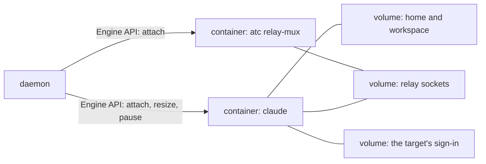

# Remote targets: Docker

- **Status:** draft

The `docker` provider runs Claude sessions in containers on the Docker Engine of the daemon's own
machine, a native Linux Engine. A session's host is a named volume that holds its home folder and
workspace, and each harness is the main process of a container of its own on that volume, because
only a container's main process can be reattached. It builds on [the contract](./contract.md): the
relay runs through a sidecar container's attach, and credentials are the `host-sign-in` kind. A kill
pauses the session's containers.

The provider is `remote: true` although the Engine runs on the daemon's machine, so a harness gets
only atc's variables and none of the daemon's environment.

## Shape



## Contracts

### The target config

```json
{
  "targets": {
    "box": { "provider": "docker", "image": "ghcr.io/example/agents:1.4.0" }
  }
}
```

| Key            | Default                | What it does                                                |
| -------------- | ---------------------- | ----------------------------------------------------------- |
| `image`        | required               | the image every container runs; it must hold the Claude CLI |
| `socket`       | `/var/run/docker.sock` | the Engine's unix socket on the daemon's machine            |
| `namePrefix`   | `atc-`                 | the start of every container and volume name                |
| `signInVolume` | `<namePrefix>sign-in`  | the volume that holds the target's one Claude token         |
| `guestDir`     | `/atc`                 | the folder inside each container that atc's files go under  |

The target's identity covers `socket`, `namePrefix`, `signInVolume` and `guestDir`. A change to
`image` reaches only new containers.

### The provider's declaration

```ts
// docker provider
return {
  kind: 'docker',
  remote: true,
  capabilities: {
    spawn: true,
    attach: true,
    input: true,
    resize: true,
    kill: true,
    transfer: true,
    run: true,
    headless: false,
    suspend: true,
    destroy: true,
    relay: true,
  },
  credentials: { kind: 'host-sign-in' },
  hostGitIdentity: true,
  readGuest,
  prepareHost,
  checkExistingHost,
  spawnHarness,
  transferArchive,
  runCommand,
  writeReadOnlyFile,
  suspendHost,
  destroyHost,
  readHarnessFates,
  dispose,
} satisfies ExecutionProvider;
```

The provider declares no `findHostFact`, because a volume has no id that a new volume under the same
name never shares.

### The objects on the Engine

| Object                      | Name                             | Mounted at                      |
| --------------------------- | -------------------------------- | ------------------------------- |
| the host's volume           | `<namePrefix><host key>`         | the image user's home           |
| the host's relay volume     | `<namePrefix><host key>-relay`   | `<guestDir>/relay`              |
| a harness's container       | `<namePrefix><session id>`       |                                 |
| a harness's relay sidecar   | `<namePrefix><session id>-relay` |                                 |
| the target's sign-in volume | `signInVolume`                   | `<guestDir>/sign-in`, read-only |

Every container also mounts the daemon's compiled binary read-only at `<guestDir>/bin/atc`, and the
host's record folder under `stateDir` read-only at `<guestDir>/records`. Every object carries the
labels `atc.target`, `atc.host`, `atc.session` (a container only), `atc.daemon`, and `atc.boot`, the
daemon machine's `boot_id` when the object was created.

The provider talks to the Engine through a port of its own, with the Engine API over the unix socket
as one adapter and an in-memory fake for tests. The port is internal to the provider, and the
builder gives it the calls the provider needs.

## How each imp duty maps

| imp does                                     | Docker does                                                                                    | Gap, and what atc does                                                                |
| -------------------------------------------- | ---------------------------------------------------------------------------------------------- | ------------------------------------------------------------------------------------- |
| creates and wakes the host                   | `prepareHost` creates the volumes if missing and unpauses the host's containers                | none                                                                                  |
| holds the host with a lease per daemon       | the `atc.daemon` label on every object                                                         | a host whose objects carry another daemon's id refuses with `host_leased`             |
| sleeps the host on a kill                    | `suspendHost` pauses every container of the host, sidecars included                            | a reboot of the machine loses the paused processes; `readHarnessFates` reports `lost` |
| reattaches a harness by its impd session     | an attach to the session's container, with its logs for the screen                             | none                                                                                  |
| starts a revive in the same VM               | removes the session's exited container and creates one with the resume argv on the same volume | none: the transcript is on the volume                                                 |
| puts a sub-session in its parent's imp       | a sibling container on the parent's volume                                                     | the two processes share the volume and run in separate process namespaces             |
| carries hooks through a reverse unix forward | `openStreamRelay` through the attach of a sidecar whose main process is `atc relay-mux`        | one more container per harness                                                        |
| swaps the credential through its broker      | none: `host-sign-in` credentials                                                               | Claude only, under the user's own token from the sign-in volume                       |
| writes the session record read-only          | `writeReadOnlyFile` writes under `stateDir`, which each container mounts read-only             | none                                                                                  |
| clones the workspace on the host             | none                                                                                           | the daemon clones on its own machine and transfers the result                         |
| runs commands and unpacks archives           | a throwaway container of the target's image on the host's volume                               | none                                                                                  |

Each harness gets its own sidecar, so the relay of one harness never waits on the link of another,
and a sub-session's sidecar ends with its own harness.

## Constraints

- The provider never pulls an image. A missing `image` makes `prepareHost` refuse with
  `host_unavailable`, problem `image_missing`, with the image reference.
- An Engine whose `OSType` is not `linux`, or whose architecture differs from the daemon's binary,
  makes the target unavailable, problem `engine_unsupported`.
- An Engine that cannot be reached at `socket` makes the target unavailable, with the socket's path
  in the problem.
- A daemon run from source has no compiled binary to mount, so it refuses every spawn on the target,
  problem `compiled_binary_required`.
- An empty sign-in volume, or one without Claude's `signInFile`, makes `prepareHost` refuse with
  `host_unavailable`, problem `sign_in_missing`, naming the volume.
- The token never appears in a container's `Env`, so `docker inspect` never shows it.
- A Claude session runs in a config folder of its own on the host's volume, so its transcripts never
  reach another session or outlive a forget.
- `readHarnessFates` reports:
  - `kept` for a running or paused container;
  - `lost` for a missing container, or an exited one whose `atc.boot` differs from the machine's
    current `boot_id`;
  - nothing for an exited container whose `atc.boot` matches, because its harness exited, and the
    next attach reports that exit with its code.
- The relay sidecar runs with stdin open and `StdinOnce` false, so a dropped attach never ends the
  mux.
- A forget removes the host's containers and volumes and its folder under `stateDir`, and leaves the
  sign-in volume.

## Builder decides

- The container user, and the home folder's path, from the image.
- How the guest launch reads the token file into Claude's environment, within the token rule above.
- The port's calls and shapes, and how the harness's attach and the sidecar's attach strip the
  Engine's stream headers.
- How CI gets an image that holds the stand-in agent CLIs, and whether its job is required, as
  `project-ci-design` says.
- The names of internal functions and files, and the error wording.

## Open questions

- **Can a session read Claude's own `/login` sign-in from the shared volume?** A spike in a real
  container settles it. Claude Code replaces `.credentials.json` by rename and rotates the refresh
  token, so sessions that share one such file can break each other's sign-in. Until then, the
  sign-in volume holds a `claude setup-token` value in `claude-oauth-token`, and Claude reads it as
  `CLAUDE_CODE_OAUTH_TOKEN`, which Claude Code never refreshes.
- **How does the user fill the sign-in volume?** The owner settles it. Until then, the guide gives
  one `docker run` command that runs `claude setup-token` with the volume mounted, and the user
  writes its output into `claude-oauth-token`.
