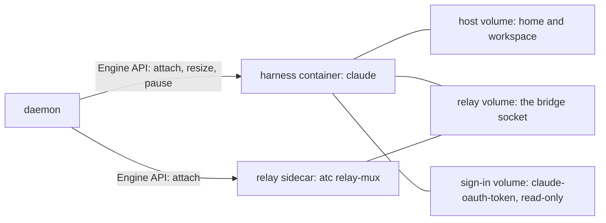

# Remote targets: Docker

- **Status:** draft

The `docker` provider runs Claude sessions in containers on the Docker Engine of the daemon's own
Linux machine. [The README](./README.md#terms) defines the terms this doc uses: host, host key,
harness, kill, revive and forget among them.

- A session's host is a named volume, the host volume, which holds the agent's home folder and the
  workspace.
- Each harness is the main process of a container of its own on that volume, because an Engine can
  reattach only to a container's main process.
- Each harness has a relay sidecar, a second container whose main process is `atc relay-mux`. The
  daemon carries the session bridge over the sidecar's attach, through
  [the relay](./contract.md#the-relay).
- Every session runs under the one Claude token that the user stores in the target's sign-in volume.
  This is the `stored-token` [credentials kind](./contract.md#credentials).
- A kill pauses the session's containers.

The provider declares `remote: true`, so a harness gets only atc's variables and none of the
daemon's environment, as on imp.
[Execution targets](../../architecture/execution/targets.md#starting-a-harness) lists those
variables.

## The containers of one session



## Contracts

### The target config

```json
{
  "targets": {
    "box": { "provider": "docker", "image": "ghcr.io/example/agents:1.4.0" }
  }
}
```

| Key            | Default                | What it does                                                                                                                        |
| -------------- | ---------------------- | ----------------------------------------------------------------------------------------------------------------------------------- |
| `image`        | required               | the image every container runs. It holds the Claude CLI, `sh`, `tar` and glibc, because the daemon's binary is linked against glibc |
| `socket`       | `/var/run/docker.sock` | the Engine's unix socket on the daemon's machine                                                                                    |
| `namePrefix`   | `atc-`                 | the start of every container and volume name                                                                                        |
| `signInVolume` | `<namePrefix>sign-in`  | the volume that holds the target's Claude token                                                                                     |
| `guestDir`     | `/atc`                 | the folder inside each container that atc's mounts go under                                                                         |

A change to `socket`, `namePrefix`, `signInVolume` or `guestDir` makes a new target. The old
target's containers and volumes stay on the Engine, and the user removes them with `docker`. A
change to `image` reaches each container the provider creates after it, a revived harness included.

### The provider's declaration

```ts
// docker provider
return {
  kind: 'docker',
  remote: true,
  capabilities: {
    spawn: true,
    attach: true,
    input: true,
    resize: true,
    kill: true,
    transfer: true,
    run: true,
    headless: false,
    suspend: true,
    destroy: true,
    relay: true,
  },
  credentials: { kind: 'stored-token' },
  hostGitIdentity: true, // a harness commits as the daemon machine's git user, as on imp
  readGuest,
  prepareHost,
  checkExistingHost,
  findHostFact,
  spawnHarness,
  transferArchive,
  runCommand,
  writeReadOnlyFile,
  suspendHost,
  destroyHost,
  readHarnessFates,
  dispose,
} satisfies ExecutionProvider;
```

`spawnHarness` calls `openStreamRelay` with a `RelayLink` whose `open` attaches to the sidecar. When
the sidecar is missing or stopped, `open` creates it first. `findHostFact` reports the host volume's
`atc.host-id` label, which the next section lists, as the host's `id`.

### The objects on the Engine

| Object              | Name                             | Mounted at                          |
| ------------------- | -------------------------------- | ----------------------------------- |
| the host volume     | `<namePrefix><host key>`         | the home folder of the image's user |
| the relay volume    | `<namePrefix><host key>-relay`   | `<guestDir>/relay`                  |
| the sign-in volume  | `signInVolume`                   | `<guestDir>/sign-in`, read-only     |
| a harness container | `<namePrefix><session id>`       |                                     |
| a relay sidecar     | `<namePrefix><session id>-relay` |                                     |

- A harness container mounts all three volumes. A relay sidecar mounts only the relay volume.
- Each container mounts the daemon's compiled binary read-only at `<guestDir>/bin/atc`. A harness
  container mounts the host's records folder read-only at `<guestDir>/records`. That folder is on
  the daemon's machine, under the provider's [state folder](./contract.md#the-state-folder), and
  holds the session records that `writeReadOnlyFile` writes.
- `readGuest` reports a folder on the host volume, `<home>/.atc`, as the guest directory, so the
  files the daemon transfers outlast the container that unpacked them. It reports
  `<guestDir>/sign-in` as `signIn`.
- Each object carries these labels:
  - `atc.target`, the target id;
  - `atc.host`, the host key;
  - `atc.daemon`, the id of the daemon's state folder;
  - `atc.boot`, the `boot_id` of the daemon's machine when the provider created the object;
  - `atc.session`, on a container only;
  - `atc.host-id`, a random id, on a host volume only.
- The provider reaches the Engine through an interface of its own, with the Engine API over the unix
  socket as one adapter and an in-memory fake for tests. The person who builds the provider gives
  that interface the calls the provider needs.

## What Docker does in place of each imp duty

| imp does                                          | Docker does                                                                                          |
| ------------------------------------------------- | ---------------------------------------------------------------------------------------------------- |
| creates and wakes the host                        | `prepareHost` creates the volumes when missing, and unpauses the host's containers                   |
| holds the host for one daemon                     | each object carries `atc.daemon`, which never changes                                                |
| sleeps the host on a kill                         | `suspendHost` pauses every container of the host, sidecars included                                  |
| keeps the harness across a sleep                  | a paused container keeps its process until the machine reboots or the Engine restarts                |
| reattaches to a harness                           | the provider attaches to the harness container, and its logs replay the screen                       |
| starts a revive in the same imp                   | the provider removes the exited container and creates one with the resume command on the same volume |
| runs a sub-session in its parent's imp            | the provider runs a sibling container on the parent's volume, with a sidecar of its own              |
| carries the session bridge through impd's forward | `openStreamRelay` over the sidecar's attach                                                          |
| adds the credential through the broker            | Claude reads the token from the sign-in volume                                                       |
| writes the session record read-only               | `writeReadOnlyFile` writes into the records folder, which each harness container mounts read-only    |
| clones the workspace on the host                  | the daemon clones on its own machine and transfers the result                                        |
| runs commands and unpacks archives                | a throwaway container of the target's image on the host volume                                       |

Each harness has its own sidecar, so the relay of one harness never waits on another's, and a
sub-session's sidecar ends with its harness.

## Constraints

- The provider never pulls an image. When the Engine lacks `image`, `prepareHost` refuses with
  `host_unavailable`, problem `image_missing`, and the image reference.
- `prepareHost` checks the Engine on each call, so a target recovers when the Engine comes back:
  - when the Engine does not answer at `socket`, it refuses with `host_unavailable`, problem
    `engine_unreachable`, and the socket's path;
  - when the Engine's `OSType` is not `linux`, or its architecture differs from the daemon's binary,
    it refuses with `host_unavailable`, problem `engine_unsupported`.
- Each container runs the daemon's compiled binary. So when the daemon runs from source, the
  provider's `create` throws `TargetUnavailableError` with problem `compiled_binary_required`, and
  the target lists as unavailable.
- When the sign-in volume is missing, or holds no `claude-oauth-token`, `prepareHost` refuses with
  `host_unavailable`, problem `sign_in_missing`, and the volume's name.
- The provider refuses to act on an object whose `atc.daemon` differs from its own daemon's, with
  `host_unavailable`, problem `host_leased`. The refusal covers a forget too.
- When an object of the host's name exists without this target's `atc.target` and `atc.host`,
  `prepareHost` refuses with `host_unavailable`, problem `host_exists`. An object with both labels
  is the host, so a retried spawn finds its own host.
- The provider never puts the token in a container's `Env`, so `docker inspect` never shows it. The
  launch reads the token file inside the container, as
  [the stored-token rule](./contract.md#credentials-1) says.
- Each Claude session runs with a `CLAUDE_CONFIG_DIR` of its own on the host volume. The launch
  seeds that folder as Claude's launch on imp does, so the session's transcripts never reach another
  session, and a forget removes them.
- `readHarnessFates` reports:
  - `kept` for a running or paused container;
  - `lost` for a missing container, or an exited one whose `atc.boot` differs from the machine's
    current `boot_id`;
  - nothing for an exited container whose `atc.boot` matches, because its harness exited by itself.
- `spawnHarness` removes an exited harness container and starts the resume command in a new one, and
  reports that it started the harness, not attached to it.
- When a sidecar has stopped and its harness container runs, the next `open` creates a new sidecar
  with `replace: true`. The relay then follows [the reset rules](./contract.md#the-relay-1).
- Each sidecar runs with stdin open and `StdinOnce` false, so a dropped attach never ends the mux.
- A forget removes the host's containers, its volumes and its records folder, and leaves the sign-in
  volume.

## Builder decides

- The image's user and its home folder, from the image's config.
- How the guest launch reads the token file into Claude's environment, within the stored-token rule.
- The Engine calls, their shapes, and how each attach takes apart the Engine's multiplexed stream.
- How CI gets an image that holds the stand-in agent CLIs, and whether its job is required, within
  the [project-ci-design](../../../.agents/skills/project-ci-design/SKILL.md) skill.
- The names of internal functions and files, and the error wording.

## Open questions

- **Can sessions share Claude's own `/login` sign-in from the sign-in volume?** A spike in a real
  container settles it. Claude Code replaces `.credentials.json` by rename and rotates its refresh
  token, so sessions that share one such file can break each other's sign-in. Until then, the volume
  holds a `claude setup-token` value in `claude-oauth-token`, and Claude reads it as
  `CLAUDE_CODE_OAUTH_TOKEN`, which Claude Code never refreshes.
- **How does the user fill the sign-in volume?** The owner, who approves this design, settles it.
  Until then, the Docker provider's user guide gives one `docker run` command that runs
  `claude setup-token` with the volume mounted, and the user writes its output into
  `claude-oauth-token`.
