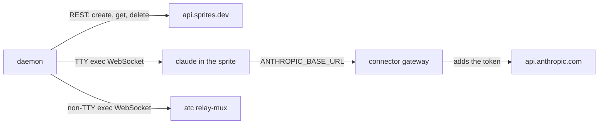

# Remote targets: Sprites

- **Status:** draft
- **Decision records:** [0001](../../decisions/0001-sprites-credentials-through-connectors.md)

The `sprites` provider runs each top-level session in a sprite of its own, a persistent Linux VM on
Fly.io that sleeps when no client is attached and wakes on the next exec. It builds on
[the contract](./contract.md): the relay runs over a non-TTY exec, and credentials come through
Sprites connectors as the `routed` kind. A kill detaches the session's execs and lets the sprite
sleep with the harness frozen inside.

## Shape



## Contracts

### The target config

```json
{
  "targets": {
    "sprites": { "provider": "sprites", "tokenEnv": "SPRITES_TOKEN", "spritePrefix": "atc-" }
  },
  "authProfiles": {
    "claude-sprites": {
      "secret": "conn_example_claude",
      "host": "api.anthropic.com",
      "header": "authorization",
      "scheme": "bearer"
    }
  },
  "agents": { "claude": { "auth": { "profiles": ["claude-sprites"] } } }
}
```

| Key            | Default                   | What it does                                                                      |
| -------------- | ------------------------- | --------------------------------------------------------------------------------- |
| `tokenEnv`     | unset                     | the daemon's variable that holds the org token, in the form `<org>/<id>/<secret>` |
| `tokenFile`    | unset                     | the file that holds the org token                                                 |
| `spritePrefix` | `atc-`                    | the start of every sprite name, and the prefix each connector's policy must admit |
| `apiURL`       | `https://api.sprites.dev` | the Sprites API                                                                   |
| `guestDir`     | the provider's own        | the folder inside each sprite that atc's files go under                           |

An auth profile on a Sprites target names a connector id in `secret`, the field that names an impd
secret on an imp target, so one profile schema serves both. The target's identity covers `tokenEnv`,
`tokenFile`, `spritePrefix`, `apiURL` and `guestDir`.

### The provider's declaration

```ts
// sprites provider
return {
  kind: 'sprites',
  remote: true,
  capabilities: {
    spawn: true,
    attach: true,
    input: true,
    resize: true,
    kill: true,
    transfer: true,
    run: true,
    headless: false,
    suspend: true,
    destroy: true,
    relay: true,
  },
  credentials: { kind: 'routed', router: createConnectorRouter(api, spritePrefix) },
  hostGitIdentity: true,
  readGuest,
  prepareHost,
  checkExistingHost,
  findHostFact,
  spawnHarness,
  transferArchive,
  runCommand,
  suspendHost,
  destroyHost,
  readHarnessFates,
  dispose,
} satisfies ExecutionProvider;
```

```ts
// sprites provider. Adapters: the REST and WebSocket API through @fly/sprites, and an in-memory fake for tests.
interface SpritesPort {
  readSprite(name: string): Promise<SpriteView | null>;
  createSprite(name: string): Promise<SpriteView>;
  deleteSprite(name: string): Promise<void>; // a sprite already gone counts as deleted
  listExecs(name: string): Promise<readonly ExecView[]>;
  openExec(name: string, request: ExecRequest): ExecConnection; // a start, or an attach by request.execID
  readConnectors(): Promise<readonly ConnectorView[]>;
  readFile(name: string, path: string): Promise<Uint8Array | null>;
  writeFile(name: string, path: string, content: Uint8Array, mode: number): Promise<void>;
}

interface SpriteView {
  readonly id: string; // a sprite made again under the same name gets a new id
  readonly name: string;
  readonly status: 'cold' | 'warm' | 'running'; // a hint only: it changes while a client is attached
}

interface ConnectorView {
  readonly id: string;
  readonly provider: string; // 'custom_api' for an Anthropic route
  readonly namePrefix: string | null; // access_policy.name_prefix; null admits no sprite
}
```

The router's route for a profile is `<apiURL>/v1/gateway/<provider>/<secret>`. The Claude adapter
sets `ANTHROPIC_BASE_URL` to it and `ANTHROPIC_AUTH_TOKEN` to `broker-placeholder`, and the gateway
replaces the placeholder `authorization` header with the stored token.

## How each imp duty maps

| imp does                                            | Sprites does                                                                                      | Gap, and what atc does                                                                                             |
| --------------------------------------------------- | ------------------------------------------------------------------------------------------------- | ------------------------------------------------------------------------------------------------------------------ |
| creates and wakes the host, holds it with a lease   | `prepareHost` creates or reads the sprite; any exec wakes it; an attached exec keeps it awake     | no lease: another client attached to the sprite keeps it awake, and the daemon cannot see that client              |
| sleeps the host on a kill                           | `suspendHost` detaches every exec of the host, the relay's included; the sprite sleeps on its own | no sleep call: the session lists asleep when the detach ends, about 10 to 30 seconds before the sprite sleeps      |
| keeps the harness in memory across a sleep          | a warm sprite freezes the process and resumes it with the same pid                                | a cold sprite can drop memory; `readHarnessFates` reports `lost` and an adopt resumes from the transcript          |
| reattaches a harness by its impd session            | a TTY exec per harness, found by the exec id the provider records on the sprite's disk            | none: a TTY reattach replays the screen                                                                            |
| carries hooks through a reverse unix forward        | `openStreamRelay` over a non-TTY exec of `atc relay-mux` with `max_run_after_disconnect`          | none                                                                                                               |
| swaps the credential through its broker             | a connector gateway adds it; `routed` credentials                                                 | no revoke or rebind in atc: the owner changes access in the connector's policy                                     |
| writes the session record read-only                 | none                                                                                              | the record takes the 0444 fallback, which the agent's user can overwrite                                           |
| clones the workspace on the host                    | none: the GitHub connector serves the API, not git                                                | the daemon clones on its own machine and transfers the result                                                      |
| runs the image's atc or uploads the daemon's binary | `writeFile` uploads the compiled daemon binary into the guest folder                              | a daemon run from source refuses every spawn, problem `compiled_binary_required`, since the relay needs the binary |

## Constraints

- A sprite's name is `spritePrefix` followed by the host key.
- `verifyRoutes` reads the connectors once per launch and refuses with `auth_target_unsupported`,
  problem `route_missing`, when a profile's connector is missing or its `namePrefix` does not start
  `spritePrefix`.
- A `prepareHost` with `isNew` refuses with `host_unavailable`, problem `host_exists`, when a sprite
  already has the name, so a spawn never reuses another session's sprite.
- v1 runs Claude only. Any other agent has no route and is refused with `route_required`.
- The provider records each harness's exec id and the sprite's `boot_id` in the guest folder. A
  start whose recorded `boot_id` differs from the sprite's current one finds the harness lost and
  starts the spec's argv.
- `readHarnessFates` answers `unknown` for a sprite whose `status` is not `running`, until a
  measurement shows that listing execs leaves a sleeping sprite asleep. Until then, a sleeping
  sprite's lost harness shows only when an adopt finds it gone.
- `suspendHost` keeps no exec open on the host after it resolves.
- A forget deletes the sprite, which ends every exec on it.
- A Sprites API error reaches the caller as `host_unavailable` with the API's status and message,
  and never with the token.
- A token that is unset, empty or unreadable makes the target unavailable, with the variable's name
  or the file's path in the problem.
- The org's limits (100 running sprites, 10 creations a minute on pay-as-you-go) reach a spawn as
  `host_unavailable` with the API's message.

## Builder decides

- The guest folder's default path, and where the exec and boot records live in it.
- How the provider replays the relay's stdout: from byte 0 through `@fly/sprites`, or from an offset
  through the `output_offset` query parameter.
- The names of internal functions and files, and the error wording.

## Open questions

- **When does a cold sprite drop its memory?** A measurement settles it: a sprite listed `cold` for
  25 minutes still held its process. Until then, the provider assumes no time and trusts only the
  `boot_id`.
- **Does listing a sleeping sprite's execs wake it?** A measurement settles it. Until then,
  `readHarnessFates` answers `unknown` for a sleeping sprite.
