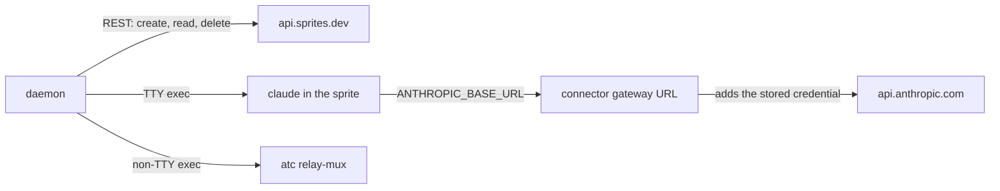

# Remote targets: Sprites

- **Status:** agreed
- **Decision records:** [0001](../../decisions/0001-sprites-credentials-through-connectors.md)

The `sprites` provider runs each top-level session in a sprite of its own.
[The README](./README.md#terms) defines atc's terms, such as top-level session, harness, host key,
imp, revive and session bridge.

A sprite is a persistent Linux VM on [Fly.io Sprites](https://docs.fly.io/sprites). It sleeps when
no client is attached, and wakes when a client runs a command in it. Sprites calls each such command
an exec. An exec can be a terminal (TTY) or a plain byte stream.

- Each harness runs in a TTY exec, which the daemon attaches to again by its exec id.
- The daemon carries the session bridge through [the relay](./contract.md#the-relay), over a non-TTY
  exec of `atc relay-mux`.
- Each Claude request goes through a Sprites connector. The user creates the connector in Sprites
  and stores the credential in it, and Sprites adds the credential to the request outside the
  sprite. This is the `routed` [credentials kind](./contract.md#credentials), and
  [0001](../../decisions/0001-sprites-credentials-through-connectors.md) gives the reasons.
- A kill detaches the daemon from every exec of the session, and the sprite goes to sleep with the
  harness frozen inside.

## How a session reaches its sprite



## Contracts

### The target config

```json
{
  "targets": {
    "sprites": { "provider": "sprites", "tokenEnv": "SPRITES_TOKEN", "spritePrefix": "atc-" }
  },
  "authProfiles": {
    "claude-sprites": {
      "secret": "conn_example_claude",
      "host": "api.anthropic.com",
      "header": "authorization",
      "scheme": "bearer"
    }
  },
  "agents": { "claude": { "auth": { "profiles": ["claude-sprites"] } } }
}
```

| Key            | Default                   | What it does                                                                                               |
| -------------- | ------------------------- | ---------------------------------------------------------------------------------------------------------- |
| `tokenEnv`     | unset                     | the environment variable of the daemon that holds the Sprites org token, in the form `<org>/<id>/<secret>` |
| `tokenFile`    | unset                     | the file that holds the org token                                                                          |
| `spritePrefix` | `atc-`                    | the start of every sprite name; it is the router's `hostPrefix`                                            |
| `apiURL`       | `https://api.sprites.dev` | the Sprites API                                                                                            |
| `guestDir`     | a path the builder picks  | the folder inside each sprite that atc's files go under                                                    |

- A target sets exactly one of `tokenEnv` and `tokenFile`. A config with both or neither is an
  error.
- An auth profile on a Sprites target holds a connector id in `secret`, the field that holds an impd
  secret's name on an imp target, so one profile schema serves both. The router reads only `secret`.
  The profile's `host`, `header` and `scheme` stay as the schema needs them, and the connector's own
  settings decide the header.
- A change to `tokenEnv`, `tokenFile`, `spritePrefix`, `apiURL` or `guestDir` makes a new target.
  The old target's sprites stay in the Sprites org, and the user deletes them with the `sprite` CLI.

### The provider's declaration

```ts
// sprites provider
return {
  kind: 'sprites',
  remote: true,
  capabilities: {
    spawn: true,
    attach: true,
    input: true,
    resize: true,
    kill: true,
    transfer: true,
    run: true,
    headless: false,
    suspend: true,
    destroy: true,
    relay: true,
  },
  credentials: { kind: 'routed', router: createConnectorRouter(api, spritePrefix) }, // the router's verifyRoutes reads the connectors
  hostGitIdentity: true, // a harness commits as the daemon machine's git user, as on imp
  readGuest,
  prepareHost,
  checkExistingHost,
  findHostFact,
  spawnHarness,
  transferArchive,
  runCommand,
  suspendHost,
  destroyHost,
  readHarnessFates,
  dispose,
} satisfies ExecutionProvider;
```

`spawnHarness` calls `openStreamRelay` with a `RelayLink` whose `open` starts the mux as a non-TTY
exec. The exec sets `max_run_after_disconnect` to no limit, so the mux outlives every dropped
WebSocket. When the link attaches to that exec again, Sprites replays its stdout from byte 0, and
`openStreamRelay` discards the bytes before its own welcome.

```ts
// sprites provider. Adapters: the REST and WebSocket API through @fly/sprites, and an in-memory fake for tests.
interface SpritesPort {
  readSprite(name: string): Promise<SpriteView | null>;
  createSprite(name: string): Promise<SpriteView>;
  deleteSprite(name: string): Promise<void>; // a sprite already gone counts as deleted
  listExecs(name: string): Promise<readonly ExecView[]>;
  openExec(name: string, request: ExecRequest): ExecConnection; // starts an exec, or attaches to request.execID
  readConnectors(): Promise<readonly ConnectorView[]>;
  readFile(name: string, path: string): Promise<Uint8Array | null>;
  writeFile(name: string, path: string, content: Uint8Array, mode: number): Promise<void>;
}

interface SpriteView {
  readonly id: string; // a sprite made again under the same name gets a new id; findHostFact reports it
  readonly name: string;
  // 'running' while a client is attached; 'warm' and 'cold' are asleep, and the two flap
  readonly status: 'cold' | 'warm' | 'running';
}

interface ConnectorView {
  readonly id: string;
  readonly provider: string; // the connector's kind: 'custom_api' for an Anthropic route
  readonly namePrefix: string | null; // access_policy.name_prefix; Sprites admits a sprite whose name starts with it; null admits none
}
```

The route for a profile is `<apiURL>/v1/gateway/<connector provider>/<connector id>`, where the
connector's `provider` and `id` come from the `ConnectorView` whose id is the profile's `secret`.
The Claude adapter sets `ANTHROPIC_BASE_URL` to the route and `ANTHROPIC_AUTH_TOKEN` to
`broker-placeholder`. The gateway replaces that placeholder `authorization` header with the stored
credential.

## What Sprites does in place of each imp duty

| imp does                                          | Sprites does                                                                                                                 | What atc gives up                                                                                                   |
| ------------------------------------------------- | ---------------------------------------------------------------------------------------------------------------------------- | ------------------------------------------------------------------------------------------------------------------- |
| creates and wakes the host                        | `prepareHost` creates or reads the sprite, and any exec wakes it                                                             | nothing                                                                                                             |
| holds the host awake for one daemon               | an attached exec keeps the sprite awake                                                                                      | the daemon cannot see another client that keeps the sprite awake                                                    |
| sleeps the host on a kill                         | `suspendHost` detaches from every exec of the host, the relay's included                                                     | a sleep on request: the sprite sleeps about 10 seconds after the last detach, as measured by hand                   |
| keeps the harness across a sleep                  | a sleeping sprite freezes the process and resumes it with the same pid                                                       | the harness of a sprite that drops its memory; a revive then starts the resume command                              |
| reattaches to a harness                           | the provider attaches to the harness's TTY exec by the exec id it records in the sprite, and Sprites replays the screen      | nothing                                                                                                             |
| carries the session bridge through impd's forward | `openStreamRelay` over a non-TTY exec of `atc relay-mux`                                                                     | nothing                                                                                                             |
| adds the credential through the broker            | a connector gateway adds it                                                                                                  | revoke and rebind in atc; the owner changes the connector's access policy in Sprites                                |
| writes the session record read-only               | the daemon writes the record with mode 0444                                                                                  | a record the agent cannot change: the agent's user owns the file, so the agent can change its mode and overwrite it |
| clones the workspace on the host                  | the daemon clones on its own machine and transfers the result, because the GitHub connector serves the GitHub API and no git | nothing                                                                                                             |
| starts the atc binary that the imp's image holds  | `writeFile` uploads the daemon's compiled binary into the guest folder                                                       | nothing                                                                                                             |

## Constraints

- A sprite's name is `spritePrefix` followed by the host key.
- When the provider creates a sprite, it writes a host record into the guest folder: the target id,
  the host key and the id of the daemon's state folder. When a sprite of the name exists without a
  matching record, `prepareHost` refuses with `host_unavailable`, problem `host_exists`. A sprite
  with a matching record is the host, so a retried spawn finds its own host.
- `verifyRoutes` reads the connectors once per spawn and per revive. It refuses with
  `auth_target_unsupported`, problem `route_missing`, when a profile's connector is missing, when
  its `namePrefix` is null, or when `spritePrefix` does not start with its `namePrefix`.
- An agent other than Claude has no route, and `decideHarnessAuth` refuses it with
  `auth_target_unsupported`, problem `route_required`.
- Each sprite runs the daemon's compiled binary. So when the daemon runs from source, the provider's
  `create` throws `TargetUnavailableError` with problem `compiled_binary_required`, and the target
  lists as unavailable.
- The provider records each harness's exec id and the sprite's `boot_id` in the guest folder. When
  `spawnHarness` finds a recorded `boot_id` that differs from the sprite's current one, the harness
  is lost, and `spawnHarness` starts the resume command.
- `readHarnessFates` answers only for a sprite whose `status` is `running`, because a client is
  attached to it and a read cannot wake it. It leaves every other sprite's sessions `unknown`. A
  sleeping sprite's lost harness shows when a revive finds it gone.
- `suspendHost` leaves no exec attached on the host when it resolves.
- A forget deletes the sprite, which ends every exec on it.
- A Sprites API error reaches the caller as `host_unavailable` with the API's status and message,
  and never with the token.
- When the token is unset, empty or unreadable, the target lists as unavailable, with the variable's
  name or the file's path in the problem.
- A spawn past one of the org's limits in Sprites, such as its count of running sprites, is refused
  with `host_unavailable` and the API's message.

## Builder decides

- The guest folder's default path, and where the host record, the exec ids and the `boot_id` live in
  it.
- How the provider replays the relay's stdout: from byte 0 through `@fly/sprites`, or from an offset
  through the `output_offset` query parameter.
- The names of internal functions and files, and the error wording.

## Open questions

- **When does a sleeping sprite drop its memory?** A measurement settles it. One sprite listed
  `cold` for 25 minutes still held its process. Until then, the provider trusts only the `boot_id`,
  whatever time has passed.
- **Does listing a sleeping sprite's execs wake it?** A measurement settles it. Until then,
  `readHarnessFates` leaves a sleeping sprite's sessions `unknown`.
