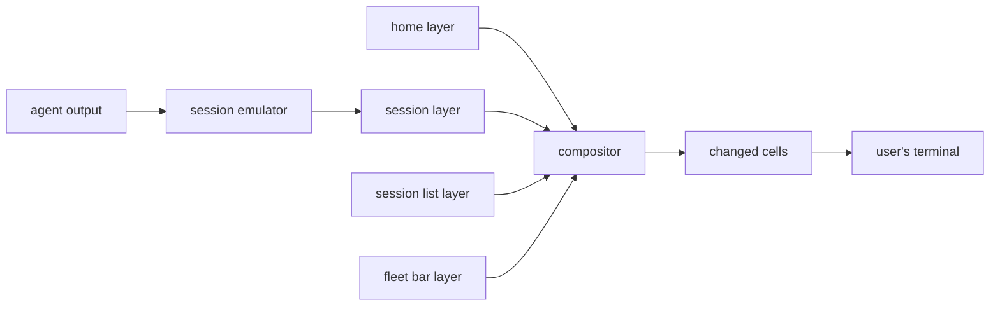

# TUI redesign

- **Status:** draft
- **Decision records:**
  [the TUI composites attached sessions](../../decisions/0003-the-tui-composites-attached-sessions.md)

This design changes how the atc TUI draws. The TUI draws every screen into a grid of cells and
writes only the cells that change. The session the user is attached to, the one whose agent they see
and type into, is drawn the same way: the TUI runs its output through a terminal emulator of its
own. Over that session, a compositor stacks:

- the session list, a see-through panel that dims what is behind it;
- the fleet bar, which owns the terminal's last row and shows every session's state.

The design also covers home, the screen with no session attached, and the place on each session:
where its agent runs, such as one imp service (atc's remote machine provider) or the user's own
machine.

## Shape

The bottom layer is the session when one is attached, else home.

| Doc                               | Owns                                                                               |
| --------------------------------- | ---------------------------------------------------------------------------------- |
| [Compositor](./compositor.md)     | the cell grid, layers, the session emulator, writing changed cells, colour, motion |
| [Home](./home.md)                 | the home screen and the wordmark sizes                                             |
| [Session list](./session-list.md) | the panel, rows, grouping, jump mode, keys, ending a session                       |
| [Fleet bar](./fleet-bar.md)       | the reserved last row and what it shows                                            |
| [Places](./places.md)             | the place on each session, and how places merge across daemons                     |

## Decisions

- **The TUI runs the attached session through its own emulator and draws the result.** See
  [the TUI composites attached sessions](../../decisions/0003-the-tui-composites-attached-sessions.md).
- **atc uses no TUI framework.** The compositor is written by hand, and the `hand-rolled-tui` lint
  rule refuses a framework import.
- **atc paints no background of its own.** Home and every empty cell use the terminal's background
  (`ESC[49m`), so the user's theme or a transparent window shows through. The session list's panel
  and its dimming blend toward that background, and the
  [compositor's Colour section](./compositor.md#colour) gives the rules.
- **`"animations": false`, a top-level config key that defaults to `true`, turns off decorative
  motion,** which is the session list's open and close. Spinners show state, so they keep turning.
- **The list and the fleet bar can group by place.** A target is one daemon's configured route to a
  place, so when two daemons reach the same imp service, the list shows one place for both.
  [Places](./places.md) gives the rules.

## Out of scope

- Colours chosen for light terminals. The foreground colours in this design are chosen to read on a
  dark background.
- Mouse support in the session list. The TUI sends mouse input to the attached session only.
