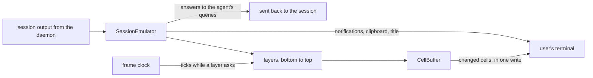

# Compositor

- **Status:** draft
- **Decision records:**
  [the TUI composites attached sessions](../../decisions/0003-the-tui-composites-attached-sessions.md)

The compositor draws every screen of the TUI as a stack of layers in one grid of cells, then writes
to the user's terminal only the cells that changed since the last frame. The attached session is the
bottom layer: the TUI feeds the session's output to a terminal emulator of its own, and the layer
copies that emulator's screen. [Home](./home.md), the [session list](./session-list.md), the
[fleet bar](./fleet-bar.md), help, the picker that starts a new session and every prompt are layers
too.

In this doc, a frame is one pass of drawing every layer and writing the changed cells. To dim a cell
is to blend its colours toward the terminal's background, as the session list does to the layers
below it.

## Shape



## Contracts

```ts
const frame = compositor.compose([sessionLayer, listLayer, barLayer]);
compositor.flush(frame);
// writes: ESC[?2026h, cursor moves and SGR runs for the changed cells only, ESC[?2026l
```

```ts
// tui module: compositor
interface Cell {
  ch: string; // one grapheme; a grapheme of width 2 puts '' in the cell after it
  fg: Colour;
  bg: Colour;
  bold: boolean;
  dim: boolean;
  italic: boolean;
  underline: 'none' | 'single' | 'double' | 'curly';
  strikethrough: boolean;
  inverse: boolean; // applied before a dim, so the dim blends the swapped colours
  link: string | null; // OSC 8 target; flush opens and closes links around runs of cells
}

type Colour =
  | { kind: 'default' } // the terminal's own colour: ESC[39m / ESC[49m
  | { kind: 'rgb'; r: number; g: number; b: number }
  | { kind: 'palette'; index: number }; // 0-255, as the agent sent it

interface Layer {
  // Draws into the buffer over the layers below it, and may read those cells to dim them.
  draw(buffer: CellBuffer, frame: FrameInfo): void;
  nextFrameAt(now: number): number | null; // when this layer next needs a frame: now + 16 while it animates, the next spinner step, or null
}

interface FrameInfo {
  now: number; // ms, from the clock that the TUI's entry passes in, so tests can use a fake one
  cols: number;
  rows: number;
  terminal: TerminalFacts;
}

interface TerminalFacts {
  depth: 'truecolor' | '256' | '16';
  background: RGB; // OSC 11 answer, else #0d1117
  foreground: RGB; // OSC 10 answer, else #c9d1d9
  kittyKeyboard: boolean; // the terminal answered CSI ? u at start
}
```

```ts
// tui module: session emulator. Adapter: @xterm/headless.
interface SessionEmulator {
  write(data: string): Promise<void>; // SessionOutput bytes, in order; resolves once parsed
  resize(cols: number, rows: number): void; // follows the PTY's size from SessionResized
  readCell(col: number, row: number): Cell;
  readCursor(): { col: number; row: number; visible: boolean; shape: CursorShape };
  readInputModes(): InputModes;
  onReply(listener: (bytes: string) => void): void; // answers to the agent's queries
  onPassthrough(listener: (sequence: string) => void): void;
}

// core module: input modes, tracked in one place for the TUI and for the daemon's own emulator of each session
const tracker = createInputModeTracker();
tracker.write('\u001B[>1u\u001B[?2004h'); // the session's output, in order
tracker.read(); // → { …, bracketedPaste: true, kittyStack: [1] }

interface InputModes {
  mouse: 'off' | 'click' | 'drag' | 'any';
  mouseEncoding: 'default' | 'sgr' | 'urxvt';
  alternateScroll: boolean; // mode 1007
  bracketedPaste: boolean;
  focusEvents: boolean;
  applicationCursorKeys: boolean; // DECCKM, CSI ? 1 h: arrow keys send ESC O A in place of ESC [ A
  applicationKeypad: boolean; // DECKPAM, ESC =: the keypad sends application sequences
  kittyStack: readonly number[]; // the kitty keyboard stack, last entry current; a full replay re-creates it with one push per entry
  modifyOtherKeys: 0 | 1 | 2;
  colourSchemeUpdates: boolean; // mode 2031
}
```

```ts
// @atcx/contract: session.attach gains an input field, and the daemon events gain SessionReplay
const attached = await client.procedures.session.attach({
  session: 'sess_8f2',
  cols: 120,
  rows: 39,
  replay: 'full',
});
// then, before any SessionOutput with a later seq:
// { ev: 'SessionReplay', sessionID: 'sess_8f2', seq: 4102, data: '…', done: false }
// { ev: 'SessionReplay', sessionID: 'sess_8f2', seq: 4102, data: '…', done: true }

// session.attach input, …existing fields
replay: z.enum(['screen', 'full']).optional(); // default 'screen': the visible screen, sent as SessionOutput, as now

// daemon event, sent only to a client that attached with replay: 'full'
z.object({
  ev: z.literal('SessionReplay'),
  sessionID: z.string(),
  seq: z.number(), // the output seq the replay is current to
  data: z.string(), // one chunk of the daemon emulator's full serialised state: both buffers, the active one, the cursor, the scroll region and every input mode
  done: z.boolean(), // true on the last chunk
});
```

```jsonc
// atc config file, top level
{
  "animations": true, // false: every transition is instant and nothing decorative moves
}
```

## Constraints

### Output

- The TUI reports `rows - 1` rows as its size when it attaches and on each resize, and keeps the
  last row for the fleet bar. The daemon sizes the PTY to the smallest size its attached clients
  report.
- The emulator takes its first size from the daemon's answer to the attach, then follows each
  `SessionResized` event. When the PTY is smaller than the window, the session layer sits at the top
  left, and the cells outside it stay at the default background.
- The TUI attaches with `replay: 'full'`. On attach, and after each `SessionDesync` event, which the
  daemon sends when the client missed output, the daemon sends a full replay as `SessionReplay`
  chunks.
- On a replay's first chunk, the TUI fully resets its emulator. It writes every chunk in order, and
  draws the session layer again only after the chunk with `done: true`. Then it writes each
  `SessionOutput` whose `seq` is greater than the replay's `seq`, and drops the rest.
- `full-replay` is a daemon feature in `DAEMON_FEATURES`, and `replay` is its feature input field in
  `FEATURE_INPUT_FIELDS`. The TUI sends `replay: 'full'` only to a daemon that lists the feature.
- A daemon without the `full-replay` feature sends the `screen` replay as output. The TUI then holds
  only the visible screen: when the agent leaves the alternate screen, the main screen shows blank
  until the agent redraws it.
- While the session has focus, `flush` puts the user's terminal cursor where the emulator's cursor
  is, with its shape and visibility. While another layer has focus, the cursor is hidden.
- The TUI writes to the user's terminal only through `flush`.
- The one exception is the sequences it passes on from the session, which it writes between frames.
- Each `flush` is one write wrapped in synchronized output (`ESC[?2026h` … `ESC[?2026l`). A terminal
  that ignores mode 2026 still shows a correct frame.
- The TUI waits for the emulator's `write` to resolve before it reads cells. The next frame draws
  all output whose `write` resolved before that frame started.

### Sequences from the session

- The emulator answers the queries it models, such as cursor position and device attributes, and the
  TUI sends each answer to the session with `session.input`. The agent gets one answer from each
  attached TUI.
- The TUI answers OSC 10 and OSC 11, which ask for the terminal's foreground and background colours,
  with the colours in `TerminalFacts`. It answers a kitty keyboard query (`CSI ? u`) with the
  session's current flags when `kittyKeyboard` is true, and sends no answer when it is false.
- The TUI passes on to the user's terminal OSC 52 (clipboard), OSC 0 and OSC 2 (window title), OSC 9
  and OSC 777 (desktop notifications) and the bell. The session list's `y` and `Y` keys, which copy
  a resume command, also write their OSC 52 between frames.
- The TUI turns OSC 8 hyperlinks into the `link` of the cells they cover.
- The TUI drops every other sequence that the emulator does not draw, among them OSC 7, OSC 133 and
  image protocols.

### Input

- While the session has focus, the user's terminal runs with the session's input modes. The TUI sets
  a changed mode before the next key reaches the session.
- While another layer has focus, the user's terminal runs with the TUI's own modes: no mouse
  reporting, no bracketed paste, no focus events, normal cursor keys (`CSI ? 1 l`), the normal
  keypad (`ESC >`) and no kitty keyboard flags. The session's modes come back when the session has
  focus again.
- The TUI sets the session's kitty flags on the user's terminal with `CSI = <flags> u`, never with a
  push, and sets them to 0 when the session loses focus. The user's terminal then holds no stack
  entry that the TUI would have to pop.
- With `kittyKeyboard` false, the TUI sends the user's terminal no kitty sequence.
- A key the TUI does not claim reaches the session byte for byte.
- The TUI claims the leader key, the key that opens the session list. It matches the leader in its
  plain, modifyOtherKeys and kitty encodings, under every kitty flag a session can set, including
  the forms that add event types and associated text.
- Mouse input reaches the session only while it has focus, only inside the PTY's area, and never in
  the fleet bar's row.

### Colour

- Colour depth comes from `COLORTERM` (`truecolor` or `24bit` gives truecolor), then `TERM`
  (`*-256color` gives 256), else 16. When it writes a cell, `flush` quantises an `rgb` colour, and a
  palette index above the depth, to the nearest colour the depth has.
- To dim a cell, the TUI first applies `inverse`, then resolves each colour to RGB: `default` from
  `TerminalFacts`, and a palette index from the standard xterm palette.
- A cell whose background is `default` keeps it when dimmed, and only its foreground is blended, so
  a transparent terminal stays transparent.
- At 16 colours, a dimmed cell keeps its colours and gains SGR dim, and the session list's panel
  draws on the default background.
- At start, the TUI asks the user's terminal for OSC 10, OSC 11 and `CSI ? u`. It draws the first
  frame at once with the fallback `TerminalFacts`, and redraws with the answers as they arrive.
  After 150 ms it stops waiting, and keeps the fallback for each question with no answer.
- The TUI's input reader takes the answers out of the input stream, so an answer never reaches the
  session as keys, even one that arrives after 150 ms.

### Motion

- After each frame, the frame clock asks every layer for `nextFrameAt` and schedules the next frame
  at the earliest answer. When every layer answers null, the clock stops, and the TUI draws a frame
  only when a session writes, a key arrives, the fleet changes or the window resizes.
- A layer that animates answers `now + 16`, so the clock runs at 60 Hz while it moves.
- A frame that takes longer than 16 ms drops the next tick. The clock never queues ticks.
- The session list's open and close are decorative motion. When the config's `animations` is
  `false`, they take one frame, and the layer answers null.
- A spinner shows state, so it turns at 10 Hz whatever `animations` says: a layer with a spinner
  answers the time of its next step, 100 ms after the last.

### Exit

- On exit, on detach and on error, the TUI resets every input mode it copied from a session, then
  restores the terminal through the TUI's existing `restoreTerminal`: the main screen, a visible
  cursor and default colours.

## Decisions

- **The TUI keeps its own emulator of the attached session.** See
  [the TUI composites attached sessions](../../decisions/0003-the-tui-composites-attached-sessions.md).
- **The emulator is `@xterm/headless`,** the emulator the daemon keeps for each session, so both
  parse agent output the same way. The `.oxlintrc.zones.json` entry for `@xterm/headless` lets the
  TUI's session emulator import it.
- **Only the attached session has an emulator.** The TUI never draws a session that nobody attached.
- **`@atc/core` tracks input modes, for the daemon's emulators and the TUI alike.** xterm tracks
  none of kitty flags, modifyOtherKeys and modes 1006, 1007 and 2031, so atc tracks them itself, in
  one place.
- **The user's terminal keeps no scrollback of a session,** because the TUI runs in the terminal's
  alternate screen.

## Builder decides

- The module layout inside `packages/tui`, and the names of internal functions.
- How the diff groups cells into runs and SGR sequences.
- How the emulator's buffer maps to `Cell`, including wide graphemes.
- The quantisation tables for 256 and 16 colours.
- What the session layer shows between attach and the first replay: blank cells are enough.
- How output that arrives while the clock is stopped is gathered into one frame, as long as a
  keystroke's echo is drawn within 16 ms.
- How strikethrough and double and curly underline are written for a terminal that may not support
  them. Blink and overline are dropped.
