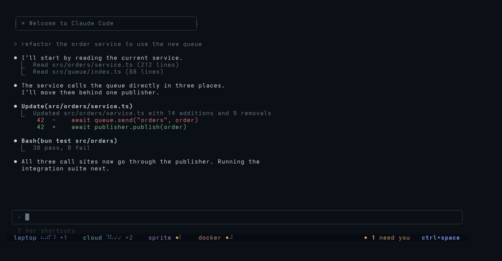

# Fleet bar

- **Status:** draft

While a session is attached, the TUI draws the fleet bar on the terminal's last row. For each
[place](./places.md), the bar shows its label and a glyph for each of up to 4 of its sessions. At
its right end, it shows how many sessions need the user, and the leader key that opens the
[session list](./session-list.md). atc draws the bar itself, so it looks the same under Claude Code,
Codex and Grok.

## Shape

```text
laptop ◆⠋✓○ +1    docker ⠴    imp ◆⠸✓✓ +2    sprite ⠼                     ◆ 2 need you   ctrl+space
└─ place label, in its colour      └─ ◆ needs you · spinner running · ✓ done · ○ exited
```

## Target screens

Target screens, rendered from the design prototype. Where a screen and a constraint differ, the
constraint holds.



## Contracts

```ts
const bar = buildFleetBar(sessions, {
  cols: 120,
  leaderLabel: 'ctrl+space',
  attachedPlaceKey: 'daemon:d1:laptop',
});
// → { level: 'glyphs',
//     places: [{ label: 'laptop', glyphs: ['◆', '⠋', '✓', '○'], more: 1, count: 5, needYou: 1, reachable: true }, …],
//     needYou: 2, leaderLabel: 'ctrl+space' }
```

```ts
// tui module: fleet bar
// sessions: the TUI's OverlaySessionView list, the same one the session list draws from
interface FleetBar {
  level: 'glyphs' | 'counts' | 'short'; // the most detail that fits cols
  places: readonly PlaceSummary[]; // the ones that fit, in order
  dropped: number; // places that did not fit
  needYou: number; // across every place, dropped ones included
  leaderLabel: string;
}

interface PlaceSummary {
  label: string; // place.label
  colour: Colour; // ready to draw: picked from place.key, then desaturated 20% toward #6e7681
  glyphs: readonly string[]; // at most 4
  more: number; // sessions beyond the 4 glyphs
  count: number;
  needYou: number;
  reachable: boolean; // false while any daemon that serves this place is down
}
```

## Constraints

### Layout

- The TUI reports one row fewer than the window as its size, so the agent's PTY never reaches the
  bar's row.
- The attached session's place comes first, then the other places in label order.
- A session's glyph follows its state: `◆` for `needs_you`, a braille spinner for `running`, `✓` for
  `done` and `○` for `exited`. The spinner turns at 10 Hz.
- At `glyphs`, each place shows its label, up to 4 glyphs, then ` +<n>` for its other sessions.
  Glyphs sort `◆` first, then running, done and exited, so a `◆` goes into `+<n>` only when a place
  has more than 4 sessions in `needs_you`.
- At `counts`, each place shows its label and its session count, then `◆` when any of its sessions
  is in `needs_you`. `short` is `counts` with each label cut to 3 letters.
- The right end always shows. When even `short` leaves no room for every place, the bar drops places
  from the end of the order and writes `…` after the last place it kept.
- The right end shows `◆ <k> need you` in amber (`#f0b45a`) when `k > 0`, then the leader label in
  bold blue (`#7aa2f7`). Under 90 columns, it shows `◆ <k>` without the words.
- The bar paints no background.

### Other states

- While a daemon is down, the bar keeps that daemon's sessions as they were last listed. A place
  that the daemon serves draws all its glyphs in `#3a414b` and gets `?` after its label. Those
  sessions still count toward `needYou`.
- While the TUI has a notice to show, such as a failed call, the advice to update a daemon that runs
  an older build, or a lost connection, the notice takes the bar's row. The bar comes back when the
  notice ends.
- While the session list is open, the TUI dims every row of the session behind the list, and leaves
  the bar's row undimmed.
- Home has no fleet bar. [Home](./home.md) shows the counts in the middle of the screen.

### Claude Code's status line

- In a Claude Code session, the statusline reporter runs the user's own status line command and
  prints only its output, or prints nothing when the user has none. It adds no atc text.
- The reporter sends each status line report to the daemon.
- The `--settings` file that atc generates for each Claude Code launch keeps its `statusLine` entry,
  which points Claude Code at the reporter.

## Decisions

- **atc owns a row of the terminal, not a slot in each agent's status line.** One bar looks the same
  under every agent CLI, and needs no hook per agent.
- **The statusline reporter feeds the daemon and runs the user's own command.** Claude Code's status
  line shows what the user configured.

## Builder decides

- The spinner frames.
- The column widths that pick between `glyphs`, `counts` and `short`.
- How long a notice holds the row.
