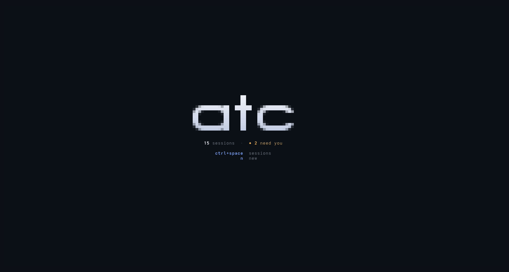

# Home

- **Status:** built

Home is what the TUI shows with no session attached: the `atc` wordmark, one line of fleet state,
and the two keys a user needs. It paints no background, so it sits on the terminal's own theme.
[Home](../../architecture/tui/home.md) describes what is built.

## Shape

```text
                        [ atc ]           the wordmark, sized to the window

              15 sessions  ·  ◆ 2 need you

                ctrl+space  sessions
                         n  new
                         R  restore       only while a fleet waits to be restored

        ⟳ update ready                    only while a notice or a daemon state shows
```

## Target screens

Target screens, rendered from the design prototype. Where a screen and a constraint differ, the
constraint holds.




## Contracts

```ts
const mark = pickWordmark({ cols: 160, rows: 45 });
// → { kind: 'outline', size: 'xs8' }
pickWordmark({ cols: 113, rows: 21 }); // → { kind: 'bitmap' }
pickWordmark({ cols: 24, rows: 8 }); // → { kind: 'text' }
```

```ts
// tui module: home
type Wordmark = { kind: 'outline'; size: 's10' | 'xs8' } | { kind: 'bitmap' } | { kind: 'text' };
```

## Constraints

### The wordmark

- `pickWordmark` picks the largest wordmark whose minimum window the window reaches in both columns
  and rows: `s10` at 164x50, `xs8` at 136x40, `bitmap` at 30x10, else `text`. The minimums keep the
  wordmark small next to the window, so it never fills more than about a fifth of the width.
- In this doc, a pixel is half a cell: the TUI draws two pixels per cell with `▀` and `▄`, and
  [Wordmark geometry](#wordmark-geometry) gives every size in pixels.
- The TUI draws the outline wordmark from signed distance fields: a rounded rectangle for each bowl
  of the a and the c, rectangles for the stems and the t's crossbar, and a rectangle cut from the
  right side of the c's bowl to open it.
- Every straight edge of the outline wordmark lies on a whole pixel, so only the curves are
  anti-aliased. Coverage comes from 6x6 supersampling per pixel.
- The bitmap wordmark has no anti-aliasing. The `text` wordmark is the word `atc` in bold, in
  `#eef1f8`.
- The outline and bitmap wordmarks' colour runs from `#eef1f8` at the top to `#c4cde4` at the base.
  The TUI blends a part-covered pixel toward the terminal's background colour, which it reads as
  [the compositor's Colour section](./compositor.md#colour) says.

### The layout

- Home is the wordmark, the fleet line and the keys, stacked. Every other cell stays at the
  terminal's default background.
- The stack sits in the middle of the window, top to bottom: the wordmark, two blank rows under an
  outline wordmark or one under the others, the fleet line, one blank row, then the keys. The
  wordmark and the fleet line are each centred left to right, and the keys are centred as one block.
- The fleet line reads `<n> sessions` (`1 session` for one, `no sessions` for none), then
  `  ·  ◆ <k> need you` when `k > 0`. `k` counts the sessions in the `needs_you` state. The two
  numbers are bold, `◆ <k>` is amber (`#f0b45a`), and the words are dim.
- The keys form two columns: each key right-aligned in bold blue (`#7aa2f7`), then two spaces, then
  its dim label. The first key is the leader key, which opens the [session list](./session-list.md),
  shown as the config's `leader` value, for example `ctrl+space`. The second is `n`, labelled `new`.
  While the last fleet has sessions to restore, a third line lists `R`, labelled `restore`, and the
  stack grows by that row.
- The notices that the status bar carried on home show on one line of their own, in amber, one blank
  row below the keys, centred: the name of a named remote daemon as `@<name>`, the TUI's notice, and
  `⟳ waiting for daemon`, `⟳ restarting daemon` or `⟳ update ready`. The line sits outside the
  stack, so a notice never moves it.
- Home redraws only when the fleet counts change or the window resizes. It never animates.

## Wordmark geometry

The wordmark shapes, in canvas pixels. A cell is 1 pixel wide and 2 pixels tall (`▀` and `▄`).

```ts
// tui module: home
interface OutlineSize {
  stroke: number; // every stroke is this many whole pixels wide
  xHeight: number;
  radius: number; // corner radius of the a and c bowls
  aWidth: number;
  cWidth: number;
  ascender: number; // how far the t rises above the x-height
  tWidth: number; // width of the t's crossbar
  tStem: number; // offset of the t's stem inside its crossbar; centres the stem
  gap: number; // height of the cut that opens the c, centred on the bowl's middle
  track: number; // space between letters
}

const OUTLINE_SIZES = {
  s10: {
    stroke: 2,
    xHeight: 10,
    radius: 4,
    aWidth: 13,
    cWidth: 13,
    ascender: 4,
    tWidth: 6,
    tStem: 2,
    gap: 2,
    track: 2,
  },
  xs8: {
    stroke: 2,
    xHeight: 8,
    radius: 3,
    aWidth: 10,
    cWidth: 10,
    ascender: 3,
    tWidth: 6,
    tStem: 2,
    gap: 2,
    track: 2,
  },
} satisfies Record<string, OutlineSize>;

// The bitmap wordmark, drawn by hand: '#' is on, '.' is off. No pixel is part-covered.
const BITMAP_WORDMARK = [
  '..........#..........',
  '..........#..........',
  '.#####..#####..#####.',
  '#....#....#...#......',
  '#....#....#...#......',
  '#....#....#...#......',
  '.#####....#....#####.',
];
```

## Decisions

- **Home is still.** It shows no animation, so it stays calm under the session list, which opens
  over it, and in a pane left open for hours.
- **The smallest drawn wordmark is a hand-drawn bitmap.** At a 1-pixel stroke, anti-aliased corners
  read as gaps, so the small size uses exact pixels, the way a font hints its smallest sizes.

## Builder decides

- How the wordmark's coverage is cached between frames: each layer keeps the coverage of the
  wordmarks it has drawn.
- The module that holds the home layer: the TUI's `home` folder.
- Whether the keys also list `r` (adopt a session) and `R` (restore the fleet): `R` is listed while
  the fleet has sessions to restore, and `r` is not listed. Both keys work on home either way.
