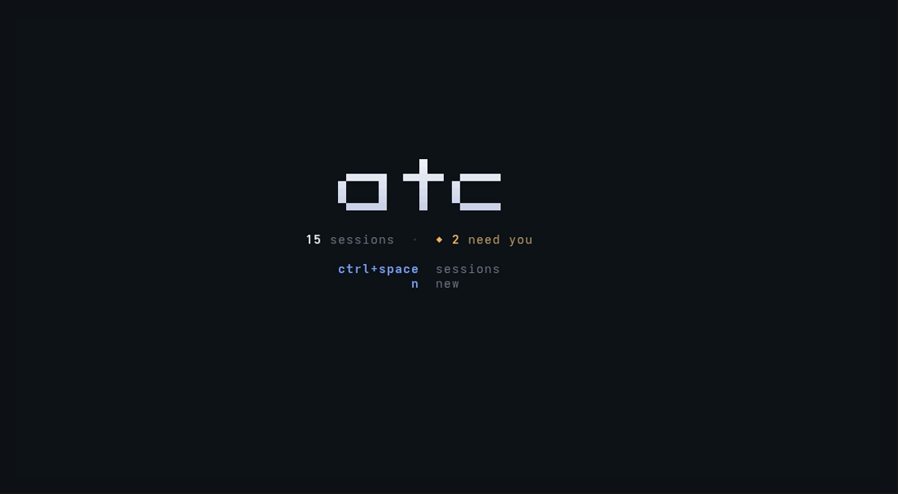

# Home

- **Status:** built

Home is what the TUI shows with no session attached: the `atc` wordmark, one line that counts the
sessions, the keys that open the session list and spawn a session, and a line of notices. Home sets
a background colour only on wordmark cells whose two pixels are both on, so it sits on the
terminal's own theme. This doc holds the shape of home, its target screens and the wordmark's pixel
geometry. [Home](../../architecture/tui/home.md) describes how the built home behaves.

## Shape

```text
                        [ atc ]           the wordmark, sized to the window

              15 sessions  ·  ◆ 2 need you

                ctrl+space  sessions
                         n  new
                         R  restore       only while a saved session has stopped

        ⟳ update ready                    only while a notice or a daemon state shows
```

## Target screens

Target screens, rendered from the design prototype. Where a screen and a constraint differ, the
constraint holds.




## Contracts

```ts
const mark = pickWordmark({ cols: 160, rows: 45 });
// → { kind: 'outline', size: 'xs8' }
pickWordmark({ cols: 113, rows: 21 }); // → { kind: 'bitmap' }
pickWordmark({ cols: 24, rows: 8 }); // → { kind: 'text' }
```

```ts
// tui module: home
type Wordmark = { kind: 'outline'; size: 's10' | 'xs8' } | { kind: 'bitmap' } | { kind: 'text' };
```

## Constraints

### The wordmark

- Each wordmark has a smallest window it fits: `s10` 164x50, `xs8` 136x40 and `bitmap` 30x10, in
  columns by rows, while `text` fits any window. `pickWordmark` picks the largest wordmark that fits
  by both columns and rows.
- The TUI draws two pixels in each cell, `▀` for the top half and `▄` for the bottom half.
  [Wordmark geometry](#wordmark-geometry) gives every size in these pixels. When both pixels of a
  cell are on, the cell's background colour draws the bottom one.
- The TUI draws the outline wordmark from signed distance fields: a rounded rectangle for each bowl
  of the a and the c, rectangles for the stems and the t's crossbar, and a rectangle cut from the
  right side of the c's bowl to open it.
- Every straight edge of the outline wordmark lies on a whole pixel, so only the curves are
  anti-aliased. Coverage comes from 6x6 supersampling per pixel.
- The bitmap wordmark has no anti-aliasing. The `text` wordmark is the word `atc` in bold, in
  `#eef1f8`.
- The outline and bitmap wordmarks' colour runs from `#eef1f8` on their top row of pixels to
  `#c4cde4` on their bottom row. The TUI blends a part-covered pixel toward the terminal's
  background colour, which it reads as [the compositor's Colour section](./compositor.md#colour)
  says. On a terminal that shows 16 colours, the TUI leaves a pixel off when its colour maps to the
  palette's black.

### The layout

- Home is the wordmark, the fleet line and the keys, stacked, with the notice line below them.
- The stack is centred in the window from top to bottom. From the top, it holds the wordmark, two
  blank rows under an outline wordmark or one under the others, the fleet line, one blank row, then
  the keys. The wordmark and the fleet line are each centred left to right, and the keys are centred
  as one block.
- The fleet line reads `<n> sessions` (`1 session` for one, `no sessions` for none), then
  `  ·  ◆ <k> need you` when `k > 0`. `<n>` counts the sessions that the
  [session list](./session-list.md) shows, and `k` counts those in the `needs_you` state. The two
  numbers are bold, `◆ <k>` is amber (`#f0b45a`), and the words are dim.
- When the fleet line is wider than the window, it drops the `◆ <k> need you` part first, then cuts
  `<n> sessions` with `…`.
- The keys form two columns: each key right-aligned in bold blue (`#7aa2f7`), then two spaces, then
  its dim label. The first key is the leader key, shown as the config's `leader` value, such as
  `ctrl+space`, labelled `sessions`. The second is `n`, labelled `new`. `R` restores the fleet, the
  sessions the local daemon saves to start again after a restart. While a session of the fleet has
  stopped, a third line lists `R`, labelled `restore`, and the stack grows by that row. A key row
  wider than the window is cut with `…`.
- The notice line is one amber line, centred one blank row below the keys. It joins, with `  ·  `:
  `@<daemon>`, when the client is on a daemon other than the default one; the client's one current
  notice, such as a failed call or the folder that atc kept after the user ended a session; and
  `⟳ waiting for daemon`, `⟳ restarting daemon` or `⟳ update ready`. The notice line sits outside
  the stack, so the stack stays where it is when a notice shows. In a window too short for the blank
  row, the notice line sits right under the keys; with no row left, it is dropped. It is cut to the
  window's width with `…`.
- Home never animates. It redraws when the sessions, the notices or the window size change.

## Wordmark geometry

The wordmark shapes, in canvas pixels. A cell is 1 pixel wide and 2 pixels tall (`▀` and `▄`).

```ts
// tui module: home
interface OutlineSize {
  stroke: number; // every stroke is this many whole pixels wide
  xHeight: number;
  radius: number; // corner radius of the a and c bowls
  aWidth: number;
  cWidth: number;
  ascender: number; // how far the t rises above the x-height
  tWidth: number; // width of the t's crossbar
  tStem: number; // offset of the t's stem inside its crossbar; centres the stem
  gap: number; // height of the cut that opens the c, centred on the bowl's middle
  track: number; // space between letters
}

const OUTLINE_SIZES = {
  s10: {
    stroke: 2,
    xHeight: 10,
    radius: 4,
    aWidth: 13,
    cWidth: 13,
    ascender: 4,
    tWidth: 6,
    tStem: 2,
    gap: 2,
    track: 2,
  },
  xs8: {
    stroke: 2,
    xHeight: 8,
    radius: 3,
    aWidth: 10,
    cWidth: 10,
    ascender: 3,
    tWidth: 6,
    tStem: 2,
    gap: 2,
    track: 2,
  },
} satisfies Record<string, OutlineSize>;

// The bitmap wordmark, drawn by hand: '#' is on, '.' is off. No pixel is part-covered.
const BITMAP_WORDMARK = [
  '..........#..........',
  '..........#..........',
  '.#####..#####..#####.',
  '#....#....#...#......',
  '#....#....#...#......',
  '#....#....#...#......',
  '.#####....#....#####.',
];
```

## Decisions

- **Home is still.** It shows no animation, so it stays calm under the session list, which opens
  over it, and in a pane left open for hours.
- **The smallest drawn wordmark is a hand-drawn bitmap.** At a 1-pixel stroke, anti-aliased corners
  read as gaps, so the small size uses exact pixels, the way a font hints its smallest sizes.

## Builder decides

- How the wordmark's coverage is cached between frames: each layer keeps the coverage of the
  wordmarks it has drawn.
- The module that holds the home layer: the TUI's `home` folder.
- Whether the keys also list `r`, which opens the spawn picker to resume an earlier conversation,
  and `R`: the build lists `R` as the layout says, and never lists `r`. Both keys work on home.
