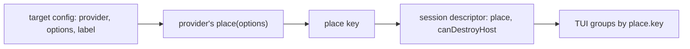

# Places

- **Status:** draft

Each session descriptor, the session record that a daemon sends its clients, carries the session's
place: where its agent runs, such as one imp service, one docker host or one machine. The
[session list](./session-list.md) and the [fleet bar](./fleet-bar.md) group sessions by place. A
target, in the config, is one daemon's route to a place, so when two daemons each have a target that
reaches the same imp service, their sessions share one place and one group.

## Shape



## Contracts

```ts
const session = await client.procedures.session.get({ session: 'sess_8f2' });
// → { …existing fields,
//     place: { key: 'imp:place-v1:4be1c09a2d7e5f10', label: 'imp' },
//     canDestroyHost: true }
```

```ts
// @atcx/contract: SESSION_DESCRIPTOR_SCHEMA gains two optional fields
const SESSION_DESCRIPTOR_SCHEMA = z.object({
  // …existing fields
  place: z.object({ key: z.string(), label: z.string() }).optional(),
  canDestroyHost: z.boolean().optional(), // see The descriptor below
});
```

```ts
// @atc/plugin-api: an execution provider's PluginDefinition gains a place rule
interface PluginDefinition<K, C> {
  // …existing fields
  place?: (options: Readonly<Record<string, unknown>>) => PlaceParts;
}

type PlaceParts =
  | {
      scope: 'shared';
      version: string; // goes into the key; a provider changes it when it changes what parts hold, so old and new keys never match
      parts: Readonly<Record<string, unknown>>; // only the option values that name the remote service
    }
  | { scope: 'daemon' }; // the place belongs to this daemon and target only
```

```jsonc
// atc config file: a target gains an optional label
{
  "targets": {
    "impz": { "provider": "imp", "url": "https://imp.example.dev", "label": "imp" },
  },
}
```

| Provider    | `place(options)`                            |
| ----------- | ------------------------------------------- |
| `imp`       | shared, version `place-v1`, parts `{ url }` |
| `docker`    | daemon                                      |
| `sprites`   | daemon                                      |
| `local-pty` | daemon                                      |

## Constraints

### The key

- atc hashes `parts` as `buildTargetIdentity` hashes a target's options: the keys sorted at every
  depth, then JSON, then sha256. The sort compares code units, so two daemons with different locales
  still sort alike. A shared place key is `<provider>:<version>:<hash>`, where `<hash>` is the first
  16 hex characters.
- Before hashing, a provider writes each URL in `parts` in one form, so `https://imp.example.dev/`,
  `https://IMP.example.dev:443` and `https://imp.example.dev./` give one key. The provider:
  - lowercases the scheme and the host;
  - drops a default port, such as 443 for `https`;
  - drops a trailing dot from the host;
  - drops trailing slashes from the path, including a `/` just before `?` or `#`;
  - keeps the query, and drops an empty fragment.

  A string that does not parse as a URL with a `scheme://` keeps its own spelling, trimmed of
  spaces.

- Daemon scope means the place belongs to one daemon and one target, and never merges with a place
  on another daemon. Its key is `daemon:<daemonID>:<target id>`, where `daemonID` is the id that
  `atc daemon id` prints. atc percent-encodes each part, so a colon in a target id becomes `%3A` and
  never splits the key into other parts. A sprites target has daemon scope though its machines run
  remotely.
- A provider with no `place` rule gets daemon scope.

### The target's label

- A target entry in the config is `provider`, an optional `label`, and the provider's options, which
  are every other key. atc takes `label` out of the entry before it passes the options to the
  provider, so `label` changes neither the target identity nor the place key.
- `place.label` is the target's `label` when the config sets one, else the target id.

### The descriptor

- The daemon fills `place` and `canDestroyHost` in every descriptor it sends: in the answers to
  `session.list`, `session.get` and `session.spawn`, and in each event that carries a descriptor.
- The gateway passes `place` and `canDestroyHost` through unchanged.
- `canDestroyHost` rides beside `place` because the [session list](./session-list.md#end) needs it
  to word its end prompt. It is true when the provider can delete machines (its
  `capabilities.destroy` is true) and this session's spawn created the machine it runs on.
  Forgetting such a session deletes that machine. It is false for a session on a machine that
  another session's spawn created.

### In the TUI

- When a descriptor has no `place`, because its daemon runs an older atc, the TUI uses key
  `daemon:<daemon name>:<target id>` and label `<target id>`, where `<daemon name>` is the daemon's
  name in the TUI's config. Those sessions group by daemon and target. When that daemon upgrades,
  its places get daemon-scope or shared keys, and their colours can change.
- When the daemons in one place give it different labels, the TUI shows the label from the daemon on
  its own machine, else from the daemon listed first in its config's `daemons`.
- When two different places have the same label, the TUI writes each as `<label> · <daemon name>`,
  with the name of the daemon whose label it shows, in group headers and in the fleet bar.
- The TUI picks a place's colour from its key, so a place has the same colour on every daemon that
  sends its key, and in every run.

## Decisions

- **Each provider names its place, as a function of its options.** Only the provider knows which
  options pick a remote service. Imp's `image` changes the machine, not the service.
- **docker targets have daemon scope.** A docker target takes only a socket path on the daemon's own
  machine, so no other daemon reaches its containers.
- **The place key is separate from the target identity.** The daemon uses a target identity to find
  a target's machines again, so it hashes every option that matters to that, including ones that
  differ between two daemons that reach one service, such as imp's `tokenFile`. A place key has to
  match across those daemons, so it hashes only what names the service.
- **sprites targets have daemon scope.** A sprites target's options name the API, not the account's
  org, so a key built from them would put every sprites account in one place.
- **Two imp accounts on one imp service are one place.** Imp's parts hold only `url`. A user who
  wants them apart gives each target its own `label`; they still share one group.

## Builder decides

- Where in the daemon `place` is computed, as long as every descriptor carries it.
- The palette that place colours come from.
