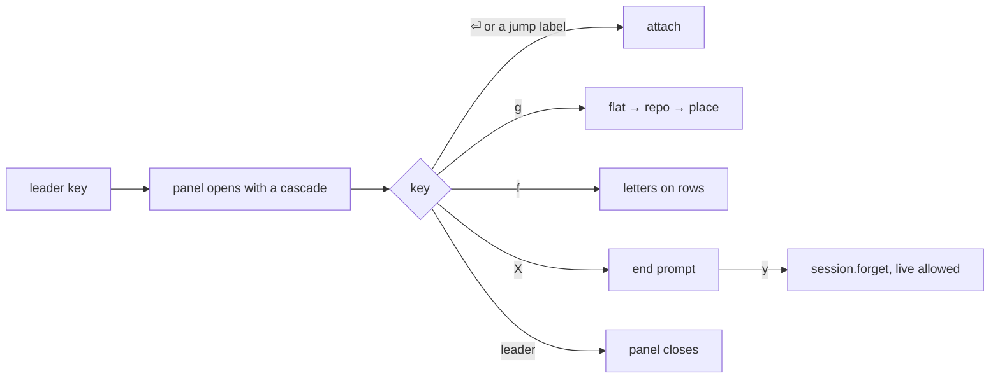
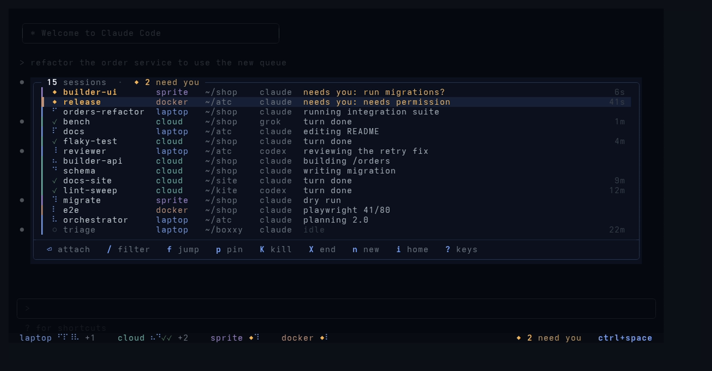
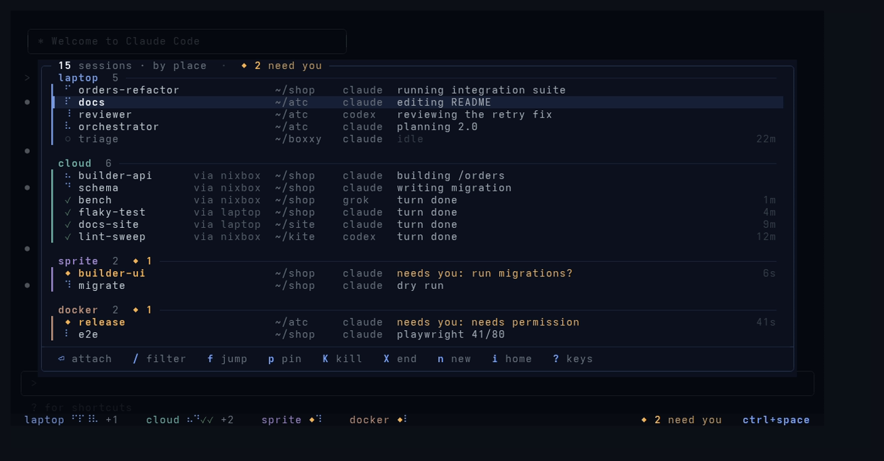
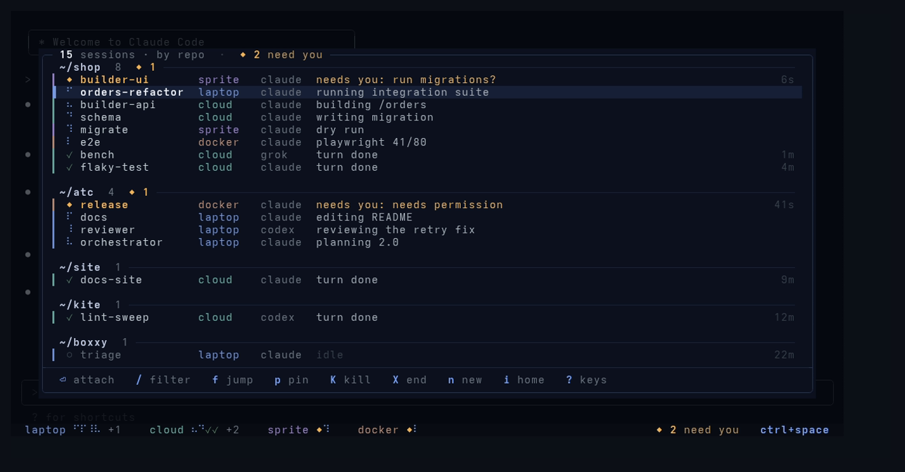
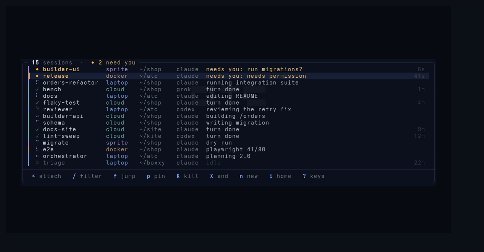
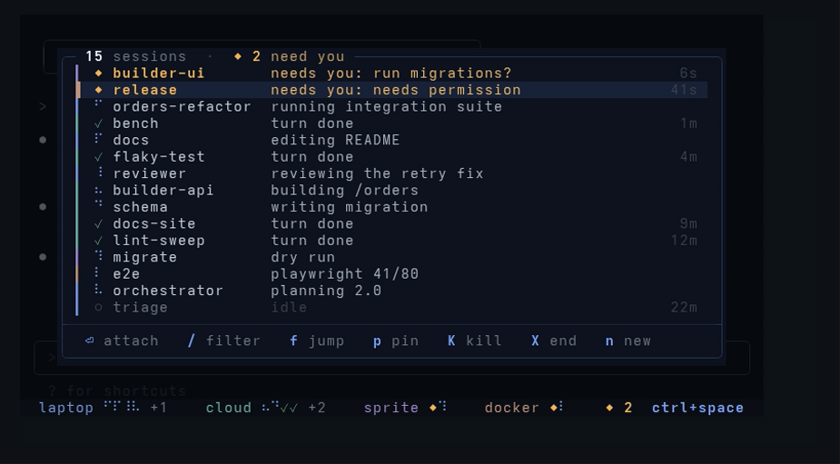

# Session list

- **Status:** built

The leader key opens the session list. The config's `leader` sets the leader key, for example
`"leader": "ctrl+space"`. The list is a see-through panel that the [compositor](./compositor.md)
draws over [home](./home.md) or over the attached session. That session stays attached and keeps
drawing, dimmed, behind the panel. In the list, `g` groups sessions by repository or by
[place](./places.md), `f` puts a letter on each row to jump to, and `X` ends a session: it stops the
agent and removes the session from the list, after a confirmation.

## Shape



## Target screens

Target screens, rendered from the design prototype. Where a screen and a constraint differ, the
constraint holds.











## Contracts

`collectListRows` in the TUI's session list module takes the names of the daemons in its options,
beside `grouping` and `filter`. Place mode needs them to find a place that holds sessions from more
than one daemon.

```ts
const rows = collectListRows(sessions, { grouping: 'place', filter: '', daemons });
// → [
//   { kind: 'header', label: 'imp', count: 6, needYou: 0 },
//   { kind: 'session', session: builderAPI, via: 'nixbox' },
//   …
// ]
```

```ts
// tui module: session list
type Grouping = 'flat' | 'repo' | 'place';

type ListRow =
  | { kind: 'header'; label: string; count: number; needYou: number } // never selectable
  | { kind: 'session'; session: OverlaySessionView; via: string | null }; // via: the daemon's name, set only in place mode when the row's group holds sessions from more than one daemon

interface OverlaySessionView {
  // …existing fields
  place: { key: string; label: string }; // from the descriptor, or the fallback in places.md
  canDestroyHost: boolean | null; // null: the daemon runs an older atc that does not send it
  stateSince: number | null; // when the TUI saw the session enter its current state; null when the session was in that state at the TUI's first listing
}
```

```jsonc
// atc config file, top level
{
  "list": { "grouping": "flat" }, // flat | repo | place: where g starts when the TUI starts
}
```

```text
╭─ 15 sessions  ·  ◆ 2 need you ────────────────────────────────────────────────────╮
│ ▎◆ builder-ui      laptop  ~/shop  claude  needs you: run migrations?          6s │
│ ▎⠋ orders-refactor imp     ~/shop  claude  running integration suite              │
├────────────────────────────────────────────────────────────────────── ↓ 4 more ──┤
│ ⏎ attach  / filter  f jump  p pin  K kill  X end  n new  i home  ? keys           │
╰────────────────────────────────────────────────────────────────────────────────────╯
```

## Constraints

### Attachment

- Opening the list leaves the session behind it attached. The TUI keeps feeding the session's output
  to its emulator, and keeps the session's PTY at the same size.
- While the list is open, keys go to the list. The user's terminal then runs with the TUI's own
  input modes: no mouse reporting, no bracketed paste, no kitty keyboard flags. When the list
  closes, the [compositor](./compositor.md#input) puts the session's modes back.
- Attaching another session from the list detaches the session that was behind the list.

### Panel

- The panel is `min(112, cols - 8)` columns wide and centred. Its height fits its rows, up to
  `rows - 6`.
- In a window too short for the whole panel, the last line, or every line of a prompt, shows first.
  The list rows go next, then the divider, the bottom border and the top border. A prompt longer
  than the window keeps its end, which holds `y / n`.
- The compositor dims every cell that the panel covers or that lies outside the panel, toward the
  terminal's background colour: by 62% over a session and by 50% over home. The
  [fleet bar](./fleet-bar.md) row stays undimmed. The compositor gets the background colour as
  [Colour](./compositor.md#colour) says.
- The panel's background is `#0f1424`, blended 86% over the cell it covers.
- The border is rounded, in `#2a3350`, with `│` at both ends of every row. The top border holds the
  title: the session count in bold, then ` · by repo` or ` · by place` when grouped, then
  `◆ <k> need you` in amber (`#f0b45a`) when `k > 0`. A title too long for the border ends in `…`.
- Each session row starts with a bar in its place's colour, the colour that
  [Places](./places.md#in-the-tui) picks from `place.key`. The selected row has a thicker bar (`▌`
  in place of `▎`), a background tinted 11% toward blue (`#7aa2f7`), and a bold name.
- A session in the `needs_you` state shows `◆` and an amber name, and its message reads
  `needs you: <message>`.
- An unread session that is not in `needs_you` has a bold name.
- A sub-session's name starts with `↳ `.

### Columns

- The columns are state glyph, name, daemon, place, repository, agent, message and age.
- The daemon column shows only when the TUI is connected to more than one daemon, and never in place
  mode.
- Place mode drops the place column. When a group holds sessions from more than one daemon, each of
  its rows shows `via <daemon>` in the place column's slot. Repo mode drops the repository column.
- The message is the last status the agent reported for the session, as the list shows it in every
  mode. A session whose machine is asleep shows `asleep`, and one whose agent is suspended shows
  `suspended`.
- The age column is blank for a session in `running` and when `stateSince` is null. For a session in
  `needs_you`, `done` or `exited`, it shows the time since `stateSince`.
- `stateSince` lives in the TUI's copy of the fleet, so it outlasts a reconnect to the daemon. It
  starts at null when the TUI starts.
- When the panel is narrower than 90 columns, it shows only state glyph, name, message and age.
- When the name, cut to 8 columns, and the age still do not fit, the age goes and the name shrinks
  to the room left. No two columns share a cell.
- The age keeps counting while the list is open: the list draws again when the first shown age next
  changes.

### The panel's last line

- When the rows do not fit, the panel keeps the selected row in view and writes `↓ <n> more` or
  `↑ <n> more` into the divider above the last line. A narrow divider shows `↑ <n>  ↓ <n>`, and one
  too narrow for that shows neither.
- The last line shows the key bar: each key bold in blue, then its label dim. The key bar drops keys
  from the right until it fits.
- These take the last line in place of the key bar while they show. When two want it, the one higher
  in this list wins:
  1. a prompt, which wraps over as many lines as it needs and never cuts the keys that confirm it;
  2. the filter;
  3. a notice;
  4. a line for a daemon that is down;
  5. the advice to update a daemon that runs an older build (`u update daemon`).

### Grouping

- `g` cycles flat, repo, place, then flat. The TUI starts at `list.grouping`, default `flat`, and
  keeps the user's choice until it exits.
- In both grouped modes, pinned sessions form a group above every other group, under the header
  `pinned`.
- A sub-session sits in its parent's group, under its parent.
- Inside a group, sessions sort as `sortSessionViews` sorts them: by state, in the order
  `needs_you`, `done`, `running`, `exited`, then the most recently attached first. A group sorts by
  its first session, then by label.
- A group header shows its label in bold, its count, `◆ <k>` in amber when `k > 0`, and a thin rule
  to the panel's edge. A label too long for the row ends in `…`, so the count and `◆ <k>` still
  show. One blank row separates two groups.
- A repo group holds one daemon's sessions in one repo root. Its label is the repo's folder name.
  While two repo labels match, each adds the daemon name, then the folders above the root, nearest
  first, as `shop · local · first`, until they differ.
- Every group label differs from the others. When a label with names added matches another group's
  own label, both add their next name.
- A place group holds every session with one `place.key`, from every daemon.

### Keys

- `⏎` attaches, `/` filters, `f` starts jump mode, `p` pins, `K` kills, `X` ends, `n` starts a new
  session, `g` cycles grouping, `i` goes home, and `?` shows help.
- [Using atc](../../guides/using-atc.md) describes the other keys: `↑ ↓ j k` and Tab move, `H`
  ejects, `P` resumes, `r` adopts, `y` and `Y` copy a resume command, `u` updates a stale daemon,
  and `q` quits.
- `a` is unbound. The list has no key that marks a session read; attaching a session marks it read.
- `i` closes the panel and shows home. The session that was behind the panel is detached and keeps
  running. Over home, `i` only closes the panel.
- `K` on a live session asks `kill <name>? · y / n`, then stops the session and keeps it in the list
  to restore. On a dead session, `K` does nothing, and the key bar shows `X end` in place of
  `K kill`.
- `X` is the only key that deletes a machine.
- `esc` leaves jump mode, the filter or a prompt and leaves the panel open. With none of them
  active, `esc` closes the panel. The leader key closes the panel from any of them.

### Jump mode

- `f` gives every visible session row a label of one letter, taken in order from
  `asdfghjklqwertyuiopzxcvbnm`.
- A label is never a letter that would extend the search. Before anything is typed, that is any
  letter in a visible name. After that, it is any letter that follows a match in a remaining name.
- Typing a letter that is not a label narrows the rows to the names that contain everything typed so
  far, as one substring, ignoring case. The matched letters turn amber, and the remaining rows get
  new labels.
- Example: with the rows `api`, `app` and `web`, `f` labels them `s`, `d` and `f`, because `a`
  appears in a name. Typing `p` narrows the rows to `api` and `app`. The letters after their matches
  are `i` and `p`, so the labels become `a` and `s`, and typing `s` attaches `app`.
- When there are more rows than free letters, every label is two letters: a free letter, then any
  letter.
- When the free letters give too few two-letter labels, the first letters go on with the letters
  that would extend the search, in the same order. Typing one of those letters then starts a label,
  so it no longer extends the search.
- A search that matches no row shows `no match` on the last line. Backspace removes the last typed
  letter.
- Typing a label acts as `⏎` on that row: a live session attaches. On a dead session, jump mode ends
  and the selection moves to its row.

### End

`X` sends `session.forget`, the call that removes a session from the fleet.
[Fleet and restore](../../architecture/daemon/fleet-and-restore.md) holds the daemon's rules for it,
including when it keeps a session's workspace folder.

- On a pinned session, `X` shows the notice `unpin <name> first` and sends nothing.
- Otherwise `X` asks once, before any call. When `canDestroyHost` is true, it asks
  `end <name>? stops the agent and deletes its <place label> machine, with every session on it · y / n`.
  Else it asks `end <name>? stops the agent and removes it from the list · y / n`.
- When the session has sub-sessions that are dead and unpinned, the prompt adds
  `, and removes its <n> ended sub-sessions` before ` · y / n`. The daemon removes those with their
  parent, and keeps every other sub-session as a top-level session. The count may include a
  sub-session the daemon keeps, because the TUI cannot see each sub-session's provider, and never
  leaves out one it removes.
- On `y`, the TUI sends `session.forget` with `refusePinned: true` and without `refuseLive`, for a
  live and a dead session alike.
- The daemon answers with a `confirmToken` when the forget would delete a machine. When the TUI's
  prompt named the machine, the TUI sends the token back at once.
- When the daemon answers with a `confirmToken` and the TUI's prompt did not name a machine, the TUI
  asks again with the delete wording, and sends the token only on `y`.
- When the daemon refuses with `host_asleep`, the TUI shows
  `<name>'s machine is asleep: attach to wake it, then end it`.
- When the forget keeps the session's workspace folder, the TUI shows the notice
  `kept <folder>: <reasons>`, with the reasons the daemon gives.
- Ending the attached session closes the list and shows home, with the kept-folder notice on the
  status bar. The next open of the list drops that notice.
- When `K` kills the attached session, the list stays open, over home.

### Motion

- Opening fades in the dim and draws the panel's frame over 180 ms. Row `i`, counted from 0, starts
  at `80 + 18·i` ms and fades in over 180 ms. With 15 rows, the open ends at 512 ms.
- Closing fades the panel out over 120 ms.
- A close during the open fade starts from what the open had reached, and so does a reopen during
  the close fade.
- The panel takes keys from the first frame of the open. A key during the cascade acts at once, and
  the cascade finishes behind it.
- When the config's `animations` is false, the panel opens and closes in one frame.

## Decisions

- **Flat is the default grouping.** Grouping is a view the user picks, and `list.grouping` sets
  where it starts.
- **The session stays attached under the list.** The session is still on screen, live and dimmed.
  The TUI detaches a session only when the session leaves the screen.
- **`X` asks before any call.** The daemon's confirm token guards MCP clients, which have no prompt
  of their own. The TUI asks a second time only when the daemon would delete a machine that the
  first prompt did not name.
- **Marking a session read without attaching it is for MCP clients only,** through the
  `atc_session_mark_read` tool, which calls `session.ack`.

## Builder decides

- The jump labels' colours, and where a label sits beside the name.
- The help screen's wording.
- Test layout, including how the cascade is tested with a fake clock.
